#+TITLE:
# Place author here
#+AUTHOR:
# Place email here
#+EMAIL: 
# Call borgauf/insert-dateutc.1 here
#+DATE: 
# #+Filetags: :SAGA +TAGS: experiment_nata(e) idea_nata(i)
# #chem_nata(c) logs_nata(l) y_stem(y)
#+LANGUAGE:  en
# #+INFOJS_OPT: view:showall ltoc:t mouse:underline
#+HTML_HEAD: <link rel="stylesheet" href="./wuth.css" type="text/css">
#+HTML_HEAD: <link rel="stylesheet" href="./ox-tufte.css" type="text/css">
#+HTML_HEAD_EXTRA: 
#+INCLUDE: "./header.org" :minlevel 1
#+EXPORT_SELECT_TAGS: export
#+EXPORT_EXCLUDE_TAGS: noexport
#+EXPORT_FILE_NAME: preface.html
#+OPTIONS: H:15 num:15 toc:nil \n:nil @:t ::t |:t _:{} *:t ^:{} prop:nil
# #+OPTIONS: prop:t # This makes MathJax not work +OPTIONS:
# #tex:imagemagick # this makes MathJax work
#+OPTIONS: tex:t num:nil
# This also replaces MathJax with images, i.e., don’t use.  #+OPTIONS:
# tex:dvipng
#+LATEX_CLASS: article
#+LATEX_CLASS_OPTIONS: [american]
# Setup tikz package for both LaTeX and HTML export:
#+LATEX_HEADER: \usepackqqqage{tikz}
#+LATEX_HEADER: \usepackage{commath}
#+LaTeX_HEADER: \usepackage{pgfplots}
#+LaTeX_HEADER: \usepackage{sansmath}
#+LaTeX_HEADER: \usepackage{mathtools}
# #+HTML_MATHJAX: align: left indent: 5em tagside: left font:
# #Neo-Euler
#+PROPERTY: header-args:latex+ :packages '(("" "tikz"))
#+PROPERTY: header-args:latex+ :exports results :fit yes
#+STARTUP: showall
#+STARTUP: align
#+STARTUP: indent
# This makes MathJax/LaTeX appear in buffer (UTF-8)
#+STARTUP: entitiespretty
# #+STARTUP: logdrawer # This makes pictures appear in buffer
#+STARTUP: inlineimages
#+STARTUP: fnadjust
#+OPTIONS: html-postamble:nil
#+OPTIONS: html-style:nil
# #+BIBLIOGRAPHY: ref plain

@@html:<label for="mn-demo" class="margin-toggle"></label>
<input type="checkbox" id="mn-demo" class="margin-toggle">
@@

\\
\\
@@html:@@
\\
\\
* About the Dark Muse; Inaugural Essay

#+begin_export html

The Great Inland Sea: most conductive of the Dark Muse
#+end_export

** To begin

In this essay I will attempt to convey my thoughts, impressions, my
/feelings/ about the **dark and gothic** (D&G), about my /dark
muse/.[fn:1] To say "dark" and put it together with "gothic," and then
to keep it from falling into clichés and stereotypes will take much
explanation. Let's start by taking a quiz---

Do you find it difficult to describe your fascination with things on
the gloomy side? You often find /dreamy/ what others find /dreary/
... as when an overcast day brings on a strangely sanguine melancholy
... or a stormy night is magnificent in a frightening and thrilling
sort of way? Twilight is a welcome reprieve from the hectic, incessant
day, freeing your senses, calming, deepening your thoughts. You've
paused to gaze transfixed upon a lonely, nondescript landscape, a
wild, deserted shore, an old, abandoned cemetery. As when a decaying,
overgrown, other-century structure makes you envious of the bats
living there. Unnatural is having to get out of heat into air
conditioning and suffer through smalltalk while drinking iced
beverages; truer would be to come inside out of the cold and sit by a
fire in a deep, shared silence drinking hot tea. Time and again what
they find "uplifting" is piteously trite out to ruefully
disappointing. You often feel outright embarrassment for someone
insistently flogging sunny-cheery. It is then a relief to be alone,
and not at all lonely.

They seem to bounce from spectacular to spectacular; while things
subtle, veiled, shadowy tenuous, understated are your druthers. Their
heroes grasp desperately and must have happy endings. Yours learn and
grow by facing the grim and harsh---and if that means succumbing to
the beating ... amen, requiescat in pace, RIP, c'est la vie, time for
mourning black.[fn:2]

And so candlelight over artificial light, linen over nylon, old
architecture over new, the genial disorder of wild nature over the
selective containment of gardens. If in a city, you can't stand
anywhere but the oldest quarter, oldest park, oldest cemetery. And
yes, it might seem a bit to ask, but wouldn't it be grand if every
month we celebrated Halloween?...  If yes to any or (hopefully) all of
this, please read on.

#+begin_export html

Transfixed by an abandoned graveyard: octonimoes@DeviantArt
#+end_export

** Natural Dark, Brontëan style

Since ever, natural dark commences once the sun has set, continuing
until the sun rises again. This period of darkness is **night**, until
relatively recently interrupted only by something burning---the nimbus
of light cast by candles, torches, fires. Light originates from a
shining /source/. Dark is opposite of source, hence, a
/[[https://en.wikipedia.org/wiki/Sources_and_sinks][sink]]/. Therefore, dark, wherever there are no light photons, behaves
like a heavy but yielding substance rather than an active
producer. Light may shine, glow, radiate, reflect; however, dark
absorbs, settles, enfolds. Light may die out once the source no longer
produces photons; however, dark would seem to be waiting, eternally
passive, starting with dim, finally black.

As humans we have attached consequence, meaning, and finally,
aesthetics to darkness, as well as to /shadows/, the interplay of
light and dark. Poetic description frames darkness not merely as the
passive absence of light, but as a tangible presence--—a /velvet
curtain/, a /liquid shadow/, or a /quiet sanctuary/ softening the
edges of the world. I would posit that light and dark are a gradient,
a differential whose interplay can be made poetic. That is to say,
there is a real aesthetic to dark. To be sure, dark lends to, brings
on mood, atmosphere, /feeling/ awaiting poetic application

+ **The Sanctuary**
  + Visuals: A heavy indigo blanket; a cloak of charcoal silk; a
    bruised plum twilight; ink pooling in the corners of a room.
  + Texture & Weight: Velvet that presses gently against the eyes;
    dark, opaque water rising; a muffled hush that dulls then swallows
    sharp outlines.
  + Example: /The dark arrived not as an emptiness, but as a warm
    wool shawl drawn slowly over the shoulders of the house./
+ **The Atmospheric**
  + Visuals: A sea of unlit glass; silver-edged gloom; the hollow
    beneath a stairwell; thickening smoke obscuring the light of a
    fire.
  + Atmosphere: An ancient, patient stillness; a world pared down to
    memory and silhouette.
  + Example: /Night pooled like spilled ink across the floorboards,
    erasing the room's edges until only the faint nimbus of the candle
    kept its shape./
+ **The Cosmic**
  + Visuals: An unfathomable well; obsidian depths; a starless abyss;
    a cathedral of shadow.
  + Scale: Boundless, heavy, and indifferent; a silence so deep it
    seems to hum.
  + Example: /Beyond the threshold lay a vast, unyielding dark—a
    silent ocean without a shore./ Or Emily Brontë's /A sudden chasm
    of ghastly light/ ... light so starkly contrasting dark as to make
    it ghastly.
+ **Rare, evocative words for darkness**
  + /penumbra/: The half-shadow on the edge of total darkness.
  + /crepuscular/: Relating to twilight or dim, fading light.
  + /tenebrous/: Dark, shadowy, or obscure (often carrying a gothic or
    solemn weight).
  + /stygian/: Pitch-black, gloomy, and impenetrable.
  + /umbra/: The deepest, sharpest core of a shadow.

Consider outskirts, edges, boundaries, frontiers, perimeters that go
from dim out to dark.[fn:3] Consider the line, /it was a dark and
lonely place/. Dark and being alone, or at least away from hustle and
bustle, comes up often in writings. Let us consider a quote from
Charlotte Brontë's /[[https://en.wikipedia.org/wiki/Jane_Eyre][Jane Eyre: An Autobiography]]/, a fictional story
taking place during the later reign of George III. Main protagonist
Jane describes the house of her adoptive family, the Rivers, called
simply /Moor House/, and its environs on the /edge/ of the wild
Yorkshire moors[fn:4]

#+begin_quote
They loved their sequestered home. I, too, in the grey, small, antique
structure, with its low roof, its latticed casements, its mouldering
walls, its avenue of aged firs---all grown aslant under the stress of
mountain winds; its garden, dark with yew and holly---and where no
flowers but of the hardiest species would bloom---found a charm both
potent and permanent. They clung to the purple moors behind and around
their dwelling---to the hollow vale into which the pebbly bridle-path
leading from their gate descended, and which wound between fern-banks
first, and then amongst a few of the wildest little pasture-fields
that ever bordered a wilderness of heath, or gave sustenance to a
flock of grey moorland sheep, with their little mossy-faced
lambs---they clung to this scene, I say, with a perfect enthusiasm of
attachment. I could comprehend the feeling, and share both its
strength and truth. I saw the fascination of the locality. I felt the
consecration of its loneliness: my eye feasted on the outline of swell
and sweep---on the wild colouring communicated to ridge and dell by
moss, by heath-bell, by flower-sprinkled turf, by brilliant bracken,
and mellow granite crag. These details were just to me what they were
to them---so many pure and sweet sources of pleasure. The strong blast
and the soft breeze; the rough and the halcyon day; the hours of
sunrise and sunset; the moonlight and the clouded night, developed for
me, in these regions, the same attraction as for them---wound round my
faculties the same spell that entranced theirs.
#+end_quote

... /the consecration of its loneliness/ indeed.[fn:5] I often read
this long paragraph(!) just to have once again the wistful, moody,
delicately melancholic, intentionally anti-spectacular /subtleties/
she describes. Amazing to me is how this and other choice dark and
moody situations set the whole tone and mood of the book. She mentions
the dimness of sunrise and sunset, the moonlit and clouded night, a
feature of what we'll later identify as the /Night School/, a
significant break from gothic literature. She establishes light and
dark as equals, then works expertly with the gradient
there-between. The dim, the shadows, the dark, the harsh, even at
times merciless inclemencies are features not flaws. She does not
suppress this **natural dark**, perhaps knowing that if it were seen
an equal to light it would eventually prove itself the older, wiser
sibling, capable of rich, complimentary contributions. In short,
through the exploration of the subtle, Brontë takes us to the sublime,
all by just the mention of /natural dark/.

Along with the light-and-dark gradient, Moor House environs are
relatively abandoned and lonely, hence, they are a unique sort of
wild, and this uniqueness is exactly because they are so unpresuming
and overlooked, so bereft of anything nature-spectacular. This is the
foundation of **natural gothic**, or the gothic found in nature. Below
we'll explore what gothic means and why it relies on dark and
shadowy.

Very important is how the nature surrounding Moor House is the
opposite of some breathtaking primordial wilderness, typically bathed
in light, great distances away, visited only by the most intrepid
explorers.[fn:6] Indeed, subtle and unassuming balancing light,
shadow, and darkness become the older, wiser siblings of well-lit
grand and spectacular. Notable too how Jane arrived at Moor
House---namely, on her hands and knees half-dead from hunger and
exposure, thus, adding complete and ultimately /necessary/
vulnerability to this sublime mix.[fn:7] It is exactly this
vulnerability that qualifies her all the more as an authentic part of
the scene. And once recovered, she is still every bit the
underdog---relative to us today in our modern nature-dominating
high-tech, hyper-materialist, modern-medicine world where we are
becoming as sort of disconnected astronauts on our own planet.

*** ...versus nature staged...

The second half of my childhood was spent in Tennessee,[fn:8] and my
favourite place came to be the /[[https://en.wikipedia.org/wiki/Great_Smoky_Mountains_National_Park][Great Smoky Mountains National Park]]/
high on the geologically ancient Appalachian Mountains border of
Tennessee and North Carolina. The /Smokies/ are a federally protected,
quasi-pristine wilderness of 522,419 acres, surrounded by
lesser-protected though still technically wilderness USDA National
Forest lands, adding another million or so acres. Statistics say the
GSMNP is the most-visited national park in all of North America at
nearly fourteen million tourists per year,[fn:9] with additional
tourist attractions and accommodations all around the park
boundaries. And what are these visitors doing? Nothing like
late-Georgian Jane on her moor. Only a tiny fraction of these visitors
are actually out on the park's extensive wilderness trails hiking and
camping. Most are only driving up and down the main dissecting highway
connecting Tennessee to North Carolina in modern spaceship-like
automobiles, perhaps getting out to mill about visitor centers.

Many years ago I visited the GSMNP on a Fourth of July, stopping in
the main tourist town bordering the park, Gatlinburg, Tennessee, where
the sidewalks were practically standing-room-only. But later that same
day I hiked for hours deep in the park on the main Appalachian Trail
and saw not another human... Strange as this may sound, I say Jane's
Yorkshire moorlands are real nature, while the Smokies have become
something else. How then? Simply because of the sheer modern
abstraction, the artificiality of purpose, all the attention, being so
recognised and well-known throughout the world.

To be sure, the Smokies are fussed and ruled over by legions of
scientists and bureaucrats at the behest of the U.S. Department of
Interior's National Park Service, UNESCO's World Heritage Convention,
the International Biosphere Programme, etc., like some great research
terrarium under an invisible glass dome. Even in the remotest,
genuinely wild spots many miles from any human disturbance, the weight
of humanity's lurking dominance, our collective mental presence is
inescapably massive ... not to mention what a visitor's purpose for
being there might be. And so we have the dichotomy of discovered
versus undiscovered, exotic versus vernacular, integrated versus
detached, grounded versus abstract, thousands versus no matches to
googling. As the Rivers' guest, Jane Eyre described a natural and
organic connection to her moorland. And yet no modern tourist can ever
expect to become truly integrated with the GSMNP /complex/ as Jane was
with her moorlands.[fn:10] Based on this preliminary comparison we'll
go on to describe what nature really is later...

** The gothic part of dark and gothic

Today the term /gothic/ has come to mean a style or aesthetic
characterized by mystery, shadows, darkness, gloom, heaviness---the
real, as well as the supernatural, dangerous and threatening. **Doom**
will out in a typical gothic novel or film where the supposed mistakes
and sins of the past come crashing down upon the present. And yet the
meaning of gothic has followed an ironic and twisted path...

+ **In history and etymology**: Originally, /Gothic/ meant anything
  referencing the Goths, an East Germanic tribe that interacted with
  and finally invaded the Roman Empire. During the Italian
  Renaissance, Gothic came to be used as a pejorative label for the
  medieval architecture to the north, equating it with barbaric or at
  least primitive or anti-classical to Greco-Roman art and
  architecture...
  
+ **In art and architecture (12th–16th centuries)**: ...again,
  specific to architecture, Gothic described the northern medieval
  European building style, mainly cathedrals, which featured pointed
  arches, ribbed vaults, flying buttresses, thin, tall walls, large
  stained-glass windows, and especially the extraordinary moulding and
  detail...
  
+ **In literature and film (18th century–present)**: ...as a genre of
  fiction starting with Horace Walpole's /The Castle of Otranto; A
  Gothic Story/ in 1764. Walpole was the first to use /gothic/ as an
  adjective meaning to merge the ancient and the modern, to combine
  the wild, improbable supernatural marvels of medieval tales with the
  psychological and emotional realism of modern characters. This took
  off as a genre, and subsequent gothic novels typically featured
  remote, decaying settings such as ruined castles or gloomy manors,
  frightening supernatural or mysterious occurrences, anguished, beset
  psychological states, and themes of past transgressions bursting
  forth upon the present. Well-known examples include Mary Shelley’s
  /Frankenstein/ and Bram Stoker’s /Dracula/.
+ **In music and subculture (20th century–present)**: ...finally,
  gothic was applied to the post-punk /goth/ fashion and music
  subculture of the 1970s on to the present. Today's goths are
  black-clad, made up black-and-white, stereotypically projecting
  obscure anguish and sorrow.

But our main concern will be how /gothic/ went from a Germanic tribe
to a style of architecture to an adjective meaning gloom, doom, and
dread, describing remote, decaying settings, evoking of melancholic
aesthetics. Ironic at it may seem, yes, Gothic architecture was all
along expressive and suggestive of all these later dark and
melancholic qualities /if we understand what dark and melancholic are
and from where they truly originate/.

Let us begin by reanalysing what Gothic architecture actually brought
to the fore---beyond the elevator pitch "pointed arches, ribbed
vaults, flying buttresses, thin walls, and large stained-glass
windows." Below are examples of two Romantic Era artists' depictions
of Gothic architecture, one by [[https://en.wikipedia.org/wiki/Ernst_Ferdinand_Oehme][Ernst Ferdinand Oehme]]

#+begin_export html

Oehme's Cathedral in Winter
#+end_export

then a famous [[https://en.wikipedia.org/wiki/Caspar_David_Friedrich][Caspar David Friedrich]] work

#+begin_export html

Friedrich's returned-to-nature Eldena Cloister Ruins
#+end_export

Oehme and Friedrich are assigned to the Romantic Era mainly due to
dates. And true to /[[https://en.wikipedia.org/wiki/Dark_Romanticism][Dark Romanticism]]/[fn:11] they made their
depictions of Gothic buildings convey gloomy, lonely, forlorn. We see
a veiled, subtle, "dog whistle" link between the bygone architecture
style Gothic with the modern connotations and qualities of gothic as
established by gothic prose of the eighteenth and early-nineteenth
centuries. Let's see another Romanticist painting of a landscape from
circa 1835

#+begin_export html

Blechen's dim, melancholic Forest way near Spandau
#+end_export

Now compare all this to the actual medieval Gothic architecture of the
Cologne Cathedral

#+begin_export html

The surprising detail of the Cologne Cathedral
#+end_export

Then again compare this to the natural depth, complexity, and textures
of a cedar and cottonwood in wild nature. This is subtle out to
sublime, but always containing in a fractal fashion constant conflict
between growth and decay.[fn:12]

#+begin_export html

The natural and subtle detail of a northern white cedar
#+end_export

#+ATTR_HTML: :class fullwidth

# #+begin_figure
# #+CAPTION: Your full-width figure caption here.
# 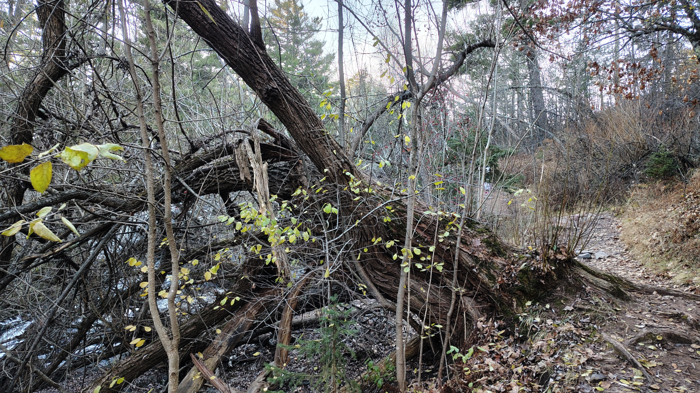
# #+end_figure

#+begin_export html

Natural D&G on a Chester Creek trail in Duluth, MN
#+end_export

Here is the key: /Gothic architecture attempted to mirror nature's
density and complexity./ It rejected the flat, simplified, or strictly
linear constraints of classical, choosing to fill space with
overwhelming detail that mimics the myriad depth and complexity of the
natural world. Some attribute this to the religious belief that the
natural world is a direct reflection of God’s divine order. Consider
the characteristic ribbed vaulting and clustered columns and how they
directly mimic the structural density of forests, with stone columns
rising like tree trunks and branching out into complex overhead
canopies.[fn:13] Then all the intricate tracery: The stone frameworks
supporting stained glass windows (e.g., rose windows) rely on dense,
interlocking geometric patterns that mirror biological forms, such as
petals, leaves, and shells. Indeed, the almost microcosmic density,
i.e., Gothic cathedrals were built as "microcosms," nature in
miniature. Again, the sheer density of statues, gargoyles, and flora
carved into every surface was meant to represent the overwhelming
abundance of God's creation.

Very well, but, still, how do we get from a medieval architectural
vernacular Gothic to the dark and gloomy meaning of gothic? Obviously,
Walpole made the first tenuous connection. And we might suggest such
doom and dread was a knee-jerk reaction, a radical chemotherapy
against the cancer of the hyper-rational scientific
Enlightenment.[fn:14] But allow me to invoke my understanding of
nature as /the myriad cycles of birth, growth, decay, and death
happening everywhere always/. This is /nature ubiquitous/, and I say
it is instinctual. However, in the modern world the second half, decay
and death, has been artificially suppressed. This is just a first
glimpse of my definition of nature, and we'll go into more depth
below.

Consider a modern American city of one million inhabitants, e.g.,
Austin, Texas, where the urban landscape is illuminated by an
estimated two to five /gigalumens/ of artificial light! Then consider
all the city's modernist architecture with its hyper-sterile straight
lines, right angles, and perfect arcs, again, all of it illuminated by
this intense, alien light. Making a polemic leap here, does this not
to some degree reflect our modern pathological fear and denial of
night, darkness, decay and death? As we consider later, the sheer
physical assault of all this light, the spatial dominance of
growth-only industrialism could very well explain modern
interpretations of D&G as fright, horror, and even evil.

The connection I'm trying to make between the pictures above is how
Gothic seemed to naturally tip to the dark and gloomy of night, along
with the decay and death of nature ubiquitous. Gothic, simply by
imitating nature, brought in /all/ of nature, which includes the
mysterious darkness, decay, and death. Believe me when I say there is
a special mental and emotional state that arises when all four aspects
of nature---birth, growth, decay, and death---are in play outdoors in
the forest, the moor, on the shore, all of it /rioting/ all around you
mile after mile.[fn:15] But in today's world, the decay and death
part, as well as darkness, have been so suppressed that their
reintroduction, reconsideration tends to rush in and clash with the
lighter birth and growth half. We today are way out of balance,
whereas in the past this balance, was captured best by Emily
Brontë.

** D&G as expressed through poetry

When we say something is /poetic/ we mean it has a moving, lyrical,
aesthetical, or imaginative quality--—whether in words, scenes, or
real-life moments—that stirs emotion or deeper meaning. But first,
let's talk a bit about poetry from a "technical" standpoint. We may
break down poetry into two main types---/[[https://en.wikipedia.org/wiki/Lyric_poetry][lyrical]]/ versus /epic/ or
/narrative/.[fn:16] In our discussion of D&G and the dark muse we will
mainly be concerned with lyrical poetry, which expresses personal
emotions, feelings, or thoughts, typically implied as in the
first-person and characterized by a musical, song-like quality. Being
personal, lyrical poetry focuses on internal states such as love,
grief, awe, or reflection rather than telling a story with a
plot. Being "lyrical" also implies a certain "musicality" is
present---rhythm, meter, rhyme, and sound devices, e.g., alliteration
or assonance. The term originates from the ancient Greek /lyre/, a
stringed instrument used to accompany sung verses.

Common forms of lyric poetry are the /[[https://en.wikipedia.org/wiki/Sonnet][sonnet]]/, a fourteen-line poem
with a strict rhyme scheme and meter; the /[[https://en.wikipedia.org/wiki/Ode][ode]]/, typically a
meditative poem praising or addressing a specific person, object, or
abstract idea; the /[[https://en.wikipedia.org/wiki/Elegy][elegy]]/, a reflective poem mourning someone who has
died or lamenting a loss; and the (originally Japanese) /[[https://en.wikipedia.org/wiki/Haiku][haiku]]/, a
quick, three-line poem capturing a fleeting image or emotional
impression.

D&G as I mean it was best expressed by certain **principal poets** of
the nineteenth century's /Romantic/ Era.[fn:17] For one example, the
poetess Emily Dickinson used words so ingeniously, so cryptically that
they quickly dissolve somewhere in the reader's subconscious. She
routinely made strings of words "give up their ghosts," just to swap in
even more mysterious ghosts---something really only doable with
poetry. And when she is D&G ... words fail... We'll explore some of
her amazing flights of /thoughts behind thoughts/[fn:18] as we go.

One very important principal, the German poet [[https://en.wikipedia.org/wiki/Novalis][Novalis]], penname for
Baron Friedrich von Hardenberg, often used a unique /[[https://en.wikipedia.org/wiki/Literary_fragment][fragment]]/ writing
style when describing his dark muse. A Novalis fragment may contain
aphoristic flashes that bridge philosophy, science, and mysticism in a
single leap. And so he abandoned even lyrical poetry to get even more
bursty, more spontaneous in order to capture the subtleties of his
D&G. Novalis offered glimpses in discrete, intuitive flashes. Lots
more about Novalis, presumed by some to be the founder of German
Romanticism, as we proceed.[fn:19]

But the heart and center of my personal take on D&G can be discovered
in the works of the Brontë Sisters, mainly the /poetry/ of Emily Jane
Brontë.

** Adding an extra wagon to the modern goth train

Now we will sort out something very important, that being why modern
goth mostly has it wrong. If you "passed the test" above where I ask
if various dark and gloomy cues move you, then chances are you can
relate to the modern goth subculture. I myself have a basic affinity
with and feel a kinship to goth.[fn:20] And yet goth is one of the
elephants I need to shift a few inches from the center of the
room. I'm certain modern goths /sense/ D&G, but, for whatever reasons,
so many of them only express and explore it very narrowly through goth
music and fashion. Complicating this picture, the goth subculture is
often seen as just an aftershock, a "Phase II" of the punk
subculture. That is, the social rebellion aspect overshadows too much
any sort of D&G aesthetics.

**I believe D&G begins with nature---and so it is from this base that
we create symbols, artefacts, icons, trappings, narratives to emulate,
decorate, magnify, socialise, humanise, if nothing else, /bring
indoors/ this natural D&G**.[fn:21]

Yes to goth, as far as it resonates with, does honor to D&G. But too
often our human take on D&G these days winds up overstated,
overwrought. /The main mistake is connecting D&G to fright, horror,
even evil./ I say we don't need /gothic/ horror fright memes, e.g.,
vampires, witches, demons ... menacing this, threatening, evil
that. My D&G is an aesthetic not meant to shock or frighten, rather,
to invite, deepen, and enrich. D&G should contain nothing cruel nor
evil nor sinister nor satanic. As philosopher and psychologist John
Vervaeke said in describing the modern crisis of anxiety and
dysphoria,

#+begin_quote
Horror is the /aesthetic/ of when you feel like you're losing your
grip on reality.
#+end_quote

Very well, I might "put my toe in the cold water of fear," as Alfred
Hitchcock once described the appeal of his horror films, but we
needn't dwell there too long. I reject the association of shock and
terror to my D&G. And so dark should not be associated with the /Star
Wars/ "dark side," not "dark" barbarism à la Conrad's /Heart of
Darkness/, and not the psychic dark described by Freud or Jung. In
general, let's drop the whole scary "dark" thing. Let's make a clean
start with a new formula:

\begin{align*}
\large{\text{D&G} \ne \text{negative}}
\end{align*}

As we'll explore, my principal Romanticist poets went above and beyond
the whole D&G equals fright, horror, evil shtick. But what has been
bundled as Romanticism, ex post facto, no doubt includes this
unfortunate connection, which I must contest. And yet so much was
baked in from the beginning...

One of the original poets of Romanticism, comrade to both Wordsworth
and Coleridge, was the English poet [[https://en.wikipedia.org/wiki/Robert_Southey][Robert Southey]], nothing less than
the British Poet Laureate from 1813 to 1843. And yet Southey was
fascinated by the mechanics of terror. In poems like /To Horror/, he
addresses the emotion directly, treating it not as an ethereal,
romantic mood but as a violent force tied to physical suffering,
disasters, war, and the macabre. He used graphic, disturbing
descriptions--—such as the screams of ravens over battlefield corpses
or shipwrecked sailors freezing in dark seas—--to shock the reader's
senses and elicit an immediate, visceral response. Southey didn't
construct D&G worlds to bask in their sublime elegance; he built them
to serve as high-stakes, frightening backdrops where morality, intense
human emotion, and terrifying supernatural forces could
collide. Unfortunately, this is the baggage D&G still carries, the
albatross I want to leave behind. My principals lifted D&G out of this
rut of fright, horror, and noxious, fatalistic malaise.

Sure, once in a great while campy, scary, over-the-top D&G can be fun;
but my whole point is to refocus on the source, that is, nature---and
then go in a different direction entirely. I'm after something more
subtle, discriminating, inward-personal. One metaphor would be the
natural sweet of a wild strawberry or raspberry versus the chemical
sweet blast of saccharine.[fn:22] I want unprocessed,
naturally-occurring D&G over synthetic derivative. **D&G is about the
sublime**. And no, we will not overthink /sublime/. **Sublime is
simply the ineffable beyond beauty.**

My sublime is not the terrible, the awful, the destructive, the
overwhelming, the calamitous as defined by [[https://en.wikipedia.org/wiki/Edmund_Burke][Edmund Burke]] in his 1757
treatise, /[[https://en.wikipedia.org/wiki/A_Philosophical_Enquiry_into_the_Origin_of_Our_Ideas_of_the_Sublime_and_Beautiful][A Philosophical Enquiry into the Origin of Our Ideas of the
Sublime and Beautiful]]/. Burke defined the sublime as an aesthetic
experience of greatness, terror, and astonishment that stands in
direct opposition to beauty. He argued that "terror is, in all cases
whatsoever, the ruling principle of the sublime". Any object or
phenomenon that excites ideas of pain, danger, or destruction triggers
this intense emotion... Really? All that? This is /not/ what sublime
means to me. /Again, the sublime is simply what lies beyond beauty,
perhaps in the realm of numinosity, i.e., that which possesses a deep
spiritual, sacred, mysterious, or awe-inspiring dimension beyond mere
the gratification and pleasurability of beauty./

Allow me to hearken back to a golden era when D&G was the cultural
currency, that being, speaking roughly, the first part of the
nineteenth century. It was a time when my principal poets, e.g., Poe,
Novalis, the Brontës, showed us how triste and Stygian can be so very
subtle, as well as terror-free sublime. And most important to modern
goths, I'm after something /I will not outgrow/, rather, continue as
my raison d'être all the way to the grave. There must be no "aging out
of the scene" as I fear often happens with ungrounded modern
goth. D&G, the Dark Muse should deepen and widen one's entire life.

** Dark like me?

/Is D&G nature or nurture/? That is, am I innately D&G, or have I by
some process been acculturated to this proclivity?[fn:23] I /feel/ it
is the former. Truthfully, I can't say for sure. Again, poetry,
especially from the early nineteenth century, was suffused with
D&G. Let's see some examples, then go into possible reasons why this
was the case.

I present here a short, simple poem from my main D&G benefactress, the
poetess whose work contains the highest percentage content of
everything I mean to say about D&G, /the woman who rules me from her
grave/, Emily Jane Brontë[fn:24]

#+begin_verse
Fall, leaves, fall; die, flowers, away;
Lengthen night and shorten day;
Every leaf speaks bliss to me
Fluttering from the autumn tree.
I shall smile when wreaths of snow
Blossom where the rose should grow;
I shall sing when night’s decay
Ushers in a drearier day.
#+end_verse

Here Emily of Haworth, West Yorkshire, is is in a zone. She is direct,
blunt even, but she does not frighten us. Her's is a dark /penchant/
completely sans horror. Back in the day this sort of D&G was well
received---for reasons not quite clear to me.[fn:25] Today, however,
many would find these lines weird, abnormal, overwrought, puerile,
/morbid/, even sick or evil.[fn:26] In my own experience talking up
D&G has gotten mostly deer-in-headlights responses, if not outright
hostility. But once we separate D&G from the modern fright-horror-evil
rap, we have a unique aesthetic, and a whole different approach to
life. Again, the Brontës saw D&G everywhere in all aspects of
life---/because it really is, in human existence, emanating from
nature itself./

Here is something a bit more relenting, but the same basic idea from
/Christina Rossetti/ [fn:27]

#+begin_verse
Fade tender lily,
Fade O crimson rose,
Fade every flower
Sweetest flower that blows.

Go chilly Autumn,
Come O Winter cold;
Let the green things die away
Into common mould.

Birth follows hard on death,
Life on withering:
Hasten, we shall come the sooner
Back to pleasant Spring.
#+end_verse

Rossetti is expressing nature's season through the lens of D&G almost
fatalistically, ending with hope bound in humble expectancy. I like to
think these two English poetesses are expressing an informed, matured
melancholy that bespeaks a deeper understanding of life---all deriving
from a deep grasp of, a homage to the D&G as it originates from
nature.

And another poem, here Longfellow's /Snow-flakes/ from a collection
first published in 1863

#+begin_verse
Out of the bosom of the Air,
      Out of the cloud-folds of her garments shaken,
Over the woodlands brown and bare,
      Over the harvest-fields forsaken,
            Silent, and soft, and slow
            Descends the snow.

Even as our cloudy fancies take
      Suddenly shape in some divine expression,
Even as the troubled heart doth make
      In the white countenance confession,
            The troubled sky reveals
            The grief it feels.

This is the poem of the air,
      Slowly in silent syllables recorded;
This is the secret of despair,
      Long in its cloudy bosom hoarded,
            Now whispered and revealed
            To wood and field.
#+end_verse

Here I see Longfellow[fn:28] looking to the natural world and
/poetising/, to be sure, in high D&G fashion. The idea of poetising,
the /poetisation/ of nature and life was central to the Romantic
Movement.[fn:29] This would be the poetry parallel to the
long-standing belief that we humans explain ourselves through, embed
our lives within narratives.[fn:30] And so despair, grief, misery are
transformed into more equanimous states of sadness and melancholy,
hopefully bringing us to a higher emotional maturity. **The skill of
moving things from the depression shelf to the melancholy shelf was
absolutely necessary back in the day---and it still is**.[fn:31]

In some paradoxical way, natural D&G eventually becomes a healer
... as if the initial agony and sorrow of life's cruel blows are like
a ravaging cancer or virus ... which may eventually go into remission
... though we may never entirely conquer, eliminate them while living
... thus, some strange symbiosis is struck... As I will soon explain,
being /mortal/ was an entirely different experience back then, back
when very few /thrived/, only survived.[fn:32]

This /poetising/ of nature, especially the dark and mystical sides,
this patient, reverent knocking on nature's door closed to us since
the Fall from the Garden of Eden, was the modus operandi of my select
nineteenth-century poets. /Rather than avoid, they sought out,
embraced, gave themselves over to D&G/. In a sense, they aligned
themselves with the great cycles of nature. Today, however, such open
homage to D&G is something we modern humans in our brightly-lit,
cordoned-off world usually think of as bad, counter-productive, even
dangerous. Today everywhere we turn we see D&G associated with fear,
horror, and evil. I say D&G originates from, is a natural part of
nature and, thus, life. I contend we have lost this understanding of
nature, and with it the subtle art of moving hardship, tragedy,
emotional crises into a stasis remission /melancholy/. Today, we
vilify and wage full-scale war against any and all hints at
melancholia (let alone D&G!) with psychoanalysis and prescription
psychopharmacology drugs. At every turn and junction we attempt to
counter "negative" thoughts with "positive" thoughts, thereby missing
a higher perspective on the inevitability of the negative in
life. /Sorrow is not the absence of joy, rather, what is above and
beyond joy./ And I believe it is no coincidence that the modern
twenty-first-century human has the weakest connection to, the most
stray understanding of real nature ever.

If there is an unnaturalness to holding humans in modern urbanscapes,
there is a parallel unnaturalness to always chivvying a person into
suppressing supposedly sad thoughts, to bombing the brain with
synthetic chemicals to reach and maintain some arbitrary state of
happiness. There is a desperate, embarrassing, stilted,
intelligence-insulting triteness to this "cheerful at all costs"
marching about in our concrete and asphalt worlds. Indeed, cheeriness
has become a gateway drug! And so all too often we are failures at
finding a /modus vivendi/[fn:33] vis-à-vis the trials and tribulations
of life as our ancestors once did. /Fazit/[fn:34]: When the negative
is so unnaturally suppressed, we become exposed to a myriad of psychic
maladies. Our ancestors seemed to instinctively know this and sought
dignity through, among other means, D&G aesthetics.

*** To suffer...

Let's hear from another of my principals, Emily Elizabeth
Dickinson[fn:35]

#+begin_verse
After great pain, a formal feeling comes ---
The Nerves sit ceremonious, like Tombs ---
The stiff Heart questions ‘was it He, that bore,’
And ‘Yesterday, or Centuries before’?

The Feet, mechanical, go round ---
A Wooden way
Of Ground, or Air, or Ought ---
Regardless grown,
A Quartz contentment, like a stone ---

This is the Hour of Lead ---
Remembered, if outlived,
As Freezing persons, recollect the Snow ---
First --- Chill --- then Stupor --- then the letting go ---
#+end_verse

In her day, life was a struggle---with entropy, adversity, depression,
with Death ready to lap over the gunwales of a person's little
lifeboat at any time. Emily Dickinson of mid-1800s Amherst,
Massachusetts, related human suffering in a severe and fatalistic yet
grounded way by pulling me into a dark place where I am suddenly
thrown into reliance on finer, higher sensibilities.[fn:36] Again, all we may
ever do in our lives is disperse, reorder the initially searing,
inescapable pain of travesty and disaster to a dull, hopefully diluted
ache in the ever-growing backdrop of time. We never "win" the race,
but perhaps we do get recognition for participating---first and
foremost from ourselves, then from the network of fellow humans around
us.[fn:37]

As Emily of Amherst said in a letter /...but to all except anguish the
mind soon adjusts/. Again I must say the subject of pain, suffering,
and loss was far better conducted in the past than they are
today. How, why? Because first and foremost they did not attempt to
contain, disguise, avoid, systematise, drug, or /process/ greif;
rather, greif was faced directly, /pain was shared/, empathy a way of
interconnecting in a healthy, communal life. The person grieving led,
and everyone else followed dutifully. And so emotional space was
allotted, support was natural, organic, openly shared. Strikingly
different from today was their acceptance of /doom/[fn:38] and fate,
two concepts antithetical to our dynamic, positivist,
pseudo-self-determining, quickly fix and paper over everything modern
ways. This, in turn, led the majority to faith in God at His most
ineffable and acceptance of His will---even if this was just a
fatalistic surrender, a belief place marker.

#+begin_quote
The soul must go by Death alone, so, it must by life, if it is a soul. \\
---Emily Dickinson
#+end_quote

...alluding to the soul as an entity, a citizen of both life and
death. Indeed. Here's some of my doggerel as a possible response

#+begin_verse
Death’s darkening atmosphere,
Clouds with no beginning, no end,
All the sky, to all horizons.
At last storm—and a body is buried.
Cloud overhead at birth...
Drifting forever over the grave...
#+end_verse

Death was handled very differently back then. Consider [[https://en.wikipedia.org/wiki/Queen_Victoria][Queen
Victoria]][fn:39] who wore mourning black from the time of her husband
Prince Albert's death in 1861 until the end of her life in 1901. In
essence, the wearing of black, for women /widow's weeds/, made a
person a walking memorial to a past life.[fn:40]

**** Queen Victoria and Tennyson's /In Memoriam A.H.H./

Queen Victoria, whose reign lasted from 1837 till her death in 1901,
found solace following the sudden death of Prince Albert in Alfred
Lord Tennyson’s /In Memoriam A.H.H./, an elegiac, narrative poem of
nearly three thousand lines. The poem, which Tennyson wrote over the
course of seventeen years to mourn the loss of his close friend Arthur
Henry Hallam, became a crucial anchor for the Queen during her
lifelong period of mourning.

When Prince Albert died of typhoid fever in December 1861, Queen
Victoria was completely devastated and retreated into near total
isolation. She famously remarked that, next to the Bible, /In
Memoriam/ was her greatest comfort. The poem’s raw exploration of
intense sorrow, philosophical doubt, eventual acceptance, and the
enduring nature of love deeply mirrored her own psychological
state. It gave the Queen a vocabulary for her immense heartbreak at a
time when royal protocol demanded public stoicism.

In April 1862, Victoria requested an audience with Tennyson at Osborne
House. It was their first private meeting since Albert's death. The
Queen recorded the emotional encounter in her journal where she told
Tennyson how much his comfort-bringing lines had sustained her. The
Queen's public and private embrace helped elevate /In Memoriam/ as a
defining cultural text of the Victorian Era. Because the monarch
openly used the poem to navigate her heartbreak, it normalized a more
expressive, sentimental, and deeply introspective style of mourning
across the British Empire, bridging the gap between private human
vulnerability and public duty.

Again, in the past, death was properly mourned. No one tried to hustle
mourners along with their grief and sadness. Contrast this with
today's all-too-prevalent dissociation, the confused emotional
shutdown, the disorganised quasi-denial and suppression we moderns too
often show towards a passing[fn:41]. For the early nineteenth century,
poetising life's train of tragedy was /depression deconstruction/ as a
life skill. The slings and arrows of human existence found conjunction
with /nature/, /D&G/, and /faith/ through poetry, thereby
highlighting, elevating, /ennobling/ our uniquely human experience on
Earth, thereby **casting a gossamer of sublimity over our natural
existence like no other generation before or since**. Theirs was the
deepest soundings of our humanness that I know, and, thus, something I
must pursue and showcase here.

/In Memorium/ is replete with examples of moving from the depression
to the melancholy shelf. The architecture of Tennyson's 131-section
(preface, 129 cantos, and epilogue) elegy is structured around three
distinct Christmas sections, which serve as chronological and
psychological milestones for his grief. While the first two
Christmases (Sections 28 and 78) find him trapped in raw sorrow and
numb despair, the third Christmas (Sections 104–106) and the final
elegiac sequence break the cycle of acute mourning. Some key lines are

#+begin_verse
Ring out the grief that saps the mind,
For those that here we see no more;
Ring in the redress to all mankind.
#+end_verse

He explicitly orders the bells to wash away his paralyzing sorrow to
make room for a broader, universal hope. And then as spring arrives,
the awakening of nature no longer feels like a cruel mockery of his
internal winter (as it did in Section 39). Instead, the greening
landscape mirrors a subtle, internal blossoming of peace

#+begin_verse
And in my breast the wave of regret
More than a hundred winters, blows
My regrets become a April violet,
And buds and blossoms like the rest.
#+end_verse

His sharp regret softens into a natural, quiet part of his seasonal
existence. /And so grief is subsumed into nature./ In the closing
sequences of the elegy, Tennyson achieves a profound, melancholic
resolution. He realizes that Arthur is no longer a localized loss to
be wept over, but a diffuse, spiritual presence woven into the entire
natural world. Here is Canto CXXVIII

#+begin_verse
Thy voice is on the rolling air;
I hear thee where the waters run;
Thou standest in the rising sun,
And in the setting thou art fair.

What art thou then? I cannot guess;
But tho' I seem in star and flower
To feel thee, some diffusive power,
I do not therefore love thee less:

My love involves the love before;
My love is vaster passion now;
Tho' mix'd with God and Nature thou,
I seem to love thee more and more.

Far off thou art, but ever nigh;
I have thee still, and I rejoice:
I prosper, circled with thy voice;
I shall not lose thee tho' I die.
#+end_verse

I can imagine how these lines brought Queen Victoria, or anyone
grieving, to a higher place.[fn:42] /In Memorium/ shows a direct and
honest approach to D&G, something we today have lost. Despite his deep
intellectual doubts, Tennyson ultimately concludes that love and the
human soul outlast physical death. One well-known line that survives
today is from Canto XXVII---/’Tis better to have loved and lost than
never to have loved at all./ But of course the elegy in literature had
been around. We'll take a brief look into a phase of elegiac verse
from the eighteenth century for comparison below.

** But again, why D&G?

D&G speaks to me at some instinctual, emotional level. How? Why? Lack
of a clear and simple answer forces me into this much wordier one. I
might say D&G remains mysterious---no matter how many different angles
from which I try to express it. D&G is something archetypal,
cathartic, evocative, centring for me. D&G is more than the lack of
light. D&G can lead the imagination to riot. The moss, lichens, and
mushrooms in the secretive shadows of the forest incite something
markedly different than does the spectacular sunny vista across the
forest valley. The overgrown ruins of the Gothic abbey elicits
something subtler than the spectacular capitol dome in imperial
city. Basically, there is more to nature, to life than the sunny and
the spectacular.

The fresh-cut rose elicits a simple, happy response, but the faded
rose another---deeper, sobering---but let's not call it depressing,
least of all morbid. Allow me once again to wax poetic. Here is
something pastiching the nineteenth century

#+begin_quote
The new cut rose: initially beautiful, thereafter dried and
desiccated, lost forever its initial delicate beauty and
fragrance. Once affording a glimpse of perfection, only reminiscent
thereafter. Beauty always some fleeting illusion or madness? Moreover
its eclipse, joining, leading the shadows of our relentless doom, our
march to the grave. And though I live in this momentary brilliance, I
still search my night shore; for until now I have known only beauty’s
haunting rumour, of love’s promise, those slightest quickenings of
things necessarily rare and formerly peripheral. Yes, in this moment I
may have some of love’s bliss, of roses' beauty, but I know I shall
cherish with a larger, more settled heart the memories thereof, echoes
sent down life’s long, clouded memory hall as true and lasting
blessings.
#+end_quote

Yes, I might have received a nod of approval back in the day, perhaps
a pat on the back...

Let's see another example of the dark muse instinctual intuitive,
another poem from Emily Dickinson, /There's a certain slant of light/

#+begin_verse
There's a certain Slant of light,
Winter Afternoons — 
That oppresses, like the Heft
Of Cathedral Tunes --- 

Heavenly Hurt, it gives us --- 
We can find no scar, 
But internal difference --- 
Where the Meanings, are --- 

None may teach it – Any --- 
'Tis the seal Despair --- 
An imperial affliction 
Sent us of the Air --- 

When it comes, the Landscape listens --- 
Shadows --- hold their breath --- 
When it goes, 'tis like the Distance 
On the look of Death --- 
#+end_verse

The last line includes /Death/ capitalised.[fn:43] Again, I must
emphasise how these nineteenth-century artists approached human
mortality so differently than we do today. As I'm saying, this
past-century view of Death has largely gone lost. I hope to recover
it. I will now posit their understanding of Death was integral to
their understanding of nature...

** Pre-modern nature and Death

#+begin_quote
Travel why to Nature, when she dwells with us? Those who lift their
hats shall see her, as devout do God. \\
---Emily Dickinson
#+end_quote

Here are the main points towards a more classic understanding of
nature:

+ Nature is the myriad cycles of /birth, growth, deterioration,
  and death/ happening constantly everywhere...
+ ...ergo, /nature is not a place/, no indoors versus outdoors, no
  here versus there, rather, a state of being, life and death,
  existence itself...
+ ...ergo, no increase or decrease of nature with movement, rather,
  nature constant ubiquitous...
+ ...ergo, deterioration, decay, and death are integral parts of true
  nature...
+ ...and so our modern **[[https://en.wikipedia.org/wiki/Transhumanism][transhumanism]]**---increasingly extra-natural,
  pseudo-immortal---flies in the face of, leaves us evermore estranged
  from true nature...
+ ...finally, my principal Romantic Era poets tapped into this real
  nature...

Here is where I throw down the gauntlet against our aloof, modernist,
triumphalist grandiosity. Modernity strives for complete estrangement
and dominance of the transhuman over nature by setting nature as
something separate and locational. Nature is "kept outside," thus,
rendered optional, the natural and synthetic fungible. I contend true
nature is anything but optional.

In chemistry there is the concept of the **reaction medium**, i.e., a
solution or matrix wherein components may be embedded to facilitate
these components' proper combining and reacting. Nature was once our
reaction medium. But today we have removed ourselves from this
facilitation function that nature, the natural world once
provided. Now we are like so many isolated, alienated molecules unable
to properly combine and react normally, healthily.[fn:44]

Nature is not a place, /it just is/---ubiquitous, unrelenting. I hold
that our modern, twenty-first-century understanding of nature is very
different than nature of early-nineteenth-century poets such as
William and Dorothy Wordsworth, John Clare, the Haworth and Amherst
Emilies.[fn:45] I contend my principals had a unique, undoubtedly
intuitive grasp of how nature was the ongoing struggle between, the
entropic balancing of birth, growth, decay, and death. But my
principals were not scientists or analysts, they were poets. And so
through their lines they attempted to take small-n nature to capital-n
Nature.[fn:46]

I contend no other creed, philosophy, religion the world over sensed,
comprehended, and expressed this cosmic truth about nature better than
my Romantic Era principals did through their poetry.[fn:47] For the
first time they faced nature directly and started to leave
controlling, dominating /anthropocentrisms/ behind. Irrelevant became
the typical coping strategies of Western and Eastern belief
systems. Indeed, what do Christianity and Buddhism have in common?
They both preach passivity, humility, and minimalism as /behavior/
strategies for coping with the swirling vortexes caused by social
conditions created by our species' toxic domination and exploitation
of this planet.[fn:48] Our alienation from true nature, our
"extra-naturalness"" is simply not on their radar, rather, they seek
interpersonal harmony, while harmony with nature is considered
irrelevant. As someone once said, /We humans turned the whole planet
into a one-species department store---then we started looting and
ransacking it!/ Is there any point to finding peace and love with such
horrendously bad nature karma raging all around us?[fn:49]

*** Indoor versus outdoor...

Take our modern indoor living environments---like modular, sealed
/space stations/ plopped down on an alien planet compared to the
simpler, more primitive structures of the not-so-distant past... Quite
literally, the Brontës' Haworth parsonage, built in 1778 out of local
stone and wood and clay, had more in common with human shelters from
one, /two/ thousand years previous than with our modern suburban homes
only some two hundred years later.

#+begin_export html

Tadao Ando Museum art by Celestin0@DeviantArt
#+end_export

Hence, /in just the past two to three hundred years a very steep,
vertical gradient or differential has grown between so-called indoors
and outdoors/. This, in turn, has brought us to see nature more as a
/place/ separate and outside, cut off, necessarily some distance away
from our artificial, sterile, high-tech, controlled and regulated
modern indoor spaces[fn:50] ... which, in turn, has lead us to rate
/nature outdoors/ on continua of relative wildness and remoteness from
our sealed-off, self-contained, humans-only environments. And so I
ask, Who, what, **where** is that person in the image above who is
walking down the glassed-in, sealed-off hall? Where are we in similar
spaces?

@@html:<label for="mn-demo" class="margin-toggle"></label>
<input type="checkbox" id="mn-demo" class="margin-toggle">

Homespun and one of its sources. Original art from Steve-Lease (DeviantArt.com)@@
@@html:@@

Even as late as my own childhood the term /homespun/ was in use to
indicate a poor, unsophisticated person, a country bumkin, a hick from
the sticks. The term referred to a person's clothing deemed inferior
for being locally made from locally-sourced, hand-spun and woven
materials such as linen and wool rather than factory-made retail
clothing brought in from afar. The early-nineteenth century Brontëan
West Yorkshire would have seen the majority of the villagers in
homespun, all but a few garments not hand-tailored bespoke.[fn:51] And
of course food was entirely from local production. Hence, a person's
daily resources were overwhelmingly local, a small bit perhaps coming
from a nearby /market town/, while only the most exotic items (e.g., a
clock, a fine musical instrument) would have come from farther
away. Of course many will argue that the British Industrial Revolution
was already well underway, having kicked off in the 1780s as factories
proliferated and much work shifted from cottage to cities. However,
the industrial-based consumer world was still lagging far behind in
rural Yorkshire.

Though today this consumer supply pyramid is completely flipped. By
the late twentieth century nearly everything was coming from afar
(far, far afar! e.g., China), while only a few personal items might
originate from a local or even regional source.[fn:52] And so in
Brontëan times (first half of the 1800s) much of the surrounding lands
were agriculturally domesticated, a working partner, so to
say. Contrast this with today's urban-suburban populations never in
contact with farmers or their farms. Nor do we know anything about
where our clothing comes from. Today, "the land" as our immediate
provider has been completely abstracted into euphemized concepts such
as /ecosystem/ and /biosphere/, which imply we are now removed
scientific observers controlling nature as if it were just another of
our mechanical objects.

No doubt we have always made a distinction between being /inside/ a
shelter and going /outside/ into the so-called /elements/. But
starting some six to ten thousand years ago we began to give up
aboriginal nomadic life and its direct daily contact with said
untamed, uncontrolled elements in order to establish permanent
city-states supported by expansive monoculture agriculture. And so
indoor environments in ever-expanding urban centres became
increasingly physically removed, walled off from the wild natural
world, becoming evermore self-contained, all-encompassing,
self-referencing, thus, /recursively derivative/.[fn:53]

Along with this growing separation came mentalities, narratives,
collective social-psychological "mindspaces" increasingly urban-based,
thus, uniquely /extra-natural/.[fn:54] Being so completely indoors
meant we no longer were in direct contact with the aboriginal animist
nature spirits all around; instead, praying to an extra-natural,
off-world monotheistic God inside of architecturally showcase
churches.[fn:55] Western architecture seemed to reach a fantastical
aesthetic crescendo in the Victorian nineteenth century, ironically
with dark, dense, dramatic Neo-Gothic as one of the a leading
styles.[fn:56] Indeed, seemingly all nineteenth century styles were some
manner of nostalgic revivalist (Greek, Gothic, Italianate,
Elizabethan, Queen Anne, etc.), perhaps hearkening back to times more
integrated with nature, i.e., shallower gradients between indoors and
outdoors. This coincided with the exponential growth in urban
population having just passed an inflection point. And so today we see
the steepness of our indoor-versus-outdoor gradient has accelerated
even more, resulting in a humanity more /extra-natural/ than ever,
billions of people in an all but permanently abstract
social-psychological spaces. /How then may we, a species seemingly
capable of great adaptability, measure with any objectivity our
separation from nature?/ But then what exactly is human adaptability?
I posit there are two sorts of adaptability

a) Permanent, thus, beneficial alteration, or
b) temporary adjustment, i.e., an allowance for less-that-optimal
   conditions, supposing an eventual return to optimal conditions.

/We humans, I contend, are the second type of adaptable./ And this
means we are not truly adaptable at all, rather, only capable of
making temporary adjustments to bad conditions. Thus, ironically, we
cannot be a barometer species or "canary in the coal mine" for our own
well-being. In fact, /we routinely ignore our fellow canary-like
humans/, allowing them right before our eyes to suffer and die, their
lack of adaptation unheeded, typically condemned as weakness. And so I
ask, What has domestic, urban, indoor living done to our brains, our
sense of belonging to the planet, to one another?[fn:57] How can we
even begin to trace back up the many rabbit hole bifurcations, the
chain of derivatives we've taken for all these centuries down and out
and away from direct interaction and response to actual nature?

To be sure, we have demonstrated an amazing collective will to make
conditions better for ourselves /and for us alone/. We even /tell
ourselves/ our dominion over, abstraction away, separation from nature
as fate, as a sort of exceptionalist, triumphalist destiny. After all,
our population doubling in less than fifty years to eight
billion[fn:58] says something to our intention, our ability to
dominate. And we have thrown every effort towards, have adapted our
collective human psyche, our /narratives/ to this separation.

Indeed, what we /tell ourselves/ comes in two forms---facts and
**stories.** Facts are packaged in reports, lists, theses,
presentations. But a message embedded in a story seems to be more
engaging, thus, hits deeper. "What is the story and how do I fit in?"
is what all of us ask of life. Alasdair MacIntyre, Paul Ricœur, Martin
Heidegger, and Wilhelm Schapp are just a few thinkers who contend the
human is essentially story-based. [[https://en.wikipedia.org/wiki/Walter_Fisher_(professor)][Walter R. Fisher]]: in his /Human
Communication as Narration: Toward a Philosophy of Reason, Value, and
Action/ (1987) proposed that we human are fundamentally /homo
narrans/. Instead of operating strictly through cold, formal logic,
the rational-world paradigm of facts, /humans evaluate all
communication, truth, and meaning based on narrative coherence and
narrative fidelity/. And so we ask, Does the story make sense, and
does it ring true to human experience?

If we are indeed story-based, narratives today come at us through a
fire hose of thousands upon thousands of fictional novels, films,
plays. But contrast this with aboriginal peoples still embedded in
nature as hunter-gatherers who typically have a single set of myth and
legends timeless and unchanging generation after generation. What does
this tell us? Is says modern narratives are like spaghetti noodles
being thrown against the wall to see which one sticks! It tells me
we're floundering, that what we are doing in the twenty-first century
is /unsustainable/, if for no other reason than we cannot find a
narrative set in this modernity that actually makes any sense and
truly engages us.[fn:59]

All doomsday spinnings aside, many of us today have grown concerned
over the question of sustainability, concerned about our long arc of
estrangement from nature.[fn:60] Let me repeat from above a completely
different understanding of nature, namely

#+begin_quote
Nature is not a place inside or outside of our human spaces, not a
place a certain distance therefrom, rather, nature is everything going
on everywhere. Nature is the myriad cycles of **birth**, **growth**,
**decay**, and **death** happening everywhere all the time.
#+end_quote

I contend the Brontës, as well as other Romantic Era poets, knew, or
at least /sensed/ this meaning of nature as beyond inside or
outside. Yes, one went /outside/, out into the "elements." But once
back indoors, a Brontë sister was not so completely out of and above
nature's touch, influence, /doom/ (i.e., the deterioration and death
part) as we now fancy ourselves. Again, the cycles of birth, growth,
deterioration, and especially death were happening everywhere
locationless /sans emplacement/.

Consider how the Industrial Revolution created urban production
landscapes vast and barren, these seemingly endless landscapes so
completely alien and devoid of any sort of nature, spatial or
otherwise---indeed, William Blake's "satanic mills." Here is what
German philosopher Ludwig Klages[fn:61] of the late-1800s said

#+begin_quote
The face of the land has become a landscape of coerced
"Chicago-ifications" as humanity has fallen into an orgy of
destruction without precedence. So-called civilization wears the face
of an unleashed murderer, while the fullness, the bounty of the earth
has withered from his poisonous breath.
#+end_quote

And an equally hard-hitter from another German, Günter Grass

#+begin_quote
We already have the statistics for the future: the growth percentages
of pollution, overpopulation, desertification. The future is already
in place.
#+end_quote

This was a change on a scale never before seen, a huge and relatively
sudden step away from the physical world as the purveyance of
nature. And even when modern individuals left the confines of an
indoor space, they were still deep within a massive concentration of
extra-natural, human-exclusive structure, logistics, and activity
... which made peasant life---as hardscrabble as it might have
been---in the pre-industrial rural landscape all but idyllic compared
the grueling, grinding poverty of the soul-emptying industrial
cityscapes.[fn:62]

Here is an excerpt from Emily Brontë's /Shall earth no more inspire
thee/ where Mother Nature speaks directly to the wayward human

#+begin_verse
...Thy mind is ever moving
In regions dark to thee;
Recall its useless roving---
Come back and dwell with me.
#+end_verse

I can never read this poem without having a very emotional
response. Indeed, the house of mirrors echo chamber that modern life
has become blocks nature and precludes any reality. And so the choice
is simple: We can go back to nature /or/ continue our useless roving,
which can only lead to evermore alienation---from nature, as well as
from each other.

To be sure, so much ominous and doomsdayish has been said about mass
society in this modern industrialised world---all pointing to the
conclusion that our vaunted adaptation skills are being stretched to
the breaking point, collective mental dysphoria increasing as a total
ecological collapse approaches.

Here again Emily Brontë, her epic /The night is darkening round
me/[fn:63]

#+begin_verse
The night is darkening round me,
The wild winds coldly blow;
But a tyrant spell has bound me,
And I cannot, cannot go.

The giant trees are bending
Their bare boughs weighed with snow;
The storm is fast descending,
And yet I cannot go.

Clouds beyond clouds above me,
Wastes beyond wastes below;
But nothing drear can move me;
I will not, cannot go.
#+end_verse

These lines are simultaneously the heart of my D&G, as well as my
understanding of nature. Yes, she is outdoors "facing the elements,"
as we say. She even refers to the wilds as "wastes" and as
"drear."[fn:64] And yet she is transfixed, frozen to the spot---and
cannot, cannot go. Subjective terms like wastes and drear refer to the
age-old attitudes towards nature as a terrible, grim, inescapable
master, a sponsor of disaster and death, hardly over which to linger,
let alone wax poetic. But surprisingly, my Romantic Era poets did just
that, and to be sure, the grandeur and sublimity of nature was the
surprising result. Haworth Emily stopped, turned around, and stared
directly at an enemy previously known as all-powerful and unforgiving,
and in so doing she sensed something deep and personally
transformative. /She was stirred to write lines that, for me at least,
are the very centre of the mystery of Life, Death, and the D&G./

Let us now contrast Brontëan Nature with Ernest Hemingway's
twentieth-century take on nature. Hemingway and his contemporaries
rambled hither and yon over the globe trying to find the ultimate
nature-as-wilderness experience. He pitted himself against, exposed
himself to the harshest, most unforgiving landscape he could find to
prove his power, his worthiness as a man. I might say this was at best
some strange sacrificial ritual to nature,[fn:65] at worst, just an
act, theatre, creating drama against a growing modern ennui. After
all, if anything serious had happened to him he could have been
airlifted out to receive modern medical care---and occasionally that
was the case...

...though not the Romantic Era poets, who lived their entire lives in
harm's way with no timeouts, no escape, no safety net. Would Hemingway
have done all those chest-pounding, macho-man things if there had been
no modern world with modern medical aid just an airlift away?[fn:66]
Haworth Emily lived in a time when /nothing/ was modern; hence, even
her circumscribed West Yorkshire moorlands were
semi-wilderness. Consider how early eighteenth-century science had no
understanding of germs.[fn:67] Quite literally, a cut on a toe could
become infected, resulting in amputation, even death in those
times. Nature for a Brontë sister was not a contest, a rite of
passage, a show or game on a borrowed fresh-air stage. They weren't
bored dare devils out to prove anything to a modern audience.

*** Liminal space

Let's take an aside to talk about the very important concept of
/liminal space/, which I believe plays a large role in D&G. Here's a
quote found on Reddit from the member "Killcode2" explaining what a
liminal space is

#+begin_quote
Imagine a classroom from your childhood. Surely you are imagining it
in the day, with sunlight spilling in through the windows and kids
shuffling to their desks. This is the state in which a classroom is
most frequently seen and serves a purpose for. Now imagine sneaking
into your school late at night and everything is empty. It is almost
/eerie/ seeing the same classroom at night in a totally different
context. Suddenly its usual purpose has been robbed and it is just a
room---but not quite. Because now it also feels strangely alien and
enigmatic to you, a purposeless, otherworldly architecture. The next
day that room would be back to normal, in its default state. It is
back to being a real classroom. But that middle phase it was in when
you saw it in the night, it's a *liminal phase*, a state of
transition. And often spaces like that carry eerie characteristics,
such as being out of time and out of place. That's liminal spaces for
you. The same could apply for an abandoned mall, an overgrown tree
house, or a swimming pool with all the water gone in the winter.
#+end_quote

There is a definition of [[https://en.wikipedia.org/wiki/Liminal_space][liminal space]] that has become popularized
across the internet going in a slightly different direction, as well
as a scholarly definition of /[[https://en.wikipedia.org/wiki/Liminality][liminality]]/,[fn:68] but, preliminarily,
let's stay with the one from the above quote. One interesting
discovery I made upon researching the phenomenon is that my preferred
definition might be explained by how our eye-slash-visual cortex
system runs on a "predictive processing" routine. In a sense, seeing
and perceiving has expectations built-in, that is to say, raw visual
stimulation doesn't just come crashing in upon us continuously without
some channeling, filtering, and shaping.

Medical science says the human's visual brain center is not passive
camera film, rather, we constantly make silent, subconscious
predictions, harbours expectations about what an environment we're
seeing should look, sound, and feel like, primarily based on past
experience. When you step into a shopping mall or a school corridor,
in a sense, your mind will involuntarily, subconsciously "pre-load" an
expectation of crowds, chatter, and motion. But then if we see these
exterior scenes without the expected human presence or contextual
cues, a /prediction error/ fires in the brain. Our cognitive system
stumbles because it cannot instantly catalog the scene into a normal
script or schema. This results in what might be called the /eerie
gap/, i.e., that micro-second of suspension where the brain realizes
something is missing or off but hasn’t yet labeled it safe or
dangerous. We're thrown off, and this momentary glitch can trigger
mild anxiety, heightened vigilance, or even dysphoria. Bottom
line---we have rigid mental templates for places, but when something
is experienced outside of its primary function (e.g., an empty
terminal usually full of travelers), the brain defaults to ambiguity,
even low-level alarm, which evolution treats as potential risk...

...at least this is the scientific starting point. But is a visual
software glitch, this involuntary momentary reaction, the whole
story?[fn:69] Here is a quote from a novel of mine. My protagonist, a
teenaged girl from Zanesville, Ohio, named Nette, is visiting her
mother's side of the family, so many of whom are "hillbilly white
trash"

#+begin_quote
Despite the fear and loathing, Nette enjoyed trips to the border
region of Ironton and West Virginia. Perhaps it was the contrast or
the exotica, but whenever she visited, the most subtle and eerie
liminal spaces would open up and beckon to her.
#+end_quote

The eeriness, however passive and nonthreatening, speaks, mysteriously
beckons to Nette---in an ongoing, formative fashion. She gathers these
strange impressions and they become a part of her life memories. Here
I am taking the phenomenon of the "predictive processing error" and
bringing it into a person's inner worlds.[fn:70]

So what does it mean for mundane three-dimensional reality to take on
a subjectively atmospheric dimension to which we form emotional
attachments and connections?[fn:71] What is happening when I stare out my
window at the forest in November, when all the leaves are down and the
forest floor is withered aster, burnt-yellow thimbleberry,[fn:72] rust
brown bracken fern all fallen over ... and then feel a
/Saudade/[fn:73], /Sehnsucht/[fn:74], or /Mono no aware/?[fn:75]

Somehow the initial eeriness, the perception glitch has become
internalized. Let's go at bit overboard. Here are a few ways to name
and describe psycho-emotional aspects of spatial perception, depending
on whether we want a scientific, psychological, or literary tone

+ **Toponeurosis**: A speculative psychological term combining topos
  (place) and neurosis, describing a state where a person's mental and
  emotional architecture is entirely tethered to and dictated by
  specific geographic spaces.
+ **Affective Cartography**: The mapping of emotions directly onto
  physical locations, to the point where a person’s internal psyche is
  structured like a map of past events.
+ **Environmental Interiorization**: The psychological process where
  external environments and the trauma or joy experienced within them
  are absorbed so deeply that they become the foundation of a person's
  ego and identity.
+ **Spatial Incarnation**: The idea that a place or event has literally
  taken on flesh, using the person’s body and mind to continue
  existing.
+ **Topophilia/Topophobia**: While topophilia is the love of a place,
  an extreme, pathological version suggests that the person’s sense of
  self has been entirely colonized by the venue.
+ **Psychogeographic Mimicry**: A term adapted from the situationist
  concept of psychogeography (the study of how environments dictate
  behavior and emotion), implying the person's internal self has
  mutated to mimic the exact atmosphere of those past places.
+ **The Architecture of the Ego**: Describing a mind built out of
  hallways, road bends, and room dimensions rather than memories and
  traits.
+ **An Echo-Chamber Core**: A person whose internal voice is just the
  resonant feedback of an old event.
+ **Spatial Osmosis**: The slow, unstoppable absorption of an
  environment's history directly into a human soul.

Clearly, the intersection of psychology and philosophy has nosed
around this topic before. But can we consider the formation of an
overall /personal aesthetics/ anchored in the /numinous/ from liminal
spaces?

/Numinousness/ and /numinosity/ refer to the quality or state of being
numinous, i.e., /being in the mysterious, holy, or awe-inspiring
presence of the sacred/.[fn:76]

+ Numen: This is the Latin root noun meaning a divine power, spirit,
  or spiritual force associated with a specific place or phenomenon.
+ Numinosum: The Latin neuter form is also used in psychology and
  philosophy to describe a numinous experience.

[[https://en.wikipedia.org/wiki/Rudolf_Otto][Rudolf Otto]] described numinous using the Latin phrase /mysterium
tremendum et fascinans/[fn:77]

+ Mysterium (Mystery): Something wholly other, incomprehensible, and
  beyond human understanding.
+ Tremendum (Awe/Terror): A sense of overwhelming power, majesty, or
  dread that causes a person to tremble or feel insignificant.
+ Fascinans (Fascination): A powerful, intoxicating attraction that
  draws a person in, despite their fear.

Let's include here what Dostoevsky says

#+begin_quote
There are seconds, they only come five or six at a time, and you
suddenly feel the **presence of eternal harmony** (POEH) fully
achieved. It is nothing earthly; not that it is heavenly, but man
cannot endure it in his earthly state. One must change physically or
die. The feeling is clear and indisputable. As if you suddenly sense
the whole of nature and suddenly say: yes, this is true. This is not
tenderheartedness, but simply joy.
#+end_quote

Yes, I really need to know how my inner and outer life are connected,
and how D&G is involved. As this may pertain to the /numinosum/, how
can we develop a relationship with, a personal aesthetic, sans any
fear or horror, towards the D&G. How can we ground D&G in natural
processes? And so we come to a fork in the road---liminality and its
potential for eeriness interpreted as dysphoric versus personally
formative out to numinous. Here's another quote from the same novel as
above. This is from Ronnie, Nette's mentor, who in the early 1970s was
in the Army and stationed in the, at that time, very remote Bavarian
Forest on the Czech border

#+begin_quote
“Okay, here’s an example,” spoke up Ronnie. “So once I was out in the
forest on a cloudy autumn afternoon. Everything felt strangely
detached, like I wasn’t supposed to remember my name or my life, as if
they didn’t matter anymore. I’d never felt it so strong before. The
wind picked up and it started to rain. I’d misjudged the time and
darkness was descending quickly. I felt /vulnerable/ in some new sort
of way. Like I wasn’t just in a foreign country, but outside, far
outside of even that. Everything just felt so, so old. Gothic is the
only word I can think of. It was fear and calm and excitement all
together. But then it felt like I was counted, included in
something. I felt like nature was counting me as one of hers, and now
she was chivying me, herding me like any other animal to go find
shelter.
#+end_quote

Ronnie sensed timelessness. She became a part of her surrounding like
never before, the "externality" of the surroundings for a modern
persona, e.g, a soldier at a high-tech military listening station,
collapsed. She felt a quasi-egalitarian camaraderie with the other
lifeforms of the environment, she just another underdog species
alongside all the others. Was this numinous, POEH---or just a moment
to shut down the logical executive? Was this /situationality/, the
state, quality, or property of being dependent on a specific situation
or context, or could she take this with her? Ronnie believed later in
life that she had encountered the Fairy Realm during her time
stationed in the Bavarian Forest. She took it with her.

*** Revisionist Blut und Boden

Today /[[https://en.wikipedia.org/wiki/Blood_and_soil][Blut und Boden]]/ (Blood and Soil) is mostly dismissed as a
tainted part of Nazi ideology, but the thirty-thousand-foot view might
present a more general concept, the idea of /ancestral rootedness/,
that is, when a people have tracked together with their immediate
environment for generations this produces a human connected to that
land in intimate, if not mystical ways.

The concept of Blut und Boden (B&B) first came to prominence in
nineteenth-century German /agrarian romanticism/,[fn:78] as well as
the German [[https://en.wikipedia.org/wiki/V%C3%B6lkisch_movement][völkisch]] movement, primarily as a reaction to the
Industrial Revolution and rapid urbanization, i.e., the mass migration
of peasants desperate for labor into cities. Early proponents like
[[https://en.wikipedia.org/wiki/Wilhelm_Heinrich_Riehl][Wilhelm Heinrich Riehl]] argued that a peasantry rooted in its ancestral
landscape formed the true moral backbone of a nation,[fn:79]
contrasting it sharply with the rootless, utilitarian nature of city
dwellers. But then the Nazi mutation came in the 1930s when B&B was
coopted by, among others, the Nazi Minister of Agriculture Richard
Walther Darré. Unfortunately, Darré made B&B into something cult-like,
subservient to the greater Nazi racial purity and ethnic cleansing
ideology. And yet the concept of ancestral rootedness remains.

The opposite of man rooted over time to a place is the concept of man
as entirely /modular/, what the sociologist [[https://en.wikipedia.org/wiki/Zygmunt_Bauman][Zygmunt Bauman]] termed
"[[https://en.wikipedia.org/wiki/Late_modernity][Liquid Modernity]]."[fn:80] In this framework, the modern, global,
high-tech, industrialized world treats individuals as
"anywheres"—--frictionless, highly adaptable economic actors who can
be dropped into any corporate office or high-rise apartment the world
over without suffering from any emotional or cultural deficit. And of
course modern society sees this flexibility, adaptability as ideal, as
progress, anything but indulgence, irrationalism, emotional
weakness. Indeed...

My own eighteen years of childhood spanned the 1950s, 60s, and 70s. My
father was a "business executive" who periodically had to make
"business trips," often to large cities. And so he would pack his
bags, put on his suit, go to the airport and fly to some city where he
would take a cab to a skyscraper, go up the elevator to an office
suite, enter a conference room full of other executives to give a
presentation on company business strategy. Throughout all of this,
especially during the presentation and ensuing discussions, he was
supposed to keep up a cool and unflappable front, as if nothing were
more normal... Today I realize that the select few who can pull off
such an abnormal feat are, by default, our leader class. However, in
his later life my father became all but a hermit living in the
country, spending as much time as his declining health would allow
hunting and fishing. And everyone knew /not/ to get him started on New
York City...

Connection to place would figure strongly in D&G; however, in the
modern world, place has become abstracted from, lifted away from
nature, the people therein supposedly made place-independent, hence,
"hot-swappable."[fn:81] As we'll explore, a /modern/
twenty-first-century city is all but a space station compared to human
habitat in the past. If D&G integrates the human with vast, ancient,
untamed nature---storms, mountains, dense woods at night, /decay and
death/, then place must be preserved.[fn:82] However, a modern
cityscape of steel, glass, and asphalt is light-blasted and
exclusively human-controlled. I contend that without the organic, the
eeriness, the /otherness/ of the natural world, there can be no real
D&G; instead, just forced derivative. But let's get hold of a
definition of gothic.[fn:83]

** Death beyond malfunction

With Nature as countless cycles of birth, growth, deterioration, and
death going on all around us, the last two components, deterioration
and death, should be understood beyond our mechanistic, reductionist
modern take of just /physical malfunction/.[fn:84] We must consider
Death capitalised.

Back in the day, Death was a hard and fast boundary---but no longer
thanks to modern medicine. It's almost as if nature's supposedly
inescapable realities, deterioration, decay, and Death, can be
postponed, cordoned off, at the very least placed under much greater
human control than ever before. /It's as if through modern medicine we
have begun to acquire a demi-godlike, proto-immortal veto power over
physical demise./ And with this control we have begun to tear down,
dismantle a great component of spirituality, namely the reckoning of
one's mortality with a deity, with an afterlife. Where once was
supposed a /mortal/, physical plane inferior to an /immortal/
spiritual plane, we now would believe only the physical plane is
relevant, we, eventually, its total masters. But with this hubris
comes a great psychic and spiritual impoverishment, the extent of
which we do not fully realise. Allow me another Emily Dickinson quote

#+begin_verse
Life is Death we're lengthy at
Death the hinge to Life
#+end_verse

For the meantime, however, death still remains an undeniable
certainty. Death comes as it always has---from old age deterioration,
fatal accident, or deadly physical aggression or predation.[fn:85] But
a completely different attitude arises when modern healthcare's
labyrinth of diagnoses, drugs, procedures, surgeries, /interventions/
routinely thwart what was once all but a certain, if not swift
demise. We have seriously disrupted the schedule of Death, and so
we've begun to lessen the mystery of Death, overturn fate,
consequence, and doom. We've become lengthier at life, oiling and
oiling Dickenson's hinge...

#+begin_verse
The days of our years are threescore years and ten; and if by reason of strength they be fourscore years, yet is their strength labour and sorrow; for it is soon cut off, and we fly away.
--- Psalm 90:10
#+end_verse

This is surely the old-fashioned take on death and its finalistic,
absolute inevitability so resounding as to constantly shake and echo
back into life. Death as life's backstop, container, timer,
revelator,[fn:86] combinator, shaper, /reaper/.[fn:87] And so I say,
as Death is interrupted, so are the greater human cycles of emotion
and spirituality interrupted ... meaning if Death is also adjustable,
as Emily Dickinson said it /wasn't/, then we are slashing blindly at
the very fabric of reality.

Indeed, what if we start to take over Death's appointment book,
rerouting, rescheduling Death's comings and goings? Psalm 90:10 is
making the point that by no means are we guaranteed seventy or eighty
years of life, and even if we get them they might not be that
great. And yet we have grown to /expect/ from the implicit promises of
modern medical science a healthy, high-quality seventy, eighty,
ninety, or even more years. Again, modern medicine has disrupted the
latter half of Nature's ubiquitous cycles---diminishment,
deterioration, decay, and death, thereby further collapsing our
understanding of what true Nature is. Modern science has lessened,
confused, disrupted the wallop of tragedy, weakened the overall
doominess of doom by redefining life as just so much carbon-based
machine circuitry, a mechanism that is to be better and better
repaired, maintained, improved against natural entropic
wear-and-tear---until we are literally immortal.[fn:88]

Allow me to relate a modern story touching on our new attitude
vis-à-vis Death. My father, who has since passed away, lost his
/third/ wife to lung cancer, inevitably caused by decades of
smoking.[fn:89] But instead of accepting this, he became angry and
accused her doctors of malpractice, threatening lawsuits. Nothing came
of this, but I wondered why such an irrational outburst from a
college-educated man?  I eventually theorised that from all the buzz
surrounding the various possible medical interventions---including
their probabilities of success or failure---he had begun to expect the
death sentence of lung cancer could, /should/ be beaten by some
technology lurking in some corner of the modern medical
mega-factory. For my father, Death was not the long-anticipated
reunion with the Creator, rather, a trigger of enmity and
recriminations over the failure of scientific procedures and
medications. Alas...

Back in the day, no one would have second-guessed Death's arrival to
such an absurd degree. Human life was like a boat with shallow
gunwales, the waves of Death /expected/ to lap over at any time. But
today the fourscore years spoken of in Psalms has become an implicitly
guaranteed minimum. Old age and death are increasingly spoken of as
"diseases" we can and should defeat. Death as a nuisance, indeed. My
father felt cheated when that three-, fourscore and more was not
forthcoming for his wife. But as you may anticipate, I contend life is
truly life only with Death---Death absolute and not easily pushed
back, not manipulated, and of course not obviated.

A sickly Anne Brontë[fn:90] on her final dying trip to Scarborough in
1849 made a stop in York where she insisted on seeing the York
Minster. Upon gazing up at the great cathedral she said, "If finite
power can do this..."  But then she was overcome with emotion and fell
silent. /Dying Anne was in a deep and personal death mindset of utter
and complete equanimity, humility, and reverence./[fn:91]

#+begin_export html

Haworth, West Yorkshire, graveyard
#+end_export

In my (unpublished) novel /Emily of Wolkeld/, the character Annette
says yes to the question posed by best friend Emily of whether she
would go back to Brontëan times in a time machine. Emily then asks
Annette, "But what if you faced a fifty-fifty chance of dying from a
now curable, fixable condition?" Annette replies, "I would /trust/ my
life, and /trust/ my death." To be sure, my father did not trust his
wife's death. How utterly sad.

*** Teenage(!) Dickinson's cemetery visit

Allow me to insert a passage from a letter Emily Dickinson wrote to
her friend Abiah Root in 1846 when she was only sixteen years of
age. She describes a visit to Boston and the first true American
cemetery (as opposed to graveyard), Mount Auburn.[fn:92]

#+begin_quote
Have you ever been to Mount Auburn? If not, you can form but slight
conception of this "City of the Dead." It seems as if nature had
formed this spot with a distinct idea in view of its being a
resting-place for her children, where, wearied and disappointed, they
might stretch themselves beneath the spreading cypress, and close
their eyes "calmly as to a night's repose, or flower's at set of sun."
#+end_quote

...teenager Amherst Emily feeling the Dark Muse. Here is one of her
many poems about Death

#+begin_verse
The distance that the dead have gone
Does not at first appear ---
Their coming back seems possible
For many an ardent year.

And then, that we have followed them,
We more than half suspect,
So intimate have we become
With their dear retrospect.
#+end_verse

That we in life are "following the dead" is a perspective we have lost
and has brought us great poverty of the soul.

...and probably Haworth Emily's most moving elegiac lines about (one
of) her deceased sister(s) in her grave --- /Song/

#+begin_verse
The linnet in the rocky dells,
     The moor-lark in the air
The bee among the heather bells
     That hide my lady fair:

The wild deer browse above her breast;
     The wild birds raise their brood;
And they her smiles of love caressed
     Have left her solitude!

I ween that, when the grave's dark wall
     Did first her form retain,                
They thought their hearts could ne'er recall
     The light of joy again.

They thought the tide of grief would flow
     Unchecked through future years;
But where is all their anguish now,
     And where are all their tears?

Well, let them fight for honor's breath,
     Or pleasure's shade pursue---
The dweller in the land of death
     Is changed and careless too.               

And, if their eyes should watch and weep
     Till sorrow's source were dry,
She would not, in her tranquil sleep,
     Return a single sigh!

Blow, west-wind, by the lonely mound,
     And murmur, summer-streams---
There is no need of other sound
     To soothe my lady's dreams.
#+end_verse

Indeed, a human being maximally human about Death...

** Night and Death according to Novalis

#+begin_quote
The world must be romanticised. In this way we will find again its
primal meaning. Romanticising is nothing but raising to a higher power
in a qualitative sense. In this process the lower Self becomes
identified with a better Self ... When I give a lofty meaning to the
commonplace, a mysterious prestige to the usual, the dignity of the
unknown to the known, an aura of infinity to the finite, then I am
romanticising. For the higher, the unknown, the mystical, the
infinite, the process is reversed---these are---expressed in terms of
their logarithms by such a connection---they are---reduced to familiar
terms.
#+end_quote

This is an oft-cited quote from[fn:93] the German nobleman George
Philipp Friedrich /Freiherr/ (Baron) von Hardenberg (1772---1801), pen
name *[[https://en.wikipedia.org/wiki/Novalis][Novalis]]*, who is considered by some to be the original muse of
the German Romantic Movement ... paralleling similar ideals and
sentiments in Britain,[fn:94] which quickly spread throughout the
English-speaking diaspora and the West in general. Specifically, his
prose-poem cycle /Hymns to the Night/ [fn:95] electrified people
around him, initially a gathering of German salon intellectuals in
Jena, Thuringia, Germany.[fn:96] These thinkers rallied around
Novalis, whom they adopted as a sort of naïf mascot, spring-boarding
from /HttN/ and Novalis' /poetising/, another term he used for the
romanticising of life. Indeed, what came to be known as Jena
Romanticism[fn:97] spread to eager circles and fertile grounds
throughout the West. They raised Novalis' idealisations of
/Poesie/ [fn:98] as an all-embracing paradigm to counter the cold,
dehumanising, thus /desensitising/ implications of Enlightenment Age
rationalism and determinism, as well as the stultifying formalisms, as
well as triumphalist imperialism of Classicism. Novalis sounded the
charge to /re-sensitise/ the human being. Here is a quote about one of
the Jena Set's central figures, [[https://en.wikipedia.org/wiki/August_Wilhelm_Schlegel][August Schlegel]] to give a quick
preliminary idea of what German Romanticism was about---

#+begin_quote
It is widely accepted that the Romantic Movement in Germany emerged,
on the one hand, as a reaction against the aesthetical ideals defended
in Classicism and Neoclassicism, and on the other, as a deviation from
the rational principles of the Enlightenment with the consequent
regression to the irrational spirit of the Middle Ages.

Schlegel argues that, from a philosophical point of view, everything
participates in an ongoing process of creation, whereas, from an
empirical point of view, natural things are conceived as if they were
dead, fixed and independent from the whole.
#+end_quote

Alas, but here is where I become quite the iconoclast, primarily by
insisting /academe has Romanticism wrong!/ Even Novalis' supporters,
his Jena contemporaries, yes, even Novalis himself seemed to lose the
thread and march about spouting dessicated
intellectualisations.[fn:99] /I posit that Novalis with his
foundational HttN took off like a sleepwalker towards the Dark
Muse/. However, Romanticism, as subsequently cooked up by "experts"
during and after, became a bloated, overanalysed, theory-bound,
cart-before-the-horse disaster. Or I will simply say, German
Romanticism began true but veered off into the ditch---all while
Wordsworthian English Romanticism never really emphasised D&G with
much intention in the first place---with the possible exception of
Coleridge's gothic borrowings from the eighteenth century.[fn:100]

I contend my principal poets were like a great river broken into
multiple braided channels across a broad landscape with little
commonality to intellectualise other than wetness. And so my whole
point with this essay to urge you to simply **read, sigh,
reflect---repeat** the lines written by my principals (Brontës,
Dickinson, Poe, Keats, Wordsworth, Clare, et al.) and not follow any
of the scholarly technocrats down their musty, mildewy rabbit holes
where the spirit of it all quickly suffocates. Of course this may seem
naive, context-free and amateurish of me, but the alternative is
winding up lost and clueless as I believe the vast majority of
so-called Romanticism scholars are. Academe Romanticism is truly the
blind leading the blind. Duly warned, let's get into /HttN/ and why it
is so important.

Reading /HttN/, one cannot escape the sheer intensity of Novalis'
swoon-fest over Night and Death. Here is a small taste

#+begin_verse
I feel the flow of
Death's youth-giving flood;
To balsam and æther, it
Changes my blood!
I live all the daytime
In faith and in might:
And in holy rapture
I die every night.
#+end_verse

and just before came

#+begin_verse
What delight, what pleasure offers /thy/ life, to outweigh the transports of Death? Wears not everything that inspirits us the livery of the Night? Thy mother, it is she brings thee forth, and to her thou owest all thy glory.
#+end_verse

It my opinion /HttN/ is one of the densest, purest, most direct
attesting to the Dark Muse ever.[fn:101] As the legend tells, his
inspiration came from being grief-stricken at the death of his
fifteen-year-old fiancée Sophie von Kühn,[fn:102] to whose grave he
made a pilgrimage for one hundred nights. The Jena Set writer Ludwig
Tieck described the teenage Sophie

#+begin_quote
Even as a child, she gave an impression which---because it was so
gracious and spiritually lovely---we must call super-earthly or
heavenly, while through this radiant and almost transparent
countenance of hers we would be struck with the fear that it was too
tender and delicately woven for this life, that it was death or
immortality which looked at us so penetratingly from those shining
eyes; and only too often a rapid withering motion turned our fear into
an actual reality.
#+end_quote

Indeed, Sophie was the mascot of the mascot, an angelic being of
singular feminine mystique inspiring great feelings and words.[fn:103]
And it was her death that threw Novalis into a state of mind which, in
turn, proved to be the catalyst for so many others. But as I must
insist, /HttN/ was not just the gymnastics of flipping the sacred to
profane, the profane to sacred as Novalis himself described
romanticising poetising. He journeyed into Night and came back with
some of the most compelling D&G ever. But immediately thereafter there
yawned open a great abyss between the actual talent-producers on the
one hand and describer-promoters on the other, i.e., Novalis' friends
who became known as the Jena Romanticists. We'll explore why so many
of Novalis' contemporaries and nearly all of his researchers did not
"get" his D&G.

** John Keats' sense of Beauty

[[https://en.wikipedia.org/wiki/Samuel_Taylor_Coleridge][Samuel Taylor Coleridge]][fn:104] is generally accepted as the leading
intellectualizer of early British Romanticism, its inception roughly
parallel to the Jena Romantic liftoff. Following is a Coleridge quote
as good as any

#+begin_quote
...first, that two forces should be conceived which counteract each
other by their essential nature; not only not in consequence of the
accidental direction of each, but as prior to all direction, nay, as
the primary forces from which the conditions of all possible
directions are derivative and deducible: secondly, that these forces
should be assumed to be both alike infinite, both alike
indestructible... this one power with its two inherent indestructible
yet counteracting forces, and the results or generations to which
their inter-penetration gives existence, in the living principle and
the process of our own self-consciousness.
#+end_quote

Indeed, such wordy intellectualizations are the usual fodder seized
upon by latter-day scholars whipping up their own word salad
copy. Yes, Coleridge and Wordsworth's /Lyrical Ballads/ is considered
the cornerstone of English Romanticism with its clearly poetising of
Nature. But as I say, these men do not seem to possess a Dark Muse or
feel much inclined to express any D&G.

I mention Coleridge to set up a contrast with the English poet John
Keats. Let us consider what Keats said years later in a 1817 letter to
his brothers George and Thomas

#+begin_quote
...I mean **[[https://en.wikipedia.org/wiki/Negative_capability][Negative Capability]]**, that is, when a man is capable of
being in uncertainties, mysteries, doubts, without any irritable
reaching after fact and reason---Coleridge, for instance, would let go
by a fine isolated verisimilitude caught from the Penetralium of
mystery, from being incapable of remaining content with
half-knowledge. This pursued through volumes would perhaps take us no
further than this, that with a great poet the sense of Beauty
overcomes every other consideration, or rather obliterates all
consideration.
#+end_quote

Keats repudiates the knee-jerk tendency of having hard and fast ideas
battle it out for supremacy. Intellectualizations, great and lengthy,
especially of the "Penetralium[fn:105] of mystery," are just so much
verisimilar[fn:106] ramblings to him. Indeed, to /not/ immediately
intellectualize, but to hold oneself in that maddeningly
counter-intuitive suspended state of unresolved---just to see where it
might lead---is Keats' great insight. Feelings and impressions and
what-ifs must be gently, carefully raised up out of the mental
ruckus. To be sure, /Negative Capability/ is about living with
/cognitive dissonance/, that such frustrations is the great and
necessary burden the poet must carry, a mental control technique key
towards deeper insights and understanding. And so the poet must fly
beyond the neat and tidy piles of logical-seeming words to reach a
higher place. Keats shoots down any and all academic intellectualisms
with his simple ode to Beauty. Here is the famed beginning of his
"poetic romance" /Endymion/[fn:107]

#+begin_verse
A thing of beauty is a joy for ever:
Its loveliness increases; it will never
Pass into nothingness; but still will keep
A bower quiet for us, and a sleep
Full of sweet dreams, and health, and quiet breathing.
Therefore, on every morrow, are we wreathing
A flowery band to bind us to the earth,
Spite of despondence, of the inhuman dearth
Of noble natures, of the gloomy days,
Of all the unhealthy and o'er-darkened ways
Made for our searching: yes, in spite of all,
Some shape of beauty moves away the pall
From our dark spirits. Such the sun, the moon,
Trees old and young, sprouting a shady boon
For simple sheep; and such are daffodils
With the green world they live in; and clear rills
That for themselves a cooling covert make
'Gainst the hot season; the mid forest brake,
Rich with a sprinkling of fair musk-rose blooms:
And such too is the grandeur of the dooms
We have imagined for the mighty dead;
All lovely tales that we have heard or read:
An endless fountain of immortal drink,
Pouring unto us from the heaven's brink.
#+end_verse

Take that Coleridge, you babbling, brachial braincase! Again, **read,
sigh, reflect---repeat.** Let Keats sink in, dear reader. Perhaps
picture Endymion in some pre-historical Arcadia sleeping under a tree.

In the 2009 film /[[https://en.wikipedia.org/wiki/Bright_Star_(film)][Bright Star]]/, a touching verisimilar bio-drama about
Keats, there is a scene where, speaking to his love interest Fanny
Brawne, he says

#+begin_quote
A poet is not at all poetical. In fact, he the most unpoetical thing
in existence. He has no identity. He is continually filling some other
body---the sun, the moon... Poetic craft is a carcass, a
sham. **If poetry does not come as naturally as leaves to a tree then
it had better not come at all**.
#+end_quote

...and then Fanny says, /I still don't know how to work out a poem./
To which Keats says[fn:108]

#+begin_quote
A poem needs understanding through the senses. The point of diving
in a lake is not immediately to swim to the shore but to be in the
lake, to luxuriate in the sensation of water. You do not /work/ the
lake out. It is an experience beyond thought. Poetry soothes and
emboldens the soul to accept mystery.
#+end_quote

And thus I would posit he did not see Romanticism as something needs
bundling and explaining and stuck with labels and herded into
categories. The point of hearing birdsong is not to think about male
birds warding off other males whilst trying to appeal to females, but
to luxuriate in the wonderful chorus of nature.[fn:109] Time and time
again I listen to or read a description of Romanticism and come away
feeling how the scholar understood nothing qualitatively, rather, is
simply stringing disparate bits and bobs together towards some
/verisimilitude/ of /penetralia/ they don't really get or
understand. And so I say the intellectual prison in which academe has
stuck Romanticism should be opened up, the guards soundly switched and
run off, the prisoners let back out into the wide fields and deep
woods where they might be beyond tedium.

** Thriving versus surviving; top dog versus underdog

In his book /The Genius of Instinct/ [fn:110] author and psychologist
Hendrie Weisinger insists we are hard-wired by nature to seek out the
best conditions in order to /thrive/, that any life other than one of
maximal thriving is time and energy wasted. He uses the example of
bats, which, according to research, have been observed to seek out
human buildings, preferring them over natural nesting in rock
outcrops, hollow trees, or caves. And in so doing, bats enjoy
advantages such as better body temperature regulation, lower infant
mortality, less threat of predation. This may be true, /but wait!/,
haven't these bats jumped /outside/ of the original constraints where
they once were completely integrated with nature? These "advantaged"
bats are now in a state of /trans/-bat-ism. In effect, the bats have
short-circuited their doom, their fate. But is this good for nature as
a whole, and what are the real long-term consequences of this cheat?

Perhaps bats doing marginally better is not too much of an imbalance
vis-à-vis the rest of their competitors and surrounding
environment.[fn:111] But what happens when a species keeps on
"thriving" more and more, increasing its success statistics, stepping
over, beyond any of the natural restrictions that /total/ integration
and harmony with nature would have required? /Aren't we humans Exhibit
A of just such an out-of-control species?/ And so I ask, how can all
this so-called thriving be good, end well?  How can a dominant species
like ours---which always seems to be "gaming the system," using the
entire planet as our exclusive, one-species department store, evermore
ingeniously and aggressively extra-natural---not eventually have to
pay some price?  Simply put, How can more and more people consuming
more and more resources and energy, each of us chock-full of fantasies about
success and prosperity, not result in an eventual overshoot disaster?

Nature seems to have two and /only/ two models: A) steady-state
niche/stasis and B) exponential, dynamic growth. And whenever a
species is not restricted to, locked down in its tightly integrated
niche, then exponential growth ensues---which eventually must hit an
inflexion point and take off dramatically and uncontrollably towards
an inevitable overshoot and crash.

I bring this up because, to my mind, Emily Brontë was just this sort
of hard-pressed little bat out in the wilds---colony-less, huddled
under a rock, barely eking out a marginal life. Here is her /Plead for
me/

#+begin_verse
Why I have persevered to shun
The common paths that others run;
And on a strange road journeyed on
Heedless alike of Wealth and Power ---
Of Glory’s wreath and Pleasure’s flower.

These once indeed seemed Beings divine,
And they perchance heard vows of mine
And saw my offerings on their shrine ---
But, careless gifts are seldom prized,
And mine were worthily despised;

My Darling Pain that wounds and sears
And wrings a blessing out from tears
By deadening me to real cares;
And yet, a king---though prudence well
Have taught thy subject to rebel.

And am I wrong to worship where
Faith cannot doubt nor Hope despair,
Since my own soul can grant my prayer?
Speak, God of Visions, plead for me
And tell why I have chosen thee!
#+end_verse

It doesn't sound like Emily was "living her best life" in the modern
sense. I consider this her ode to skipping the unnatural trans-human
thrive scene of her day and striking out into some Beyond to commune
with her God of Visions. Again, I must believe she was a little bat
fluttering across the semi-wilderness moorland, a true existential
/underdog/ definitely /not/ thriving, rather, a quasi-equal of all the
other underdog wild critters, as was still marginally possible back
then.

Compare this with today's outdoor adventurer who, clad in "technical"
gear from REI, Patagonia, North Face, drives to government set-aside
wilds such as the Smokies mentioned above in a four-wheel-drive Jeep
Cherokee, consumes protein bars and electrolyte drinks, listens to
appropriate New Age music with earbuds, takes smart phone pictures and
GoPro videos. Any serious mishaps? Call for immediate helicopter
rescue on the iPhone satellite connection... At some point we're just
amateur Earth astronauts like Katy Perry on a Blue Origin flight into
sub-space, no?

When nature is truly in balance, /all/ participants are underdogs to
some degree. But no longer us modern humans. We have demanded and
gained all but total dominance over nature. We see ourselves above and
beyond nature. But now I must ask, Where does that leave us? The
obvious answer is /outside of nature/ looking in, looking back,
looking down, babbling on with borrowed New Age spiritual
grandiosities, pretending to have some connection that was severed
long ago. Imagine a divorced man who calls his ex-wife daily. This is
us with nature.

Emily Brontë died of anorexia-induced malnutrition, contaminated
water, tuberculosis---pick one, two, or all three---five months after
her thirtieth birthday. She only saw the greater world outside of her
tiny Haworth village and its surrounding hills for less than two
years.[fn:112] And I must strongly reiterate, hers was a world
containing nothing modern as we know it, e.g., a simple cut could lead
to an infection requiring amputation, or even worse.

Though it may seem counterintuitive to claim her existence in early
nineteen century West Yorkshire was as wild and rugged, as
back-to-nature as, say, homesteaders today on some remote Canadian
wilderness river. Was she still not observing nature from a
long-established civilised place of safety, thereby rendering her
observations just as tainted, just as removed and relativistic as ours
today? I say no. If someone homesteads the remote Canadian bush, they
did so voluntarily. This means they're not living real life, i.e.,
reactive, rather, they are pursuing a lifestyle, i.e.,
proactive.[fn:113]

Clearly our modern, quasi-Earth astronaut perch of high-tech
materialism is many orders of magnitude greater than hers, such that
even our wildest, remotest places today are not nearly as threatening,
as precarious as was her own moolands. Just consider how today each of
us consumes upwards of /one hundred times/ the resources and energy
(i.e., per capita) as did one of our European ancestors from Emily's
time. As I contend, /the bigger the dance floor has grown, the more
spastic, the more abstract, the crazier the dancing has become/. I see
a direct correlation between resource liberalisation and social
liberalism---and thus the abstractions and phantasms, the feeling of
being lost in /[[https://en.wikipedia.org/wiki/The_Matrix][The Matrix]]/ we experience today. I contend my Haworth
Emily's was a unique vantage point in a special place and time,
neither too exposed to nor removed from elemental nature. I contend
pre-Roman Yorkshire and Brontëan Yorkshire were more alike
technologically, socially, look-and-feel than Brontëan Yorkshire and
today's Yorkshire just some two hundred years later.

And yet I'm often confronted with modern scoffers who must believe
Romantic Era poets only knew nature from picnics held at country
estates where dandies and their pampered ladies were attended by
servants, as seen, e.g., in Hollywood film versions of Jane
Austen[fn:114]

#+begin_export html

<b>Emma</b> picnic in the harrowing, savage wilds of Surrey, England
#+end_export

And of course, the scoffers pile up facts and figures about how
deprived and downtrodden the common man was back then. Against all
this I will not argue, so missing the point as they are. Again, for us
moderns, nature is a /place/, a /location/ away from and diametrically
opposite our modern space-station-like interior worlds. For us nature
picks up somewhere "outdoors," past our suburbs and out behind our
agri-factory farmlands, eventually becoming something we call the
/Great Outdoors/. And so the farther afield from modern civilization
we can go, the more authentic, the truer and wilder nature supposedly
becomes. And so we create a /nature continuum/ whereby a presumably
untouched, trackless wilderness as far from civilization as possible
is the truest nature, while hardly nature at all would be that weedy
ditch behind our triple-paned windowed, vinyl-siding-clad,
forced-air-HVAC suburban house. But let me again be blunt: We do not
get more nature simply because we have gone like intrepid, exploring
astronauts ever farther out from our sterile, artificial exclusively
human home base. Nature is not something close or remote, rather,
/Nature is everywhere all the time/.

It is precisely because we have spoiled so much of our immediate
nature that we elevate far-afield wilderness regions to a practically
sacred, quasi-off-planet status. This is why writers like Ernest
Hemingway and Jack London exploit fright memes in describing distant,
exotic, hostile places like the Yukon and Africa ... indeed, virtually
identical to science fiction stories of strange, hostile, dangerous,
alien planets conquered by brave, stalwart astronauts. But where does
that get us?[fn:115]

And so I insist my poets of the so-called Romantic Era were not
pampered dandies with their fine ladies strolling for a few bored
minutes on manicured estate grounds, all while their servants lived in
abject misery. Nor were they "white privilege" beneficiaries of the
"Age of Exploration" colonialism. My poets were mainly short-lived
little bats in their crevasses and corners, as hard-pressed as any
bats have ever been.

** Eighteenth-century British Dark

As alluded above, the world was seeing D&G, exploring dark
proclivities decades before Novalis and German Romanticism,
specifically eighteenth-century Britain and what might be called its
/gothic movement/ starting off with the doom-and-gloom /Graveyard
School/ of poetry. After Graveyard, right after mid-century, came the
/gothic novel/ full force with its direct, if not formulaic
doom-and-gloom. But then came what might be called the /Night School/,
which became the basis of my dark corner of Romanticism. Again, the
grave as inspiration---

*** The Graveyard School

It was only a few decades into the eighteenth century, many decades
before Wordsworth or Novalis, when there emerged in Britain a style of
poetry which has since been named the /[[https://en.wikipedia.org/wiki/Graveyard_poets][Graveyard School]]/. As I do with
Novalis and his /HttN/, I can't help but believe these English
Graveyarders were more sleepwalkers than any sort of intentional
movement leaders. My Exhibit A of Graveyard is Edward Young's
epic-length /[[https://www.gutenberg.org/files/33156/33156-h/33156-h.htm][The Complaint: or, Night-Thoughts on Life, Death, &
Immortality]]/ (or simply /Night-Thoughts/, ca. 1742-1745).[fn:116]
Bursting with a grandiosity best provided by poetry, Young
relentlessly spins out darkness and doom. To be sure, he is D&G with a
shudder, full of fright memes meant to weigh down and ultimately
crush---if we take him seriously. A quick taste

#+begin_verse
"When the cock crew, he wept”---smote by that eye
Which looks on me, on all: that Power, who bids
This midnight sentinel, with clarion shrill
(Emblem of that which shall awake the dead),
Rouse souls from slumber, into thoughts of heaven.
Shall I too weep? Where then is fortitude?
And, fortitude abandon’d, where is man?
I know the terms on which he sees the light;
He that is born, is listed; life is war;
Eternal war with woe. Who bears it best,
Deserves it least...
#+end_verse

...indeed, life eternal war with unrelenting woe. Typical of Graveyard
School, there is no hope, no escape, just the weight of an assumed
curse (ultimately original sin?), then processions of lamentation to
cliff edges and the fated tumbling thereoff. Reading further

#+begin_verse
Art, brainless Art! our furious charioteer...
...Drives headlong towards the precipice of death;
Death, most our dread; death thus more dreadful made:
Oh, what a riddle of absurdity!
#+end_verse

Don't put away your hip waders yet

#+begin_verse
From short (as usual) and disturb’d repose,
I wake: how happy they, who wake no more!
Yet that were vain, if dreams infest the grave.
I wake, emerging from a sea of dreams
Tumultuous; where my wreck’d desponding thought
From wave to wave of fancied misery
At random drove...
#+end_verse

I just hate it when dreams infest my grave, don't you? Of course every
student of the Dark Muse, of D&G should read Young's
/Night-thoughts/. But as I say, this over-the-top doom hyperbole will
eventually deliver even the most indulgent reader to incredulity. Dare
I say at some point it becomes farce.[fn:117]

Though Graveyard had a more contemplative, measured side. For example,
Thomas Gray's /[[https://www.poetryfoundation.org/poems/44299/elegy-written-in-a-country-churchyard][Elegy Written in a Country Churchyard]]/ (1751) treats
our intellect with more respect. To be sure, eulogising the dead is a
much older and well established genre, typically emphasising the
qualities of the deceased over the dark, eternal abyss the grave might
represent. If we are meant to succumb to Young's relentless pounding,
Gray's elegy of a lost friend is Dark and fatalist and yet reverent
and faithful

#+begin_verse
Large was his bounty, and his soul sincere,
Heav'n did a recompense as largely send:
He gave to Mis'ry all he had, a tear,
He gain'd from Heav'n ('twas all he wish'd) a friend.
#+end_verse

With Gray whatever woefulness, doom may be swirling about, God in his
heavenly domain still has our backs. In short, Gray does not beat us
down as much as did the hardcore Graveyard Schoolers.

Whence this proto-D&G? Was there a distinct D&G breakout before? Or
has D&G always been in the air? I would simply say Graveyard arrived
unexpectedly, a natural, organic upwelling---notwithstanding its heavy
and oppressive. Which begs my central question, How does D&G rise to
cultural and intellectual prominence?[fn:118] To be sure, many of that
era condemned gothic and Graveyard as unworthy subculture. But
eventually came refinement, which I might call the /Night
School/. Though intervening was the /gothic novel/, which we must now
investigate.[fn:119]

*** Enter the /gothic novel/

Prose versus poetry. In the past, poetry was seen by members of polite
society as the higher, the acceptable form of literature. For example,
Germany has long been referred to as the land of /poets/ and
thinkers.[fn:120] Prose in the form of the novel,[fn:121] on the other
hand, was looked down on, seen as too revealing invasive personal,
i.e., it would be improper, unseemly, distasteful to expose even an
imaginary person's life details in such an open and revealing
fashion. And so according to this attitude, it was considered crude to
so freely fantasise human goings-on in a fictional way. Preferable for
literature to ennoble the human as a being created in the likeness of
God, hence, let us not dwell on our mundanity and failings. After all,
a novel was neither factual (e.g. a saint's hagiography) nor high
lyrical poetic (e.g., church hymn lyrics or /Heldenlieder/). A
novel-roman was simply too plain-spoken, i.e., the unavoidable clarity
of straight descriptive writing invariably generated an undesirable
ordinariness. And so it was in this social climate that the prose
novel bumped along into post-Medieval Age as a tolerated, sometimes
useful corruption of writing, a regrettable parallel to poetry,
consumed mainly, as it was said, by arriviste, vulgarian middle-class
women. But as the middle class grew in power and numbers, the novel
came to the fore, especially in the eighteenth century.[fn:122]

Modern academe considers the novel /The Castle of Otranto, A Gothic
Story/, appearing in its first edition in 1764, to be the official
start of British /gothic/ literature.[fn:123] Written by the excentric,
iconoclastic English nobleman Horace Walpole (1717 – 1797), /Otranto/
is a fantastical melodrama set in sixteenth-century Naples offering
the slumming, darkly-inclined readers of the day a big dose of
darkness, doom, and woe.  Walpole's penchant for medievalism rode a
long-simmering nostalgic idealization of the Medieval Age.[fn:124]
While the adjective /gothic/ referred to medieval Gothic architecture,
this is ironic since the label Gothic had previously been used
pejoratively in the Renaissance alluding to the destructive barbarian
nature of the Goths, that is to say, Gothic architecture was crude and
barbaric. By marrying medieval settings with a dark, psychological
landscape of fear, curses, and ghostly interventions, Walpole inverted
the negative connotations of the word. He turned /gothic/ from a
simple architectural insult into a celebrated shorthand for
pleasurable terror, mystery, and sublime darkness. Nonetheless, gothic
/horror/ was an instant hit, and other writers and influencers quickly
joined in creating a full-on gothic literature movement.[fn:125]

#+begin_export html

Wolf's Crag from Walter Scott's gothic <i>The Bride of Lammermore</i> 
#+end_export

Above is an etching from a publication of Sir Walter Scott's /[[https://en.wikipedia.org/wiki/The_Bride_of_Lammermoor][The
Bride of Lammermore]]/ (1819). Consider the sheer visual density and
heaviness of the scene (click on the image to be taken to a larger
version). /Whence, wherefore/ this heaviness, this portent?
Predominant is nature being D&G in an inhospitable, threatening
way. The human-built castle is primitive, isolated, and
vulnerable. The riders are miniscule, exposed... It's as if every
single living cell---plant, animal, human---is clinging to life by a
thread, and any dim green and blue hues of vegetation and sea are
wholly irrelevant. The scene evokes danger, dysphoria, as if surely
something horrific is just waiting to transpire. But again how, why?
Why did such darkness emerge and what was (and still is) the appeal?
Hitchcock tautologies aside,[fn:126] modern academe has offered
theories about the socio-political-psychological landscape of the
times, and yet these experts only sound supercilious and patronising
from their modern triumphalist perches, as if they are searching for a
disease to explain a malady, weakness to explain indulgence. No,
indeed, D&G, even when crude and heavy, arrests, mystifies,
predominates, the appeal all the stronger for its recessive,
ungraspable spherical symmetry. To be sure, this "coming out" of
gothic in the eighteenth century was overwrought, indulgent with its
fright memes, but undeniably popular and onto something real about the
inner human experience---at least to the Western world of those times.

The popularity of the gothic novel continued throughout the nineteenth
and into the twentieth century, although shifting to the romance
genre---after the term romance had evolved to mean love.[fn:127] Next,
we'll explore Gothic as it entered the nineteenth century, then the
twentieth.

**** Gothic received but still fright and horror

***** Ann Radcliffe (1764 - 1823)

Novelist Ann Radcliffe could be said to be the first to gain
respectability for gothic fiction. Upper-middle-class and spanning the
proto-Romantic late-eighteenth century into the Romantic Era, she
forged a broad readership in the risen middle class for her moral and
even intellectual treatment of gothic gloom-and-doom. Through her five
popular novels, Radcliffe took Gothic prose beyond cheap, campy scare
tactics, as well as Walpole's outlandish devices, through into wide
acceptance. And yet she remained solidly $D&G = fright-and-horror$.

A constant thread throughout her writings was Edmund Burke's
understanding of the /sublime/, heavily rooted in and a conscious
refinement of Edmund Burke’s aesthetic theory. This intellectual
relationship was completely intentional, and Radcliffe /explicitly
named Burke when outlining her philosophy/.

Radcliffe’s engagement with Burke is definitively documented in her
critical essay, [[https://saylor.org][/On the Supernatural in Poetry/]], written around
1802–1803, published posthumously in 1826, initially intended as an
introduction to her /Gaston de Blondeville/. Written as a dialogue
between two travelers, Radcliffe explicitly invokes Burke's name to
defend her literary choices and her concept of the sublime:

#+BEGIN_QUOTE
I apprehend, that neither Shakespeare nor Milton by their fictions,
nor /Mr. Burke by his reasoning/, anywhere looked to positive horror
as a source of the sublime, though they all agree that terror is a
very high one...
#+END_QUOTE

** Reconciling Burke: Extension, Not Just Derivation
While Burke's 1757 treatise [[https://wikipedia.org][A Philosophical Enquiry into the Origin of Our Ideas of the Sublime and Beautiful]] established that *terror, obscurity, and power* are the primary sources of the sublime, Burke frequently lumped "terror" and "horror" together as similar psychological states. 

Radcliffe consciously steps in to correct and clarify Burke’s narrative logic:

- Burke's Baseline :: The sublime relies on a sense of danger or terror experienced from a safe distance, which exercises the mind and creates a "delightful terror". He argued that obscurity (not seeing a threat clearly) heightens this sublimity.
- Radcliffe's Refinement :: Radcliffe argued that Burke failed to draw a vital boundary line. She split his concept into a strict dichotomy: *Terror vs. Horror*. 
- The Distinction :: For Radcliffe, /terror/ relies on Burkean uncertainty and obscurity; it "expands the soul, and awakens the faculties to a high degree of life," making it the true engine of the sublime. Conversely, /horror/ relies on graphic, physical certainty (like a grotesque corpse or direct violence); it "contracts, freezes, and nearly annihilates" the mind, making the sublime impossible.

** The Depiction in her Fiction
In her novels, such as [[https://wikipedia.org][The Mysteries of Udolpho (1794)]], Radcliffe masterfully executes this Burkean sublime by painting vast, obscure landscapes (heavily inspired by the rugged mountains of the Alps) and using her trademark *"explained supernatural"*. By keeping threats hidden in shadows or behind veils, she allows the heroine's (and the reader's) imagination to expand with /terror/. When the threat is finally revealed to have a rational explanation, the immediate physical danger drops away, returning the characters to a Burkean "place of safety" where they can fully process the sublime experience.

Radcliffe does not use landscape merely as a backdrop; she uses it as
a mirror for her characters' emotions and a physical manifestation of
the divine. In both novels, /the forest and ruined architecture are
poetically woven into the narrative through the concept of the
"sublime"/. —an 18th-century aesthetic theory where vast, decaying, or
terrifying scenery evokes a sense of awe, spiritual elevation, and
psychological dread.

** 1. The Ruined Architecture: Isolation and Psychological Decay
In Radcliffe’s world, a building is never just a building. Ruined architecture symbolizes the passage of time, the decay of tyrannical power, and the mental state of the heroine trapped within it.

*** The Romance of the Forest
The ruined Abbey of St. Clair represents both a fragile sanctuary and a Gothic trap. Radcliffe weaves poetry directly into the prose to show how the ruin induces a state of romantic melancholy:

#+BEGIN_QUOTE
"The stately Gothic emblems... which had once seen the pride of monkish splendor, were now forgotten deserts, the resort of foxes and owls... The gloom of these recesses was congenial to the state of his [La Motte's] mind, and he walked under the shade of the ruins in a kind of pleasing dejection."
#+END_QUOTE

Later, Adeline actually writes a literal poem within the text (/"Sonnet to the Lily"/ and /"Night"/), looking out at the ruins to process her grief. The physical decay of the abbey reflects her own shattered safety.

*** The Mysteries of Udolpho
The Castle of Udolpho is the ultimate symbol of oppressive patriarchal power and psychological terror. Its architecture is description-heavy, designed to make Emily (and the reader) feel utterly insignificant:

#+BEGIN_QUOTE
"Emily gazed with melancholy awe upon the castle, which she now saw, mounting high over the cliffs... its battlements, ruined and partially dismantled, seemed to frown defiance on the world below. The silent grandeur of the structure... struck her with a dreadful sensation."
#+END_QUOTE

Radcliffe uses words like *=frown defiance=* to personify the architecture. The ruinous state of Udolpho represents the moral decay of its master, Montoni, and the crumbling of Emily’s control over her own life.

** 2. The Forest: Terror, Sanctuary, and the Divine
Forests in Radcliffe's novels are dual-natured. They are chaotic places where bandits and villains lurk, but they are also vast, cathedral-like natural spaces where the heroine can connect with God and find true freedom.

*** The Romance of the Forest
The forest is woven into the very structure of the characters' daily lives. Its darkness provides a physical veil that hides them from the world, blurring the lines between safety and terror:

#+BEGIN_QUOTE
"The deep solitude of the forest, the silence of the night, and the majestic grandeur of the trees, whose branches formed a leafy canopy overhead, conspired to touch her heart with a solemn and elevated devotion."
#+END_QUOTE

Here, the forest acts as a natural church. Radcliffe uses the word *=conspired=*—usually a word associated with villains—to show how nature actively forces Adeline into a state of spiritual reflection. 

*** The Mysteries of Udolpho
While /Udolpho/ is famous for its mountains, the forests of the Apennines and the Pyrenees are used to transition Emily between the terror of the castle and the peace of the outside world. The forest represents a poetic escape from the rigid, stone-cold confinement of male-dominated castles:

#+BEGIN_QUOTE
"The breath of evening came cooler through the forest... and the world she had left seemed to fade from her mind like a dream. In the presence of these giant oaks and the whispering winds, there was a liberty that the stone walls of Udolpho could never confine."
#+END_QUOTE

Radcliffe weaves the /"whispering winds"/ and /"giant oaks"/ into the text as comforting, living entities. The forest becomes a poetic antidote to the suffocially silent, ruined castle.

** Summary of the Poetic Weaving
- *The Architecture* is always described using heavy, shadowy, and vertical language (/battlements, frowning, recesses, chasm/) to evoke *confinement and dread*.
- *The Forest* is described using fluid, sensory, and musical language (/leafy canopy, whispering winds, evening gale, solemn murmurs/) to evoke *freedom and spiritual sublimity*. 

By contrasting the rigid, dying stone of the ruins with the wild, living fabric of the forest, Radcliffe creates a poetic push-and-pull between human tyranny and natural freedom.
Use code with caution.
If you plan to export this to another format, would you like me to add Org mode export tags (like #+TITLE: or #+AUTHOR:) or adjust the heading depths to match your master document?

The three most popular novels written by the Brontë sisters---/Jane
Eyre/ by Charlotte, /Wuthering Heights/ by Emily, and /The Tenant of
Wildfell Hall/ by Anne---are usually considered to be gothic,
influenced by Radcliffe, and therefore, at least according to my
logic, flawed vis-à-vis D&G. But like I saying, by the time of their
publication and subsequent fame, gothic prose had largely shaken off
its lightweight and déclassé image. Class and taste were no longer the
problem, rather, expression and depiction. But as I insist, prose
attempting D&G cannot help but miss the subtleties and power of
poetry.[fn:128]

**** The gothic river spreads and widens

Although the tone and timbre set by Radcliffe's five novels held for
decades

*** The Night School...and I was darkling left...

As unique and original as I want Novalis' /Hymns to the Night/ to
have been, I must present Englishwoman [[https://en.wikipedia.org/wiki/Anna_Laetitia_Barbauld][Anna Lætitia Barbauld]]'s /[[https://en.wikisource.org/wiki/Poems_(Barbauld)/A_Summer_Evening%27s_Meditation][A
Summer Evening's Meditation]]/ (/ASEM/) as the same sort of solemn
praising of the Night, but having already appeared in 1773.

Without more investigation I have no real idea if Barbauld's /ASEM/,
weighing in at one hundred and twenty-four lines, started what I'm
calling the /Night School/. But as a working theory, yes, she offered
eighteenth-century Britain a new perspective on D&G with an
accessibility and maturity not really seen in Graveyard and certainly
not gothic novels. She nods to Young's /Night-thoughts/ at the start
with the quote, /One sun by day, by night ten thousand shine/, then
launches directly into her summer night and its canopy of stars

#+begin_verse
Tis past! The sultry tyrant of the south
Has spent his short-liv'd rage; more grateful hours
Move silent on; the skies no more repel
The dazzled sight, but with mild maiden beams
Of temper'd light, invite the cherish'd eye
To wander o'er their sphere; where hung aloft
Dian's bright crescent, like a silver bow
New strung in heaven, lifts high its beamy horns
Impatient for the night, and seems to push
Her brother down the sky. Fair Venus shines
E'en in the eye of day; with sweetest beam
Propitious shines, and shakes a trembling flood
Of soften'd radiance from her dewy locks.
The shadows spread apace; while meeken'd Eve
Her cheek yet warm with blushes, slow retires
Thro' the Hesperian gardens of the west,
And shuts the gates of day. 'Tis now the hour
When Contemplation, from her sunless haunts,
The cool damp grotto, or the lonely depth
Of unpierc'd woods, where wrapt in solid shade
She mused away the gaudy hours of noon,
And fed on thoughts unripen'd by the sun,
Moves forward; and with radiant finger points
To yon blue concave swell'd by breath divine,
Where, one by one, the living eyes of heaven
Awake, quick kindling o'er the face of ether
One boundless blaze; ten thousand trembling fires,
And dancing lustres, where th' unsteady eye
Restless, and dazzled wanders unconfin'd
O'er all this field of glories: spacious field;
...
#+end_verse

No woe, no doom-and-gloom; instead, a relentless parade of visceral
and natural D&G hyperconductivity. Barbauld hauls us outdoors to
partake, imbibe, behold the Night like never before. We are not
swimming in woe and doom, rather, we are touched, moved to reflect on
darkness with finer emotions and reverence...

#+begin_verse
...But are they silent all? or is there not
A tongue in every star that talks with man,
And wooes him to be wife; nor wooes in vain:
This dead of midnight is the noon of thought,
And wisdom mounts her zenith with the stars.
At this still hour the self-collected soul
Turns inward, and beholds a stranger there
Of high descent, and more than mortal rank;
An embryo God; a spark of fire divine,
Which must burn on for ages, when the sun,
(Fair transitory creature of a day!)
Has clos'd his golden eye, and wrap'd in shades
Forgets his wonted journey thro' the east.
#+end_verse

/ASEM/ leads the mind away from mundane earthly limitations to travel
the stars. Night over day. Night expansive yet serene and passive, a
more nuanced interim inviting deeper, more mature and human
introspection. Far distant, cool, and gentle are the myriad stars of a
summer's eve, unlike our single oversized and often ruinous local star
of day. And here is some of my own doggerel called /From a Grandniece
To Her Great-aunt At Her Great-uncle’s Funeral/

#+begin_verse
You see, dear Auntie, 
Day is all supposes, 
Night but only a few.
Night quietly closes 
Day’s great to-do.
Lost on the Day,
I wait for deepest Night,
for Darkness and I must
Decline clamant Light. 
#+end_verse
  
This is my kind of D&G, that is to say, free of any campy scare
tactics---fun as they may be. Most assuredly every protégé of the Dark
Muse, all darkly inspired must read Barbauld's masterpiece. Therein
lies an exposition of natural darkness, placing it far above the
reproach of gothic horror detractors. Though /ASEM/ was as far as I
can tell a singleton, a unicorn whose influence seemed to lay dormant
for decades.[fn:129] One Barbauld biographer mentioned a trend of that
time of ladies studying astronomy. But obviously Barbauld is waxing
D&G, not just dabbling with celestial bodies. Perusing her other
poems, yes, she often dwells on nature, sometimes in a dusky way, but
addressing Dark as she did with /ASEM/ doesn't appear again, nor from
others during her pre-Romanticism times. Today she is known as an
influential social commentator, moralist, and educator, but not as
proto-Romanticism. And so I must jump ahead some /fifty/ years and
bring in Brontëan poetry as a direct continuation of this Night School
thread. Haworth Emily's /[[https://en.wikisource.org/wiki/The_Complete_Poems_of_Emily_Bront%C3%AB/Stars][Stars]]/ is just one her many examples of Night
School from someone who probably had never read nor heard of
Barbauld's /ASEM/. Exactly like Barbauld, in /Stars/ Haworth Emily
lauds the night and its starry sky

#+begin_verse
Thought followed thought, star followed star
Through boundless regions, on;
While one sweet influence, near and far,
Thrilled through, and proved us one!

Why did the morning dawn to break
So great, so pure, a spell;
And scorch with fire the tranquil cheek,
Where your cool radiance fell?
#+end_verse

The untrammelled night sky's depth and expanse over the harsh blaring,
the tedium of daylight life, indeed. And so the last two stanzas

#+begin_verse
Oh, stars, and dreams, and gentle night;
Oh, night and stars, return!
And hide me from the hostile light
That does not warm, but burn;

That drains the blood of suffering men;
Drinks tears, instead of dew;
Let me sleep through his blinding reign,
And only wake with you!
#+end_verse

/Night School/ refines D&G by rising above the ostentatious,
overwrought caricatures of Graveyard poetry and gothic prose. No
fright or horror gimmickry, rather, a clearly refined aesthetic. I
have Night School starting with Barbauld's /ASEM/, then continued
independently by others. Let's look at Anne Brontë's /Night/

#+begin_verse
I love the silent hour of night,
For blissful dreams may then arise,
Revealing to my charmed sight
What may not bless my waking eyes.

And then a voice may meet my ear,
That death has silenced long ago;
And hope and rapture may appear
Instead of solitude and woe.

Cold in the grave for years has lain
The form it was my bliss to see;
And only dreams can bring again,
The darling of my heart to me.
#+end_verse

Simpler, more measured was Anne's poetry than her sister's. And she
includes the grave by eulogising either of her older sisters Maria or
Elizabeth, or her mother, but again, sans drama. And this calmer, more
introspective Dark kept quietly maturing throughout the nineteenth
century.[fn:130]

But let us not forget the many poems devoted to the moon. Here is Anne
Brontë's /Fluctuations/

#+begin_verse
What though the Sun had left my sky;
To save me from despair
The blessed Moon arose on high,
And shone serenely there.

I watched her, with a tearful gaze,
Rise slowly o'er the hill,
While through the dim horizon's haze
Her light gleamed faint and chill.

I thought such wan and lifeless beams
Could ne'er my heart repay
For the bright sun's most transient gleams
That cheered me through the day:

But, as above that mist's control
She rose, and brighter shone,
I felt her light upon my soul;
But now---that light is gone!

Thick vapours snatched her from my sight,
And I was darkling left,
All in the cold and gloomy night,
Of light and hope bereft:

Until, methought, a little star
Shone forth with trembling ray,
To cheer me with its light afar---
But that, too, passed away.

Anon, an earthly meteor blazed
The gloomy darkness through;
I smiled, yet trembled while I gazed---
But that soon vanished too!

And darker, drearier fell the night
Upon my spirit then;---
But what is that faint struggling light?
Is it the Moon again?

Kind Heaven! increase that silvery gleam
And bid these clouds depart,
And let her soft celestial beam
Restore my fainting heart!
#+end_verse

Here we may imagine the youngest Brontë bowed if not weighed down by
her earthly afflictions, cares, deprivations; but then in this lean,
hungry, susceptible state she is caught in an emotional whirling,
carried, borne up by the natural nighttime procession of sun to moon
and stars. She speaks of her tearful gaze, her fainting heart, her
spirits, her emotional exposure. She is a vulnerable ward of nature,
but all the more tenaciously pursuant of its subtleties. Indeed, back
then it was always subtleties, delicate qualities found in Nature by
the vulnerable if not pathetic human, an exacting counting of
seemingly modest blessings which then gained them a sublime
ascendency. Oh, what we miss today...

If I weren't pledged to Emily, I might say Anne has an even finer take
on Dark than her older sister. I might dare to say Anne's Christianity
is more conventional, whereas Emily with her obvious
thought-behind-thoughts mental state took a starker, more
fatalist view of God. Anne humble, Emily defiant perhaps;
nevertheless, the Dark Muse absolutely owned by the B-Sisters!

William Wordsworth was nearly always about daylit Nature, as were his
foundational Romanticist ideals. Though in his /A Night Thought/
(published 1837) he clearly intersects with Night School

#+begin_verse
Lo! where the Moon along the sky
Sails with her happy destiny;
Oft is she hid from mortal eye
Or dimly seen,
But when the clouds asunder fly
How bright her mien!

Far different we---a froward race,
Thousands though rich in Fortune's grace
With cherished sullenness of pace
Their way pursue,
Ingrates who wear a smileless face
The whole year through.

If kindred humours e'er would make
My spirit droop for drooping's sake,
From Fancy following in thy wake,
Bright ship of heaven!
A counter impulse let me take
And be forgiven.
#+end_verse

Moon and Night would simply be another aspect of didactic Nature,
though he does allude to the more mature subtlety brought by the
darkness. Again, he has wandered into Night School in his /To the
Moon/, here the second stanza

#+begin_verse
The aspiring Mountains and the winding Streams,
Empress of Night! are gladdened by thy beams;
A look of thine the wilderness pervades,
And penetrates the forest's inmost shades;
Thou, chequering peaceably the minster's gloom,
Guid'st the pale Mourner to the lost one's tomb;
Canst reach the Prisoner---to his grated cell
Welcome, though silent and intangible!---
And lives there one, of all that come and go
On the great waters toiling to and fro,
One, who has watched thee at some quiet hour
Enthroned aloft in undisputed power,
Or crossed by vapoury streaks and clouds that move
Catching the lustre they in part reprove---
Nor sometimes felt a fitness in thy sway
To call up thoughts that shun the glare of day,
And make the serious happier than the gay?
#+end_verse

If I previously alluded Wordsworth concentrated on Nature over
anything particularly Dark, with these choice few lines he does D&G
very well. Sad then that he didn't have more to say in the direction
of the Dark Muse.

Allow me to mention another Night Schooler, namely, the Swiss poet
[[https://en.wikipedia.org/wiki/Gottfried_Keller][Gottfried Keller]]. Again, he is even later by some three or four
decades than the Brontës or Wordsworth. Here is his /Winternacht/ or
/Winter Night/

#+begin_verse
Not a wingbeat went through the world;
silent and brilliant lay the white snow.
Not a puff of cloud hung in the starry canopy,
no wave surged in the torpid lake.
 
From the depths climbed a lake-tree,
to its crown encased in ice;
and upon its branches climbed the water nymph,
gazing up through the green ice.
 
There I stood upon the thin glass
that separated me from the black depths;
Close beneath my feet I saw
her white beauty, limb for limb.
 
With smothered sorrow she groped
here and there on the hard barrier.
Never will I will forget her dark expression;
always, always, shall it remain in my mind!
#+end_verse

One of my favourites, I have always wondered what the protagonist did
with the rest of his life. Did he return to the lake to try and find
his water nymph; or did he resign himself to his mortal and mundane
existence? Indeed, the human separated from Nature, though having a
portentous reunion one night. In any event, the mystery and allure,
the aesthetic of a forest in deep winter night is undeniable. Such
magic and mystery could not have occurred in daylight. Like Edgar
Allan Poe's /The Raven/, which we will discuss below, there is a great
melancholy over a loss that deepens and ultimately enriches.

And so with Night School first there is the darkness of night, then
the human finding a fright- and horror-free D&G aesthetic therein. To
be sure, recitations of the world in darkness give subtle rise to the
finest, keenest insights and feelings. /...to call up thoughts that
shun the glare of day/, indeed.

** Romanticism (sic)

If a group of people enter a restaurant together, the maître d' will
probably assume they are a party and require a single table. This is a
good analogy to what has happened to my D&G principal poets at the
hands of so-called scholars over the past two hundred years. I
certainly have a lot to say about what has come to be known as
/Romanticism/,[fn:131] as it is the catch-all term meant to make my
principals sit at the same table and seem good company.

By now the reader knows I want my principals to have come by their
sublime poetry "as naturally as leaves come to a tree," as the film
/Bright Star/'s Keats said. I insist my visionaries were just that,
visionary. Yes, they might have had much in common, obviously a time
line, but I cannot abide reducing them to puppets dangling on strings
connected, owing to proto-this or precursor-that on some scholar's
assembly line.[fn:132] Of course my principals were of their times,
and yet outliers, outsiders, unicorns, not meant to be lumped together
or lined up on a labelled shelf. Worse, I also insist their actual
lives give little solid insight into their craft or gifts. And yet we
have this most /unnatural/ box, this clammy container created by both
contemporaries of the day, then subsequent generations of "experts" to
hold, control, own, to /jail/ my greats, this cage they call
/Romanticism/. And so I say, to grip a butterfly so tightly is to
squash it.

Concocting "influences" is bread-and-butter Romantic Era
academics. One hot mess is the [[https://www.bbc.co.uk/programmes/b0144q90/episodes/guide][BBC's series on Romanticism]][fn:133]
hosted by English historian Peter Ackroyd. Next, the severe,
left-brained Bertrand Russell in his /The History of Western
Philosophy/ mangles away at Romanticism in a pedantic way. These are
Exhibit A-1 and A-2 of people who don't get it but must sound
deep important erudite.

*** Feelings, emotions, innocence, nature ... anything else?

So many of these ivory tower Romanticism slogs begin with this set of
axiomatic equations[fn:134]

\begin{align*}
\large{\text{Romanticism}} &= \large{\text{feelings}}, \\
\large{\text{Romanticism}} &= \large{\text{emotions}}, \\
\large{\text{Romanticism}} &= \large{\text{innocence}}, \\
\large{\text{Romanticism}} &= \large{\text{nature}}
\end{align*}

to build theorems whereby Romanticism is made out a highly spirited,
anti-rationalist (unrational, disrational, irrational?), predominantly
vernal youthful /revolt/ against the soulless straitjacket, the
supposedly failed humanism of Enlightenment logic, as well as stodgy,
urban-centric classicism ... basically, anything established and
coming before. Like hallucinating AI chatbots, the Romanticism scholar
twists and tangles cords and wires, connecting up Descartes, Rousseau,
the American and French Revolutions, Defoe, Spinoza, Bacon, Hobbs,
Shakespeare,[fn:135] ... Buddha, Jesus, Merlin, the Pope ... to
form massive graphs of vertices and edges spanning the near and
distant past---the denser, the more far-fetched, the better. And yet
this literary DNA matching is mostly happening long after the fact in
a modern setting. That alone... So often my beloved visionary
principals are anachronistically tagged proto-Beat, archetypal-hippie,
back-to-nature, right-brain contrarian iconoclasts just doing their
anti-Establishment thing.[fn:136]

And there is the famous Oxford professor Isaiah Berlin[fn:137] who
described Romanticism in an oft-sited set of lectures as

+ a new and restless spirit, seeking /violently/ to burst through old
  and cramping forms,[fn:138]
+ a /nervous/ preoccupation with perpetually changing inner states of
  consciousness,
+ a longing for the unbounded and the indefinable, for perpetual
  movement and change,
+ an effort to return to the forgotten sources of life,
+ a /passionate/ effort at self-assertion both individual and
  collective,
+ a search after means of expressing an /unappeasable yearning for
  unattainable goals/.

Especially the last point makes my principals seem like children who
want everything in life's candy shop. Again, an intentionality is
implied that my principals most certainly did not bring---leading us
once more to the disjunction between latter-day "expert" analysts and
the original, now grave-mute creators. But then the question Berlin
raised at the beginning of his first lecture, namely, whether this was
really a movement at all---or just a state of mind always "in the
air," emerging but then fading, as I might add, like supposed virtual
quantum particles blinking in and out of existence...

Similarly, Berlin cannot nail down what rank-and-file adherents to
Romanticism really wanted or were about. He imagines interviewing
Romanticism proponents of the times

#+begin_quote
Suppose you had spoken to these persons. You would have found that
their ideal of life was approximately of the following kind
... integrity, sincerity, readiness to sacrifice one's life to some
inner light, dedication to some ideal for which it is worth
sacrificing all that one is, for which it is worth both living and
dying. You would have found that they were not primarily interested in
knowledge, or in the advance of science, not interested in political
power, not interested in happiness, not interested, above all, in
adjustment to life, in finding your place in society, in living at
peace with your government, even in loyalty to your king or to your
republic. You would have found that common sense, moderation, was very
far from their thoughts.
#+end_quote

In my humble opinion, this describes nothing about, say, a Brontë or
Keats or Clare. Granted, Berlin seems to occasionally cotton on to how
very cryptic and fluid it all was back then. But again, Berlin is
describing a straw man proponent, perhaps a person sitting in the
audience, the stands, while missing entirely what really made my
principals so great. /He just doesn't get it./ Over and over he and
other scholars mistake the chance geometry on the forest floor for a
path that was never really there.

As a writer myself I can say writing is difficult. I once sat down and
tried to write something of prose without any ideas, themes, or
prompts to start with. I simply asked myself over and over "What are
you trying to say?" And out came a wild story of a Byronic hero,
probably a ghost, pacing up and down a past-century street that was in
eternal twilight and being reclaimed by encroaching nature. Right. I
can say yes to Berlin's not-interested list above, but then I stand as
he does before the question of /What are we trying to do?/ In my case,
a D&G novella popped out of all the confusion and blockage---and this
happened long before I had turned my attention to anything dark and
gothic. Such a lack of intention is quite obvious in my principals as
well.

For example, much is made by latter-day scholars of the "writing
contest" held by Byron, the Shelleys, Mary and Percy, and John
Polidori in the summer of 1816. If you have ever been around creative
people who are throwing around ideas, you'll know how wild and
unpredictable it can be. Indeed, one would think there could be no
better setup for D&G than an unnaturally (volcanic eruption-induced)
cold, wet, and dark summer in a villa on Lake Geneva.[fn:139] Out of
that summer's endeavour came /[[https://en.wikipedia.org/wiki/Frankenstein][Frankenstein; or, The Modern Prometheus]]/
written by Mary Shelley,[fn:140] /[[https://en.wikipedia.org/wiki/The_Vampyre][The Vampyre; A Tale]]/ written by John
Polidori, and Byron's much shorter poem /[[https://en.wikipedia.org/wiki/Darkness_(poem)][Darkness]]/. But again, this is
the literary version of quantum virtual particles coming into
existence out of nowhere, with no real rhyme or reason to rearrange
some two centuries later into dissertations. And though D&G was
clearly the centreing concept, all three works are really just
throwbacks to gothic horror. In my estimation, they did not move the
D&G needle. I'll explain as I go who I believe did.

No better is /The Oxford Anthology of English Literature/, volume four
/Romantic Poetry and Prose/, edited by Shakespeare authority Harold
Bloom and celebrated literary critic and "New York Intellectual"
Lionel Trilling

#+begin_quote
Romanticism resists its definers, who can fix neither its
characteristics nor its dates. It is a broad movement in the history
of European (and American) consciousness, but whether it represented a
genuine change in consciousness we still cannot know.
#+end_quote

That's an honest start, but then they dredge up as a supposed
proto-Romanticist Jean-Jacques Rousseau

#+begin_quote
The virtual identity between High Romanticism and Revolution marks the
French visionary Jean-Jacques Rousseau as the central man of Romantic
tradition: [Quoting [[https://en.wikipedia.org/wiki/William_Hazlitt][William Hazlitt]],] "It was Rousseau who brought the
feeling of irreconcilable enmity to rank and privileges, above
humanity, home to the bosom of every man, identified it with all the
pride of intellect, and with the deepest yearnings of the human
heart." To this remark, one can add that it was Rousseau who completed
the process of “inventing” adolescence and also of raising the vision
of external nature to an ecstasy. Unfortunately, this ecstasy was a
reduction, since it was purchased at the price of estrangement, of
making nature wholly other than the human viewer. Ruskin, who
consolidated so much of Romantic criticism, calculated the price of
this estranging ecstasy as what he called the /[[https://en.wikipedia.org/wiki/Pathetic_fallacy][pathetic fallacy]]/, the
imputation of consciousness to an objective world secretly known to be
lifeless. Though himself an inheritor from Wordsworth and Coleridge,
Ruskin expressed profound uneasiness as to this characteristic mode of
Romantic vision.
#+end_quote

In just one paragraph we've flown off in many direction. They refer to
[[https://en.wikipedia.org/wiki/John_Ruskin][John Ruskin]], the nineteenth-century polymath, who described the
concept of /pathetic fallacy/ in his analytical biography of modern
painters. For example, /They rowed her in across the rolling
foam---the cruel, crawling foam.../ According to Ruskin,

#+begin_quote
The foam is not cruel, neither does it crawl. The state of mind which
attributes to it these characters of a living creature is one in which
the reason is unhinged by grief. All violent feelings have the same
effect. They produce in us a falseness in all our impressions of
external things, which I would generally characterize as the Pathetic
fallacy.
#+end_quote

And so the sharpness of grief can make the clouds might seem darker,
mournful, or uncaring, that is, we anthropomorphise. Which is
bad. But then why this canceling of artistic license? Who knows?

...and so we go round and round. Question: Where does Keats'
admonition not to figure the lake out but to luxuriate in the water
fit in? Where is D&G in any of academe's Romanticism? The directness of
Emily Brontë's D&G brought forth /Fall leaves fall/

#+begin_verse
...I shall smile when wreaths of snow
Blossom where the rose should grow;
I shall sing when night’s decay
Ushers in a drearier day.
#+end_verse

cannot be explained by any Romanticism academic, forcing me through
this manifesto to start over from scratch. Again, /Emily is not just
Novalis' poetising./ When I read her /Fall leaves fall/, yes, they are
words to be processed by my brain's logical language model, but then
they land on the emotional limbic part of my mind. This is a
quasi-[[https://en.wikipedia.org/wiki/Mirror_neuron][mirror neuron]] "yes, I feel this way too" moment giving me pause
and activating my Dark Muse, how and why, I don't know. /Fall leaves
fall/ is its own alpha and omega, i.e., I imbibe, feel, and go
forth. I /behold/ all this sublime ideation of D&G and allow it to
move and inspire me. And it surely does. But then that is all. /There
is no further work for the logical frontal cortex, let alone
scholarship./ Haworth Emily infects me with contagion, and I too smile
and sing along with her.

Surely we all try to follow logically-set plans and rules in our
lives, logically-derived "goals." But we are simultaneously emotional
beings, constantly assessing how we /feel/ about this or that. How we
/feel/ overall is always in the mix. This is what I call the /logic
train/ and the /emotion braid/. And so when I read /Fall leaves fall/
my braid of emotions stretching back to my birth (or even further)
swells and lifts me beyond my mundane, deterministic logic train. /And
it is exactly this mirroring and swelling that scholars don't get,
never catch on to./ Visions of snowy wreathes and night's decay have
me pause on my clear, well-lit logic track. If we dare say anything
general about Romanticism, it did offer a re-centering towards the
emotion bundle against the domination of the logic train feared from
Enlightenment.

Let me ask: How do we maintain emotional health? By minding our
feelings? Allow me to share a bit of my folk psychology: We cannot
allow the logical to always dominate and control the emotional. There
can be no stripping out of this or that strand of our emotion
braiding. And so when dealing with academe's cutting around on
Romanticism I must, as Emily Dickinson wrote, /Beware of the surgeon
with his knife, lest he find the culprit life/.

*** Nature this, nature that...

The indoorsmen of academe never fail to raise /nature/ up as the
recurring theme of Romanticism. For them it's nature this, nature
that---but with only the most patronising view of what it meant to my
principals. Nature what? Nature awareness, appreciation, adulation,
respect, idealisation, idolisation, rapture, fervour, worship. To
academe, nature was a literary device, a guiding motif, a metaphor
supply closet, a source of inspiration, a cruel mistress, a loving
mother, an hallucinogenic or opiate---transport, ecstasy,
transcendence, etc... So unable to square poetic expression vis-à-vis
nature with scholarly objectivism as modern academe is, my principals
are inevitably reduced to soppy, dreamy, sentimentalists, their lines
see-through by us greater, wiser modernist grownups. Academe does not,
cannot conceive of nature on a poetic level. They certainly do not
understand nature as I've described it above, i.e., a non-place, the
constant everything everywhere cycles of birth, growth, decay, and
Death. After wading through so much of their "scholarship," I can only
conclude academic Romanticism misses the mark spectacularly.

Academe's favourite Romanticism nature boy is of course William
Wordsworth, whom so many call Romanticism's godfather[fn:141]---but
then routinely pan as a sappy sentimentalist. Scholars are creatures
of their times too, beholden unto this modern age and its shallow
urban-bound nihilist-tainted public audiences. Thus, they cannot help
but use as touchstones modern realism and our supposedly more
objective and unvarnished realist understanding of nature and life in
general. What Wordsworth said about wandering like a cloud and going
nuts over daffodils is presented to modern classrooms as affected,
mushy, maudlin---

#+begin_verse
I wandered lonely as a cloud
That floats on high o'er vales and hills,
When all at once I saw a crowd,
A host, of golden daffodils;
Beside the lake, beneath the trees,
Fluttering and dancing in the breeze.

Continuous as the stars that shine
And twinkle on the milky way,
They stretched in never-ending line
Along the margin of a bay:
Ten thousand saw I at a glance,
Tossing their heads in sprightly dance.

The waves beside them danced; but they
Out-did the sparkling waves in glee:
A poet could not but be gay,
In such a jocund company:
I gazed—and gazed---but little thought
What wealth the show to me had brought:

For oft, when on my couch I lie
In vacant or in pensive mood,
They flash upon that inward eye
Which is the bliss of solitude;
And then my heart with pleasure fills,
And dances with the daffodils.
#+end_verse

#+begin_export html

Borrowdale rainforest in Wordsworth's beloved Lake District.
#+end_export

Eye rolls, smirks, and tsk-tsking in today's English department
classrooms. The fonder Wordsworth's waxing, the more he is the target of
our patronisation and condemnation. Missed entirely is his subtle and
sublime. Here from /Lines Written a Few Miles above Tintern Abbey/

#+begin_verse
...Of aspect more sublime; that blessed mood,
In which the burthen of the mystery,
In which the heavy and the weary weight
Of all this unintelligible world,
Is lightened:---that serene and blessed mood,
In which the affections gently lead us on,---
Until, the breath of this corporeal frame
And even the motion of our human blood
Almost suspended, we are laid asleep
In body, and become a living soul:
While with an eye made quiet by the power
Of harmony, and the deep power of joy,
We see into the life of things.
#+end_verse

Modernism has no concept of, no use for affections, for serene and
blessed moods, of seeing into the true life of things. Of course
Wordsworth is genial here. He goes to the heart and soul of what I
want to bring forth with WutheringUK, even though he hasn't included
D&G. With words he causes great vibrations to my emotion braid by
/yearning for true membership to the greater realm of Nature/---as I
would. He's a thankful man, which is so foreign to the egocentric,
anthropocentric, modernist triumphalist today. We, supposedly better
informed by modern science, distance ourselves from any sort
environmental equality. And so a false pseudo-objectivity comes home
to roost. A scholar in the Wikipedia article on /Tintern Abbey/
complains of Wordsworth ignoring the reality of the times

#+begin_quote
[Wordsworth manages] to see into the life of things only by narrowing
and skewing his field of vision and by excluding certain conflictual
sights and meanings.
#+end_quote

Obviously, Wordsworth was a toxic male apologist for the
hetero-patriarchal capitalist industrialist imperialist system,
conveniently ignoring how so very many women and minorities were being
oppressed, exactly as he, so privileged, gazed so narrowly upon those
sights and penned those lines... And so Wordsworth winds up just a
dusty old statue glimpsed during a quick run-through the classic wing
of the museum, much more interesting, much better things in the modern
wing for sure. Alas...

In his own intuitive way, Wordsworth tried to make nature the reaction
medium for human purity and innocence. In /To a Highland Girl/ he
transforms a peasant shepherdess he encountered on a trip to wild
Scotland into a demi-angel

#+begin_verse
...With earnest feeling I shall pray
For thee when I am far away:
For never saw I mien, or face,
In which more plainly I could trace
Benignity and home-bred sense
Ripening in perfect innocence.
#+end_verse

Unmistakable is Wordsworth's logic that the natural human---healthy,
high, and innocent---can only be found in such remote natural settings
completely outside the brutality of the crowded, dirty, dangerous,
industrialised cities. Needless to say, academe has no starting place
with such a idealisation of humanity long since dismissed. Modern
academe, whether admitting it or not, has moved on to more realistic
analysis of the human. [[https://en.wikipedia.org/wiki/Literary_realism][Modern realism]] abounds with debased,
conflicted, even pornographic pictures of women. And so we have
Charles Bukowski's "dirty realism" to counter naive Wordsworth.

Of course the elephant in the room with /To a Highland Girl/ is a lone
man encountering a lone maiden in the wilds---which filled the man
with fatherly admiration and wonder. But again, in the modern setting
there is no such agape nor beatific love. Sigmund Freud explicitly and
deliberately substituted libido for love in order to establish his
psychoanalysis as an objective, quantitative science. And thus any
sort of fondness or warm feelings a human might hold for another can
only move through the Freudian bottleneck of sex. And this became a
foundational principle in modern academic thought. Which has resulted
in literary scholarship "objectively analysing" such garbage as
Bukowski's /The Fiend/... All in the badly misplaced spirit of
"intellectual honesty."

And so back to nature, modern academe sees the natural world as never
more than a /theme/, a /leitmotif/, thus, a piece of the very
oxymoron-ish "creative machinery"---bereft of any clue as to what
Nature capitalised means.[fn:142] Indeed, Nature a /reaction medium/,
conducive to feelings and innocence, inviting re-sensitisation is
entirely missed...

Romanticism poetry can often enough be nothing more than a human
describing what they /see/ and how it makes them /feel/, if not
/yearn/. But then modern academe, based in blighted urban centers,
cushioned by modernity, mired in nihilism and outright absurdism, is
not able to abide any of this and must actively denigrate it. The
modernist harps on /reality/ as if only we today know what is
real. Again, the triumphalism we show today is condescending a
patronizing. One of the modernist's favourite words is /conditions/,
as in "conditions were deplorable" meant to cancel any nature-gushing
by supposedly privileged elitist poets. And so the ghosts of an
"oppressive system" are always trotted out to cast shade on my
principals---despite how vulnerable everyone of that pre-modern age
was.

The tone of proto-modernist [[https://en.wikipedia.org/wiki/Virginia_Woolf][Virginia Woolf]]'s /[[https://en.wikisource.org/wiki/The_Common_Reader/%22Jane_Eyre%22_and_%22Wuthering_Heights%22][Jane Eyre and Wuthering
Heights]]/ is decidedly patronizing and condescending, like a grownup
reacting to the primitive scribblings of children. Woolf unabashedly
states that Charlotte Brontë lacked a broader framework of philosophy,
comedy, or deep intellectual observation. Really...

#+begin_quote
There is in [Emily and Charlotte] some untamed ferocity perpetually at
war with the accepted order of things which makes them desire to
create instantly rather than to observe patiently.
#+end_quote

You'll never read a more delusional denigration of two of the English
language's greatest writers than Woolf's of Emily and Charlotte
Brontë. Here's more 

#+begin_quote
Hence it is that both Emily and Charlotte are always invoking the help
of nature. They both feel the need of some more powerful symbol of the
vast and slumbering passions in human nature than words or actions can
convey. It is with a description of a storm that Charlotte ends her
finest novel /Villette/. “The skies hang full and dark---a wrack sails
from the west; the clouds cast themselves into strange forms.” So she
calls in nature to describe a state of mind which could not otherwise
be expressed. But neither of the sisters observed nature accurately as
Dorothy Wordsworth observed it, or painted it minutely as Tennyson
painted it. They seized those aspects of the earth which were most
akin to what they themselves felt or imputed to their characters, and
so their storms, their moors, their lovely spaces of summer weather
are not ornaments applied to decorate a dull page or display the
writer’s powers of observation--—they carry on the emotion and light
up the meaning of the book.
#+end_quote

And so we see the contrast between women immersed in nature as a
reaction medium versus an arguably [[https://en.wikipedia.org/wiki/Classification_of_personality_disorders#Cluster_B][Cluster-B/C]] wretch of a woman
self-imprisoned in a polluted city. Woolf's essay is a clear window
into the clash of Romanticism and modern realism. Perhaps re-read
Charlotte's description of Jane Eyre's life at Moor House (see
above). You are reading nature described like never before or
since. And yet the urbanite Woolf and her crowd can only roll their
eyes and look down their noses. "How trite, how twee..." they seem to
say. Alas...

As I just said, so often my principals simply listed out with
reverent poetising their observations of nature, as does Anne Brontë
in her /Lines Composed in a Wood on a Windy Day/

#+begin_verse
My soul is awakened, my spirit is soaring
And carried aloft on the wings of the breeze;
For above and around me the wild wind is roaring,
Arousing to rapture the earth and the seas.

The long withered grass in the sunshine is glancing,
The bare trees are tossing their branches on high;
The dead leaves beneath them are merrily dancing,
The white clouds are scudding across the blue sky

I wish I could see how the ocean is lashing
The foam of its billows to whirlwinds of spray;
I wish I could see how its proud waves are dashing,
And hear the wild roar of their thunder to-day!
#+end_verse

I might see my principals instinctively, unintentionally, belatedly
stamping a new European nature worship out of their nearby moors and
forests---necessarily independent of whatever had been the vernacular
paganisms before Roman occupation ... orthogonal as well to
Elizabethan [[https://en.wikipedia.org/wiki/Pastoral][pastoral]] lyric, German /Shepherd Poetry/ of the
post-Thirty Years War seventeenth century, or even the Greek Arcadian
/Bucolic/ traditions, and, of course predating and fully unaware of
any of our New Age Eastern-slash-shamanism mashups.[fn:143] They found
something entirely new and, dare I say, as authentic as
possible. Again, Nature capitalised, which proceeded to explore how
nuanced nature could be. Here is a more sober quote from 23-year-old
Emily Brontë as part of a French writing exercise while in Brussels

#+begin_quote
All creation is equally mad ... Nature is an inexplicable problem; it
exists on a principle of destruction. Every being must be the tireless
instrument of death to others, or itself must cease to live. Yet
nonetheless we celebrate the day of our birth, and we praise God for
having entered such a world.
#+end_quote

In my opinion, this says it all about our entropic physical
plane---and in such simple terms. Later I will dive into the three
poems which I believe describe this seemingly simple but portentously
paradoxical observation best.

**** Novalis and Clare

John Clare (1793–1864) was an English Romantic poet and the son of a
Northamptonshire farm laborer. Often celebrated as one of the greatest
laboring-class or "peasant" poets in English literature, his life and
subsequently poetry was defined by deep attachment to the rural
landscape.

Born in Helpston, Northamptonshire, Clare worked as a field laborer
from a young age with very little formal schooling. He taught himself
to write poetry and avidly observed local flora and fauna. He rose to
fame with his debut collection, /Poems Descriptive of Rural Life and
Scenery/ (1820), followed by /The Village Minstrel/ (1821), /The
Shepherd's Calendar/ (1827), and /The Rural Muse/ (1835). Despite
early praise from the London literary establishment, he struggled to
earn a living for his wife and children, as well as deal with fame. In
1837, he entered High Beach asylum, and from 1841 until his death in
1864, he lived in the relatively progressive for its time Northampton
General Lunatic Asylum, where he was able to continue writing poems.

Unlike many Romantic Era "explainers" who viewed nature through a
purely symbolic or philosophical lens, Clare focused in on the
micro-details of the English countryside—--bird habitats, wildflowers,
insects, and seasonal shifts (e.g., /The Nightingale's Nest/). His
work mourns especially the so-called /inclosures/,[fn:144] the
destruction of communal rural life, the fencing of open fields, and
the felling of trees, linking ecological devastation directly to
social and personal displacement leading to /anomie/.[fn:145]

Some of John Clare's most emotionally powerful poems dealt with these
/inclosures/. Here are lines from his /The Lament of Swordy Well/

#+begin_verse
The bees flye round in feeble rings
And find no blossom bye
Then thrum their almost weary wings
Upon the moss and die
#+end_verse

Clare’s late-life decline and grief over Helpston's transformation is
one of literature's earliest and most raw records of solastalgia or
ecological mourning. Bringing John Clare and Novalis together against
the backdrop of the Industrial Revolution creates a contrast in how
two of my principals understood nature. While both resisted the
mechanistic, purely utilitarian view of the natural world emerging
during their times, they approached the crisis from opposite ends of
the spectrum---Clare from the personal tragedy of local, material
loss, and Novalis from the heights of philosophical idealism.

It can be said both Novalis and Wordsworth saw nature as a spiritual
mirror, a sublime, ineffable backdrop, a metaphysical gateway to the
infinite. Clare, a working-class agricultural laborer, gave the
perspective of nature as a threatened home. Novalis in /The Novices of
Sais/ treats nature as a vast, mystical puzzle or /cipher/ (in German
/Chiffernschrift/) where lifting the veil of Isis[fn:146] reveals the
unity of the human mind and the cosmos. Clare, however, never reaches
for such altitude. For Clare, nature is not an abstract idea or a
universal spirit, rather, a specific brook, a single crooked oak, or
the particular patch of clover at Swordy Well.[fn:147]

Novalis and Clare can be seen as a contrast between nature
transcendent versus nature immanent.[fn:148] Romanticism as presented
by its explainers, then and now, waxed philosophical, while my
principals typically kept things immediate and immanent primarily
through poetry and poetizing.[fn:149] It comes down to what "stirs"
more, a poem or an intellectualization? If we read a scholarly history
tome on the British enclosures, are we ever brought to the touching
immediacy of the bees suffering and dying from loss of habitat? If we
are to chop up life and reassemble it as words, shouldn't these
assemblies be poems? To Clare, the environmental destruction of the
enclosures was not a topic abstracted about in a salon over espresso
or apéritifs, rather, it was the actual erasure of his livelihood and
community. Clare was thrown into /solastalgia/ and /anomie/ long
before philosophers coined the terms. While we may sublimate our
environmental grief, thereby piling up more Freudian neurotic debt,
Clare lost his whole bearings on life.

As the Industrial Revolution hit its inflection point in the early
nineteenth century, agriculture became industrialized alongside
factories. Enclosures applied industrial efficiency, privatization,
and maximum yield methods directly to the land. Long before modern
environmental science coined terms like monoculture or habitat
fragmentation, Clare documented the exact chain reaction of ecological
collapse: grub up the wild hedges, the wildflowers, and the bees
starve; drain the marshes, and the fauna vanishs. Novalis, himself a
trained mining engineer, fought the Industrial Revolution’s general
mindset by attacking Enlightenment rationalism, arguing that reducing
nature to dead matter and mathematical laws stripped the world of its
soul. Clare fought the exact same mindset on the ground, documenting
how turning diverse, shared ecosystems into fenced, profit-driven
grids destroyed both biodiversity and human kinship.

Just as a chemical reaction medium determines whether elements can
interact or are kept apart, Clare depicted the commons as a vital
social and ecological medium. Enclosure neutralized that medium,
fencing off land, severing the relationship between villagers and
wildlife, and leaving both the poor and the bees isolated and
starving. The various panics and crises we may suffer as a human
embedded in human society are so much tempest in a teapot compared to
the Clare's solastalgia. For him the crises of nature and ecological
destruction were real and pressing at a level of poignancy we rarely
deign to face.

*** Sensitivity

Besides nature, the modern ivory tower wants my principals, as for
example Berlin argues, to have been more in tune with their senses,
more impulsive, less emotionally suppressed---out to downright
sensual.[fn:150] And so when not signalling political correctness,
modern scholars simply patronise as did Woolf, she like a
developmental psychologist describing children. I am constantly
confronted with how modernists so widely miss what being instinctual
and creative was back in the so-called Romantic Era. Regrettable this,
how one sort of gifted---the analytical intellectual scholar---is
unable to fathom another sort of gifted---the artistic lyrical.

And yet from an historical, socio-psychological standpoint we today
may only guess (badly?) at what creative, sensitive people in those
times really saw, thought, and felt. Insensitive to the suffering of
the oppressed classes? What did the escalating Industrial Revolution,
as well as British imperialism mean to people at the dawn of the
nineteenth century? I posit these external forces were the source of
dehumanising and ultimately /desensitising/ reverberations throughout
society, felt keenest by my brightest, most sensitive
people. Politically correct as we might be, we today are at quite
different levels of accommodating the awful, at normalising,
relativising, going numb to the consequences of modern industrial
life. But as the eighteenth century was ending, moral and emotional
dissociation was not so advanced, reactions more spontaneous and
honest. To be sure, my principals were affronted by what humanity
was doing, troubled especially over where it was all heading.

No, my principals did not personally experience human exploitation,
colonialism, capitalist industrialism, and yet they either knew of it
or sensed its impact. And in their own fashion they became
crypto-reactionary against it. What was conscious versus what
subconscious in Wordsworth's mind as he sat above the Tintern Abbey
ruins? Indeed, all of the negativity supposedly swirling around---the
burgeoning British Empire, the immediate proto-indstrialism havoc all
around the River Wye and environs. And yet his response was limbic
pondering. Of course modern academe will churn out filler---the
historicity, the paradigms and socio-political winds. They make the
backdrop of Enlightenment's cold, relentless dynamism and reductionist
determinism visible in contrast. But this all misses the visceral, the
emotional aspect. And so I say, /It takes a poet to know a poet, and
it takes a special, time-travelling poet to know these special
Romantic Era poets./

But then dare I, your guide, claiming poetic skill, be so critical of
all these well-established Romantic Era professors? Following is
something I wrote in the spirit

#+begin_verse
And from bygone generations I have surely more than blood.
The loom, the wrapped bolt a shared past, holds me taunt.
And try though I may, little hope there is finding out,
Fully realising this force of past souls and blood.
For no sooner is some design of
Art, music, words offered than opens
A far greater twilit space echoing the past.
Alas, that these modern conceits must us all fail;
For the Muses range far above, behind, and beyond--- 
From the heart out to the eternal sea, sky, land,
And everywhere and forever between,
Subtle to mystical to rapturous.

Woe, the tarried songbird whose weakening wings
In late November portend death’s evening hour,
Life’s requisite warmth finally dissipated,
Her once vast blue space closing dark,
The mysterious frontiers setting up,
The shadowy boundary closing...

That we humans may touch,
Stroke the dark velvet curtains
Long before we slip the concealed gaps.
Death would have all such anticipation moot---
All suppositions. vain assurances flashing then quit,
All expectations rattling, echoing lastly towards stillness
Leaving friends to carry on in dutiful remembrance,
That those, at graveside, must as best they can
Face the darkness and resolutely reach out
Beyond the day’s anguish and sadness
(Vainly?) to some holy everlasting.
#+end_verse

This might have won me an honourable mention back in the day, perhaps
a dinner invite. But I seriously doubt any contemporary Romanticism
experts could have written such lines---half because they could not,
half because to such mawkishness they would not deign.

Yes, my poets of yore. And as Berlin noted, no political stance was
ever intended; rather, by trying to re-humanise, /re-sensitise/, à la
Novalis' poetising, theirs would be a far more subversive phenomenon
as only some new belief system or "underground movement" can
be. Socio-political templates of today do not let through my
principals, rather, they cover them up. But if Emily Dickinson, for
example, meant nothing political or even religious, no consciously
declared lifestyle or paradigm, what did she mean, what did any of
them mean or want? To me what they did and said seem in my times
wholly ethereal and extra-human. One historicity modernists cannot
abide is how my principals drafted behind the general severe Calvinist
Christian wake of the time, ultimately deferring to God. Here is Emily
Dickinson poetising belief

#+begin_verse
The stimulus, beyond the grave
 His countenance to see,
Supports me like imperial drams
 Afforded royally.
#+end_verse

One fallout due to the Wordsworths' and Coleridge's "regionalism" was
the [[https://en.wikipedia.org/wiki/Lake_District][Lake District]] becoming the modern world’s first eco-literature
tourist destination, now a national park with sixteen million visitors
a year.[fn:151] Again, we find none of Hemingway's adventure and
danger in Wordsworth's /Home at Grasmere/[fn:152]

#+begin_verse
...
The place from which I looked was soft and green,
Not giddy yet aerial, with a depth
Of Vale below, a height of Hills above.
Long did I halt; I could have made it even
My business and my errand so to halt.
For rest of body ’twas a perfect place,
All that luxurious nature could desire,
But tempting to the Spirit; who could look
And not feel motions there? I thought of clouds
That sail on winds; of breezes that delight
To play on water, or in endless chase
Pursue each other through the liquid depths
Of grass or corn, over and through and through,
In billow after billow, evermore;
Of Sunbeams, Shadows, Butterflies and Birds,
Angels and winged Creatures that are Lords
Without restraint of all which they behold.
...
#+end_verse

And so he is more what might today in slight be called /[[https://en.wikipedia.org/wiki/Cottagecore][Cottagecore]]/
than, e.g., Jack London's cast of wolves ripping throats in his
relentlessly savage, slant-anthropomorphic /[[https://en.wikipedia.org/wiki/White_Fang][White Fang]]/. So many of
the tourists to Tintern Abbey or the Lake District expect to /feel/
something of what Wordsworth felt, extra-experiential to the unique
scenery itself. /They want to be moved like he was moved./ Contrast
this with visitors to Alaska wanting a Jack London take on the wilds
they experience for a few days.

*** East and West: Why D&G is not East

As a teen in the early 1970s, I, like so many, fell under the spell of
the strange and mysterious television series /[[https://en.wikipedia.org/wiki/Kung_Fu_(1972_TV_series)][Kung Fu]]/, which
premiered in 1972. For a kid growing up in Tennessee, /Kung Fu/ was a
Western pop introduction to Eastern religion and philosophy. The main
character, Kwai Chang Caine, is a Chinese-American orphan raised in a
Chinese Shaolin Buddhist monastery circa mid-1800s. /Kung Fu/ begins
with Caine as a young man taking revenge on a nobleman who has
senselessly killed his beloved master. Which of course is the
antithesis of the Buddhist way; hence, Caine must leave the monastery,
and China as well, heading to America. Before this crisis, orphan
Caine was taught the Kung Fu martial arts style alongside the Buddhist
pacifist, non-resistant approach to life. And so episode after episode,
Kwai Chang roams across the American Wild West of the mid-nineteenth
century as an aesthete itinerant on the run from the Chinese
government, embodying the peaceful, compassionate way---all while
putting bad guys on there butts.

Wanting to know more, I found a book on Zen Buddhism where I
discovered the concept of /Unsui/, which is Japanese and means /cloud,
water/. The term also refers to a novice monk

#+begin_quote
In Japan, one receives unsui ordination at the beginning of formal
ordained practice, and this is often perceived as 'novice ordination.'
#+end_quote

This dense, written-for-adults book further described Unsui
metaphorically, saying water exhibits perfect /passive resistance/,
e.g., it changes states if challenged: as water it flows around
impediments; as steam it evaporates away from heat; if blocked or
dammed, it simply waits supremely patient; if frozen, likewise,
waits---for nothing can stop its eventual movement to the sea. And yet
now I see this as irrelevant to my Dark Muse, a false path, so to
speak. I remember we were all enthralled with Kwai Chang's adventures;
kids and adults alike all looked forward to each new episode. But yes,
looking back I can now say with assurance this extreme Eastern
pacifism is not for me.

Buddhism wants enlightenment---which supposedly raises us to a higher
trans-human state. For example, once enlightened we no longer can be
dragged down by worldly cares, needs, desires, hassles. But how many
actually reach this state, a place like some quasi-permanent version
of Dostoyevski's presence of eternal harmony? This is why I cannot
take seriously any sort of Eastern religion with the stated goal of
enlightenment, if for no other reason than /so very few people ever
arrive at this self-actualization/. And where is my D&G in the East?
Say what you will about it, the "severist," Calvinist-flavoured
Christianity of the Brontë sisters is probably the "house
spirituality" of my Dark Muse.

But can there be a Western Zen? To be sure, Emily Brontë's /All
creation is equally mad.../ presents a deep koan-like paradox. Which
would seem to fall into fatalism or perhaps stoicism rather than
offering any guarantees to higher consciousness. /Buddhism promises
relief from suffering. My D&G, on the other hand, "works with
suffering."/

My principals never sought to offer anything as spiritually
comprehensive as Buddhism, no sort of spiritual path to higher
anything. They scattered seeds. They didn't sell finished canned
goods. They expanded on /[[https://en.wikipedia.org/wiki/Sturm_und_Drang][Sturm und Drang]]/, but did not draw out any
sort of architectural plans. Yes, interaction with, movement in
Nature; but no political or spiritual paradigms towards specified
goals for the mundane world. They lived haphazardly, spoke in
fragments, and the results were anti-comprehensive. One final
observation of Goethe was similar: He was central to this time, but
centralised nothing. He too saw Nature as everything, if for nothing
more than endless empirical study as did his friend Alexander von
Humboldt. As Goethe notes, Nature has endless facets impossible to
comprehend as a whole...

#+begin_quote
Nature has no system, she has, she is life and consequence from an
unknown centre out to an unrecognisable perimeter.
#+end_quote

And how could just poetised feelings---Longfellow's piteous ruing of
snowflakes, Novalis' swooning over the night---counter all the violent
dog-eat-dog of mad creation, all the smashing, banging, clanging, all
the shouting, wailing, arguing of real world Britain going on over the
moorland horizon? While Goethe assuredly did, my principals never
attempted to own or direct the aesthetics of their times. After all,
what could have been the artistic, aesthetic compliment to
colonialism, Newtonian science, capitalist industrialism, and the
subsequent Marxist surge?

And therein lies so much of the irony and paradox of what my
principals stirred up. What sense did naming William "Dances With
Daffodils" Wordsworth poet laureate of the British Empire
make?[fn:153] No, indeed, what the Romantic Era poets and artists
created was, as we might categorise (sic) it, a very /underground/
aesthetic, an anti-movement that blanched and faded in the presence of
political debate, that called no seekers, no bhikkhus, no one
torturing themselves into the lotus position to seek higher spiritual
planes. Grim was the new industrial urban world where the once
blithely subsistence peasants was compelled to migrate into hellscape
cities to become wage slaves, living in squalor, hunger, and
exploitation. /Homo homini lupus/ [fn:154] had raised its terrible
head in a new and awful way. The /radical philosophers/, as the
proto-Marxist activists were called by some, attacked seeking to
violently wrest power from the wealthy, i.e., the modern haves versus
the have-nots. Marxist dialectics insisted that when the gradient
became too great necessarily the revolution begins.[fn:155] But my
principals seemed mute. Or were they?

From the start many opposed what Romanticism seemed to be doing and
saying. Goethe and Schiller promoted as an alternative their /Weimar
Classicism/. To their thinking, some sort of neo-classicism was the
best compliment to modern man. But then what aesthetic could
compliment real-world imperialism? Obviously an art touting glory,
majesty, splendor, regality, grandeur to justify, substantiate
whatever terrible things were going out on the imperial
frontiers. Even more poignant was the classicist envelope around
religion, elevating the huge paradox of pious, compassionate
Christianity as a seemingly stop-at-nothing empire's real underlying
humanistic intentions. All in all, Romanticism could not be applied
anywhere except perhaps on a walk in Wordworth's Lake District, or
from the Brontë's Haworth out over the moors to the Top Withens
ruins. Indeed, the Wordsworths offered a new sort of membership to
nature strange and mysterious with no rationalisations or
justifications of industrialism or imperialism. So very ironic, but
yes, Britain seemed to be saying "Wordsworth is who we truly are" when
he was named poet laureate, ruing silently against absentee capitalism
for its environmental destruction and imperialism for its lack of
humble Wordsworthian nativism. A Britain dominant and ascending
seemingly knew it was going against its true self, violating its
collective soul's warranty.

Germany likewise was in political as well as aesthetic uncertainty and
turmoil.

#+begin_quote
In 1806, Napoleon conquered Prussia. French troops occupied and sacked
Weimar, where Goethe had lived since 1775. They broke into Goethe’s
house; many of his friends lost everything. Still, Goethe reconciled
himself to Napoleon’s empire, which he regarded as a **legitimate
successor to the Holy Roman Empire**. \\
---from [[https://shannonselin.com/2016/10/napoleon-met-goethe/][Shannon Selin]], Napoleonic-era historic novelist
#+end_quote

This acceptance of Napoleon's vaguely hinted at republicanism and
supposed modernisations led many German intellectuals to forgive
whatever destruction the French invasion caused, for in the end the
crazy quilt of backwards German postage-stamp-sized principalities
would finally be forced into the "modern era."[fn:156] Or so the
thinking went. But not all were on board. For example, leading
Romanticist painter [[https://en.wikipedia.org/wiki/Caspar_David_Friedrich][Caspar David Friedrich]] with his /[[https://en.wikipedia.org/wiki/The_Chasseur_in_the_Woods][Der Chasseur im
Walde]]/[fn:157] (/The Chasseur [soldier] in the Forest/) from 1814
depicts a sort of comeuppance for arrogant French modernisation
against timeless, indomitable German Nature. His visual metaphor has a
single French soldier apparently under a spell, obviously lost and
separated from the French retreat from Russia, while the symbol of
doom, the raven, waits. If any painter understood D&G, it was Caspar
David Friedrich.[fn:158] Perusing his works, we see he /never/ stoops
to fright memes, but delivers an exquisitely /liminal/ darkness. More
about Friedrich's Gothic and liminality ahead...

** The Romantic Movement compartmentalised

#+begin_quote
And further, by these, my son, be admonished: of making many books
there is no end; and much study is a weariness of the flesh. \\
---Ecclesiastes 12:12
#+end_quote

And yet academe's version of so-called Romanticism is still a very big
elephant in the middle of our darkly-inclining room.[fn:159] And so
what to do with this beast wont to obfuscate, to blunt and talk to
death the work of my genial, gifted principals? When not /completely/
missing the Dark Muse point, academia wants to pigeonhole it as gothic
fright. Again, one of the main tasks of WutheringUK is to get Dark out
of its academic and popular media ruts. Nonetheless, we should review
the compartments of the Romanticism box.

*** German and English Romanticism: parallel but cross-fertilising?

Romanticism scholars are all over the map with theories. For
example, Andrea Wulf in her /Magnificent Rebels/ depicts Johann
Wolfgang von Goethe as a sort of adult-supervision den dad of the Jena
Set, and yet here is something he actually said about Romanticism

#+begin_quote
Klassisch ist das Gesunde, romantisch das Kranke ... \\
or further\\
... Romanticism is disease. It is the weak, the sickly, the battle cry
of a school of wild poets and Catholic reactionaries; whereas
classicism is strong, fresh, gay, sound, like Homer and the
/Nibelungenlied/.
#+end_quote

I won't accuse Wulf of poor research or intentional obfuscation, but
something went wrong with /Magnificent Rebels/. Having been a founder
of /Sturm und Drang/, Goethe might have been of two minds. Perhaps he
was initially attracted to all the buzz around Jena, all the /haute
pensée/ sprung up in his backyard, but then soured on its content,
implications, clashed with the personalities behind it. Certainly
Schiller did. Still, Wulf's is a prime example of how diverse, even
contradictory Romantic Era scholarship can be.

To be sure, many contemporaries of the actual artistic producers, my
principals, helped talk Romanticism into existence---the Jena Set,
Coleridge, Germaine de Staël, Emerson in America, et al.---but again,
I believe the actual principals were far-sighted, inward-gazing,
quasi-timeless unicorns not following guidelines nor living up to
anybody's expectations.[fn:160] ... and most certainly they did not
"write to spec" or pastiche, as was fairly obviously the case with
gothic horror novelists. /And so I say once more sifting through all
the academic chaff gets us nowhere versus simply reading and silently
contemplating the product itself/. All for naught is the listing of
facts, dates, and figures, creating categories and pigeonholes,
imagining commonalities, generalities, throwing a formulaic hyperplane
over my lone wolf creators. Caveat emptor, I say. If the purpose of a
poem, as Keats said, is to embolden the soul to accept mystery, then
the typical analytic academic death march must be seen as
counterproductive. For me at least, my principals /re-sensitised/,
while their describers and explainers have only managed to
/de-sensitise/ with their left-brain-bound approach.

Some insight to this antagonism comes from two men of that era who
unfortunately wore both creator and explainer hats: Samuel Taylor
Coleridge and Edgar Allan Poe. With them we see how their creations
might take us into the ephemeral mists of Romanticism's subtleties and
sublimities, while their intellectualizations and pontifications
thereof only sound windy, if not shrill out to ridiculous.[fn:161] And
yet the urban salons of the time necessarily trafficked in rational,
left-brain talk and copy. And this is for me the /crisis of
Romanticism/, i.e., the huge divide between the creators and their
content versus their contemporary describers and promoters. And so I
say yes Mr Keats, we shall luxuriate long in the lake, but then
slowly, gently swim back to the shore to gracefully and silently rise
out of the water and stand on the bank exulted for the whole
experience. Of course we cannot luxuriate in the lake forever, but
upon dry land we must somehow hold the experience in awe and reverence
and not grasp for logical explanations, which can only turn it into a
show, a farce, even so, a sham, a carcass.

Today a hit song or a TikTok video can go globally "viral" in less
than a day, with imitations instantly springing up like mushrooms
after rain. However, in the closing years of the eighteenth century
there just seemed to be something in the air, which, fatefully, came
to be called Romanticism, called so first by Jena Set founder
Friedrich Schlegel[fn:162] The prima facie seeds were works from
Coleridge and Wordsworth's collaboration /Lyrical Ballads/ (first
edition) appearing in 1798 and Novalis' /HttN/ in 1800. And yet my
principal principal, Emily Brontë, wrote decades later and arguably
knew very little if not absolutely nothing about Jena, Novalis---or
even much of Coleridge and Wordsworth other than perhaps a reading of
their /Lyrical Ballads/. Later, Poe is said to have encountered
translations of Ludwig Tieck's short stories. Otherwise,
cross-fertilisation was a sketchy thing. For example, brother and
sister William and Dorothy Wordsworth spent some seven months in
Germany between 1898 and 1899, but were there only to save money and
perhaps learn German. They apparently had no idea of Novalis or Jena
Romanticism starting up at that time!

What is called /Early German Romanticism/[fn:163] began when Novalis'
/HttN/ burst upon the scene in the very first year of the nineteenth
century. Clear to me, however, is that /HttN/ was a one-off that came
out of the blue, thus, certainly not intentional, positioned for, or
tailored to any specific trend or agenda. Contrast this with Goethe's
play /[[https://en.wikipedia.org/wiki/Iphigenia_in_Tauris_(Goethe)][Iphigenia in Tauris]]/ (versions in 1779, 1781, 1786), based on
Euripides' original, and specifically meant to showcase Goethe's ideal
of modern classicism, i.e., his and Friedrich Schiller's [[https://en.wikipedia.org/wiki/Weimar_Classicism][Weimar
Classicism]].[fn:164] Enter the /Jena Set/, centred around the Schlegel
brothers, August Wilhelm and Friedrich, along with August's wife
Caroline, who seized upon the mostly absentee Novalis as their boy
wonder /Liebling/ mascot---and the conflation of producer and
describers began in earnest. But just one year after /HttN/ appeared,
Novalis died on them. Though the seed had sprouted and the Jena Set
went on to create an entire mountain range of Jena Romanticism which
had little to do with their boy-man hero Novalis' scattered utterances
and writings. After philosopher [[https://en.wikipedia.org/wiki/Johann_Gottlieb_Fichte][Johann Gottlieb Fichte]] fell out of
favour, the young, dynamic [[https://en.wikipedia.org/wiki/Friedrich_Wilhelm_Joseph_Schelling][Friedrich Wilhelm Joseph von Schelling]] came
on board; and it is his /nature philosophy/ which became Jena
Romanticism's house brand, eventually adopted and promoted by
Coleridge (sometimes as literal translation as in his [[https://en.wikipedia.org/wiki/Biographia_Literaria][Biographia
Literaria]] - 1817), then by Emerson and the Transcendentalists in the
Colonies. Again, all of this shambling and churning misses Dark
entirely! Thus, right from the start Dark is obscured behind a wall of
theorising and intellectualisations. Alas.

*** Poe and Dark Romanticism

/Dark Romanticism/ (DR), mentioned above, would be an even more
unfortunate academe box sporting the adjective dark. At its centre was
supposedly [[https://en.wikipedia.org/wiki/Edgar_Allan_Poe][Edgar Allan Poe]].[fn:165] Alas but the Wikipedia description
of DR trots out all the negative stereotypes of Dark. As one
biographer noted, Poe struggled all his short adult life to make a
living as a writer and poet. One supposed quote of his said

#+begin_quote
Your writer of intensities must have very black ink, and a very big
pen, with a very blunt nib.
#+end_quote

My take on Poe was that, as I said above, he led a Dr Jekyll, Mr Hyde
literary existence. The American publishing world was rarely
supportive, as one biographer said, eager to move on from anything
gothic. And yet Poe always seemed to amaze and find though back doors
an audience.

Poe's best known poem was /[[https://www.poetryfoundation.org/poems/48860/the-raven][The Raven]]/, which wound through the
publishing world---mainly periodicals and newspapers---throughout
1845, finally landing in a collection of Poe's poems in the summer
of 1845. And by the twentieth century, school children would learn by
heart at least the first stanza

#+begin_verse
Once upon a midnight dreary, while I pondered, weak and weary,
Over many a quaint and curious volume of forgotten lore---
    While I nodded, nearly napping, suddenly there came a tapping,
As of some one gently rapping, rapping at my chamber door.
"'Tis some visitor," I muttered, "tapping at my chamber door---
            Only this and nothing more."
#+end_verse

and if you were a good student, perhaps even the second stanza

#+begin_verse
Ah, distinctly I remember it was in the bleak December;
And each separate dying ember wrought its ghost upon the floor.
    Eagerly I wished the morrow;---vainly I had sought to borrow
    From my books surcease of sorrow—sorrow for the lost Lenore---
For the rare and radiant maiden whom the angels name Lenore---
            Nameless here for evermore.
#+end_verse

then of course /...’Tis the wind and nothing more.../ and other such
evocative snatches. For youth poetry reciting contests, /The Raven/ has
been a standard. But through all this we have what is basically a
throwback to the doom-and-gloom Graveyard School gothic, i.e., not
informed by, e.g., Barbauld's finer sort of Dark.

Following /The Raven/ came Poe's unfortunate essay entitled /The
Philosophy of Composition/ wherein he attempted to reverse-engineer
what he did to come up with /The Raven/. Here's a portion

#+begin_quote
I had now gone so far as the conception of a Raven, the bird of
ill-omen, monotonously repeating the one word "Nevermore" at the
conclusion of each stanza in a poem of melancholy tone, and in length
about one hundred lines. Now, never losing sight of the object-
supremeness or perfection at all points, I asked myself, "Of all
melancholy topics what, according to the universal understanding of
mankind, is the most melancholy?"  Death, was the obvious reply. "And
when," I said, "is this most melancholy of topics most poetical?" From
what I have already explained at some length the answer here also is
obvious, "When it most closely allies itself to Beauty: The death then
of a beautiful woman is unquestionably the most poetical topic in the
world, and equally is it beyond doubt that the lips best suited for
such topic are those of a bereaved lover."
#+end_quote

Alas, but I just cannot accept that he created /The Raven/ on some
mechanised poetry conveyor belt, speaking of Death capitalised, then
the death of a woman almost as if a gimmick. Again, alas. It gets
worse

#+begin_quote
Most writers---poets in especial---prefer having it understood that
they compose by a species of fine frenzy---an ecstatic intuition---and
would positively shudder at letting the public take a peep behind the
scenes, at the elaborate and vacillating crudities of thought, at the
true purposes seized only at the last moment, at the innumerable
glimpses of idea that arrived not at the maturity of full view, at the
fully-matured fancies discarded in despair as unmanageable, at the
cautious selections and rejections, at the painful erasures and
interpolations---in a word, at the wheels and pinions, the tackle for
scene-shifting, the step-ladders, and demon-traps, the cock's
feathers, the red paint and the black patches, which, in ninety-nine
cases out of a hundred, constitute the properties of the literary
histrio [actor, player].
#+end_quote

Cringe. He sounds ashamed about falling into a state of "ecstatic
intuition," as if he is surrounded by peers around whom he had better
not sound too airy-floaty. Or maybe he wanted to say, "'Twas
nothing. Just follow my formula, and you too can write a nice, dark
poem that'll have them all weeping." Super cringe.

Personally, I do believe /The Raven/ came from something
ecstatic---out to trance and vision. Again, Poe was simply an erratic
character who seemed to change personalities often. But sometimes I
want /The Raven/ to be about the death of Romanticism. If academe says
the last breath escaped circa 1850, then perhaps I could read into the
lines a lamenting of the passing of an era symbolised by a beautiful,
virtuous woman Leanore. Allow me, please.

And so here I want to make a very important point about my principals,
to be sure, /that they were only vessels,/ those particular mortals
the Muses chose to be their emissaries. This angle is well developed
in the Hollywood film /[[https://en.wikipedia.org/wiki/Amadeus_(film)][Amadeus]]/ where Mozart[fn:166] was depicted as
an immature, outta-control brat, while all the same the conduit of
heavenly music. As alluded above, Novalis was likely just such a
boy-wonder Amadeus sort, Poe often enough mercurial, Emily Brontë
austere anorexic, Emily Dickinson a spinster recluse. Looking too
closely into their personal stories gets us no closer to discovering
the origins of their inspiration---in other words, another academe
dead end, so leave off already! As writer and artist Kahil Gibran said
about children in his /The Prophet/, they come /through/ us, they are
not /of/ us.

Though Poe's own descriptions of his "place of creative origin" was
surprisingly insightful. He once mentioned the state of having
"thoughts behind thoughts." Which is something I found described in a
[[https://www.spiegel.de/wissenschaft/mensch/neuregulin-1-genie-und-schizophrenie-moeglicherweise-folge-eines-gens-a-870089.html][/Der Spiegel/ article]] from 2012 about the link between creativity and
/schizophrenia/. Basically, an "expression" of the gene Neuregulin 1
(NRG1), which supposedly is key in regulating "synaptic plasticity"
can sometimes be amiss, but not so amiss that full-on schizophrenia
results. Instead of full debilitation with phantom voices and raging
paranoia, a "schizoid lite" sufferer will have the hidden underground
river of wild disassociated thoughts, but be able to control it, even
tap into it. After reading this Der Spiegel article scales fell from
my eyes---it described me! Here is an example of a poem I wrote

#+begin_verse
Dark burgundy roses, cobalt irises
Delivered for the night's performance,
To the theatre in the hollow, */le théâtre du vallon/*.
Village-bound now, the hollow once a fairy circle,
Long since fairy dream haunted.
Look down from the sacred grove, now the square.
Recall the one attendance as a child:
Visions of darker, older nights since. 

Escape to the countryside;
Great sunlight to dispel dark fairy rumour.
Yet the pale blue sky but tissue, the thinnest canopy.
Indigo lace swirling, grey clouds, fog billowing.
Incessant winds to lift and shred the canopy
Till starless void revealed...

... darkness, and a chill wind rises up
The cobblestone /ruelle/ from the hollow.
On this night of many nights as one,
Dark purple clouds stripe a moon large and orange,
Placed just above /le théâtre du vallon/.
#+end_verse

As far as describing my creative process I remember becoming fixated
upon a nighttime scene of a narrow, winding, cobblestone,
other-century street and a small theatre therein. And the rest simply
came from the underground river of /thought rumour/ below my direct
consciousness. For further evidence I might add a section of my novel
/Emily of Wolkeld/. Here is Emily describing her special place

#+begin_quote
She gazed once more at the broken outline of Wolkeld Hall through the
trees, letting her concentration slip and her eyes glaze. She
listened after that strange place in her mind from which bits
and pieces of scenes played beyond her comprehension, where
shadows of thoughts never quite became clear. Though at times
something would suddenly stand before her and demand her best
attempt at a poetisation.

Since Kansas, since puberty, she would occasionally find herself
slipping into some further space beyond the secret compartments. But
again, she could only sense, partially comprehend this expansive,
twilit region, fleeting, but long dominating her heart and mind. At
first she considered such flights just intense day-dreaming, but over
time they became less imagined, more a definite communion with a
distinctly separate realm. It was a dusky world, steeped in sublime
melancholic loneliness, often large and panoramic. At first she found
it worrisome---not some clear religious transport of light and
ecstasy. And yet she came to believe good was speaking, not evil, nor
for that matter any sort of lurking mental illness. She wished it to
be something of her soul’s true home, perhaps some distant view of
Cumbria---at least that was the place to which she always mapped it,
for which she yearned immediately thereafter.
#+end_quote

The queen of this sort of /Schizophrenia Lite™/ is of course Emily
Dickinson, whose lines often disappear into this underground
region. Reading her hundreds of little one-, two-, three-stanza bursts
leaves me certain she was definitely Schizo-lite™

#+begin_verse
A thought went up my mind to-day
That I have had before,
But did not finish, --- some way back,
I could not fix the year,

Nor where it went, nor why it came
The second time to me,
Nor definitely what it was,
Have I the art to say.

But somewhere in my soul, I know
I've met the thing before;
It just reminded me --- 't was all ---
And came my way no more.
#+end_verse

Bright gems, one after the other, poured out of that terribly gentle,
unimaginably deep woman. Sigh...

Now, on to what I consider Poe's best poem, namely, /[[https://en.wikipedia.org/wiki/Annabel_Lee][Annabel Lee]]/

#+begin_verse
It was many and many a year ago,
   In a kingdom by the sea,
That a maiden there lived whom you may know
   By the name of Annabel Lee;
And this maiden she lived with no other thought
   Than to love and be loved by me.

I was a child and she was a child,
   In this kingdom by the sea,
But we loved with a love that was more than love---
   I and my Annabel Lee---
With a love that the wingèd seraphs of Heaven
   Coveted her and me.

And this was the reason that, long ago,
   In this kingdom by the sea,
A wind blew out of a cloud, chilling
   My beautiful Annabel Lee;
So that her highborn kinsmen came
   And bore her away from me,
To shut her up in a sepulchre
   In this kingdom by the sea.

The angels, not half so happy in Heaven,
   Went envying her and me—
Yes!—that was the reason (as all men know,
   In this kingdom by the sea)
That the wind came out of the cloud by night,
   Chilling and killing my Annabel Lee.

But our love it was stronger by far than the love
   Of those who were older than we---
   Of many far wiser than we---
And neither the angels in Heaven above
   Nor the demons down under the sea
Can ever dissever my soul from the soul
   Of the beautiful Annabel Lee;

For the moon never beams, without bringing me dreams
   Of the beautiful Annabel Lee;
And the stars never rise, but I feel the bright eyes
   Of the beautiful Annabel Lee;
And so, all the night-tide, I lie down by the side
   Of my darling—my darling—my life and my bride,
   In her sepulchre there by the sea---
   In her tomb by the sounding sea.
#+end_verse

#+begin_export html

Annabel Lee from Julian Peters Comics
#+end_export

If there is a better American example of the Dark Muse, I don't know
it. Here Poe is contemplative melancholic, rather than flogging fright
as he does in his prose. I wonder if Poe knew of Novalis and his
supposed one hundred nights of graveside vigilance for deceased Sophie
von Kühn? Perhaps, but irrelevant. Again, I suss out that both Poe and
Emily Brontë grasped the Dark Muse and found expression through their
poetry---but, again, so ironically, not through their prose where they
could only fall back into gothic handle-cranking. And so I fall back
to poetry and fragmented bursts as the only vehicle of true Dark.

I would add that Poe, of my principal principals, was undoubtedly the
best educated and informed. He would have known Greek mythology best,
i.e., all about [[https://en.wikipedia.org/wiki/Thanatos][Thanatos]], Nyx, Hypnos, the Underworld and, in general,
the classic Greek proto-gothic take on death and night. And yet he
delivers in his /Annabel Lee/ our new sort of Dark Muse.[fn:167]

** Emily Brontë's (unintended?) worldview

#+begin_export html

Heather on high...
#+end_export

Here I will simply and plainly state (gush) that Emily Jane Brontë is
the very centre of my Dark Muse. Through just a handful of her poems
she embodies for me the heart and soul of what I consider /base/ Dark
and /real/ Romanticism. But as mentioned above, she has largely been
left out of any Romanticism boxing or packaging.[fn:168]

Though many are surprised when I say forget her book /Wuthering
Heights/, which for me is just stock old-school gothic, however
artistically potent we may find it.[fn:169] I said this before---and,
yes, it may seem odd and counter-intuitive---but prose, loaded down
with depictions of human mundanity as it must be, is doomed, as it
simply cannot do for Dark what poetry can. Likewise, Poe lost much
altitude when he would switch from poetry to prose---however much fame
he might have won from his short stories. I insist Brontë and Poe said
deep and lasting things about the Dark Muse in their lyric verse, but
really only added pulp to the gothic shelf with their
storytelling. Again, I insist gothic is a second-hand derivative, a
Platonic cave shadow of true Dark. Yes, blasphemy to many of you, but
as always, YMMV, your mileage may vary...

Of course there's no denying the human being is very
narrative-oriented. Basically, we crave /original time/ mythology. But
a telling, a story must be of legend import and gestalt;[fn:170]
otherwise, it runs the risk of being confusing, misleading, that is to
say /false/ legend, exciting our psychic legend receptor sites,
stirring up archetypes, only to lead us hither and thither, but in the
end doing us no real service for all the innervation. Which eventually
can only lead to burnout and collective madness.[fn:171] What?!
Really? Yes! And where did I get such a crazy idea? From a Native
American on the Blackfoot Reservation many years ago who adamantly
insisted his people's traditional legends were true and not just
children's fairy tales. He insisted[fn:172] our white-man science was
pointless and told us nothing worth knowing, and, worse!, that our
fictional novels, plays, and films were /false legends/, and that we
were a bunch of hapless, delusional fools chasing after false
legends![fn:173] Not kidding. But as has (thankfully!) often happened
in my life, this encounter knocked another layer of scales from my
eyes and light shined through, connections and eurekas ensued.

One quick in-place aside. It is terribly ironic how we would never
have known Emily Brontë's poetry had not big sister Charlotte pilfered
her manuscripts from their hiding place and had them published without
Emily's permission. Similarly, the reclusive Emily Dickinson only saw
some ten poems published, but after her death /over a seventeen
hundred/ were discovered in her room and subsequently published. And
so I wonder, how many Barbaulds, Brontës, Dickinsons, Poes fell back
under the waves never to be known? As with so many like the Amherst
and Haworth Emilies, /we found them, they didn't find us/. Alas.

Let me restart by saying Haworth Emily combined in her /poetry/

+ *Nature*,
+ *Dark*, and
+ *Christianity*

though in keeping with Keats' /Negative Capability/, no one or two
overshadowed the other two or one. Let's imagine a doughty frontier
one-room school teacher who forces the rowdy peasant boys of
blood-feuding families, Dark, Nature, and Christianity, to sit next to
each other on the school bench and work together. And so I urge you to
simply get the Penguin Classics /Emily Brontë The Complete Poems/ and
read and read and never stop reading Haworth Emily over and over. And
in so doing you will hopefully be able to make this magical Negative
Capability suspension of Nature, Dark, and Christianity hover above
your own heart and mind. Problematic, however, is how some forty-four
of her poems are referencing her [[https://en.wikipedia.org/wiki/Paracosm][paracosm]], her fantasy land
/[[https://en.wikipedia.org/wiki/Gondal_(fictional_country)][Gondal]]/,[fn:174] and without any surviving backstory, they are
obscure and cannot really be fathomed today.[fn:175] Still, the
remaining poems are gold. I will now single out three key (non-Gondal)
poems[fn:176]

+ /The night is darkening round me/ (once more),
+ /I'll come when thou art saddest/ and
+ /I would have touched the heavenly key/

which appear together as poem 31. in /The Complete Poems/ as a good
start to understanding the Brontëan West Yorkshire moorland philosophy
of life

#+begin_verse
The night is darkening round me,
The wild winds coldly blow;
But a tyrant spell has bound me
And I cannot, cannot go.

The giant trees are bending
Their bare boughs weighed with snow,
And the storm is fast descending,
And yet I cannot go.

Clouds beyond clouds above me,
Wastes beyond wastes below;
But nothing drear can move me—
I will not, cannot go.

---

I'll come when thou art saddest,
Laid alone in the darkened room;
When the mad day's mirth has vanished,
And the smile of joy is banished
From evening's chilly gloom.

I'll come when the heart's real feeling
Has entire unbiased sway,
And my influence o'er thee stealing,
Grief deepening joy congealing,
Shall bear thy soul away.

Listen 'tis just the hour,
The awful time for thee;
Dost thou not feel upon thy soul
A flood of strange sensations roll,
Forerunners of a sterner power,
Heralds of me?

---

I would have touched the heavenly key
That spoke alike of bliss and thee;
I would have woke the entrancing song,
But its words died upon my tongue.
But then I knew that he stood free,
Would never speak of joy again,
And then I felt ... 
#+end_verse

Hmm, just more of that strangely flowery, antique-sounding stuff from
back then. And so you may wonder why I assign such importance to these
lines, how they could contain an entire philosophy. As I've said
before, I believe Emily Brontë, being such a marginal, hard-pressed
little bat was singularly qualified to speak to us today. She being
introverted, marginal, unassuming, and yet fiercely determined, stood
during those short years of her life (no doubt unwittingly) at the
nexus of a perfect storm of history, social-psychology, and culture.

I spoke previously of /The night is darkening round me/ (as well as
her /All creation is equally mad.../ quote), and I'll reiterate that
in this one poem she expresses the Dark Muse so very well. First, she
is dealing directly with natural, /source/ Dark---as Nature is the
source of Dark---and not just packaging the icons, prompts, and
[[https://en.wikipedia.org/wiki/Phantasmagoria][phantasmagoric]] symbols of gothic Dark. She is subservient to, in total
awe of this phenomenon of stormy darkness descending. She owns being
small, insignificant, overwhelmed, overpowered. This is not the
melodramatic resignation of Edward Young, not doom or woe-is-me
fatalism, not the serene reflection of Night School Barbauld. Nor is
she spiritual or reverent per se, which dominates the following two
poems. Instead, she is captivated by something beyond her control,
something seemingly extra-spiritual. She describes a powerful liminal
space created naturally by darkness descending during a snow storm,
wherein she senses a vast mystery and sublimity. Again, if we are the
man who has divorced his wife, but calls her every day, this evening
is one of those rare and portentous phone conversations. Darkness
coming down upon the wild, natural setting transports her, calls out
and speaks to her real self, presenting not just a fleeting /presence
of eternal harmony/ moment, rather, contact with a /*world* of eternal
mystery/. And yes, that world is Dark.

As discussed above, there is the basic Wordsworthian homage to Nature,
i.e., episodes of swooning over, riffing on, paying compliments to an
outdoor scene, e.g., Wordsworth's /Tintern Abbey/. Emily, however, has
been arrested, even rendered lame by Nature's commanding presence
symbolised as a tyrant's spell. And being so much under this tyrant's
spell belies a crisis. A liminal phase phenomenon has overthrown her
mundane, rational human regimen to accost her heart and mind with
something of some incomprehensible Beyond.

Indeed, if she were truly marginal and bat-like, not so very anchored,
not so bought into the "real," mundane world, if she had /shunned the
common paths that other run/,[fn:177] then this twilight storm across
the previously benign wastelands would surely have confronted her with
a compelling alternative to the profane, real world. Instead of an
"everywhere," mapped and ultimately dominated by humans, she glimpses
an "everywhen" rooted in the eternal. It would seem Emily's "God of
Visions" has blessed her. And so we have this everywhen rumour of some
higher world whereof the frail, enthralled narrator may only catch
glimpses presented so compellingly in this short, three-stanza lyrical
poem. Similar to Keller's /Winter Evening/ described above, we may
then wonder how the observer will proceed in life, so overwhelming as
she describes the encounter. Her lines surely embolden the soul to /be
in/ mystery. She creates the intrigue of Dark, she frames mystery by
poetically encoding deep insight borne of experience, of
vulnerability, and ultimately transport.

*** Von Droste-Hülshoff's versus Brontëan Nature 

The German poetess [[https://en.wikipedia.org/wiki/Annette_von_Droste-H%C3%BClshoff][Annette Freiin von Droste zu Hülshoff]] (1797 -
1848)[fn:178] in her /Der Knabe im Moor/ (/The boy on the moor/ first
appearing in 1842)[fn:179] likewise speaks of Nature's power as
darkness descends. However, Droste means to bring to us the /fear/ of
nature as a superstitious peasant lad would experience it. Here is my
free prose translation of the first stanza

#+begin_verse
How ominous it is to cross the moor, when its haze, its mists writhing like phantoms bind and weave through the low growth; and up comes a springlet beneath every step, a hissing sung from the ground. How eerie it is to cross the moor when the reeds rustle in the breezes...
#+end_verse

...wild nature so ominously forsaken, so frighteningly forsaken. But
whence this ominous, frightening, and forsaken? Whence the backstory
superstitions? Droste narrates a peasant lad's scary twilight trip
across a semi-wild section of his early-nineteenth century Westphalian
lowlands, describing in terrifying detail how the landscape would seem
to come alive with terrible demonic threats. In the next five verses
the boy succumbs in his growing panic to fantasies of evil spirits and
bad actors; but in the end he makes it back---with perhaps some help
from his guardian angel---to Christian civilization. I bring up
/Der Knabe/ here because both Brontë and Droste are working with
Nature as a /liminal phase/ that has suddenly eclipsed a known,
mundane, daylit locality, becoming either a spell-binding gate to a
higher realm or a downright frightening reintroduction to the
forbidden pagan past.

In both cases the landscape is not some far-removed trackless
wilderness only approachable by Earth-astronaut explorers, rather,
marginal, abandoned spaces. These are not the geographically-dominant
forests of pre-history, wild and savage and brimming with animistic
spirits. Rather, centuries of Christian indoctrination and rationalist
science have come between the human and the greatly shrunken wild
places.

But then neither Brontë out in the storm nor Droste's lost boy
suffered under today's normative anthropocentrism where nature is so
completely contained and explained, so completely demystified. The
liminality channelling once dominant Nature is impacting, gripping yet
impressionable humans. However, we today, so deeply embedded in our
space-station, quasi-Jetsons-like existences, cannot fully appreciate
the eeriness, the out-of-time-and-space transport of someone two
hundred years prior. Nature has impacted, gripped Emily and Annette's
boy as few of us so deep in our rationalist, desensitised,
disassociated mindsets can be reached. And so most of us today will
simply scoff at such experiences as succumbing to irrationalism or
superstition. Both /The night is darkening round me/ and /Knaben im
Moor/ speak to a proto-nostalgia for nature's power and dominance, a
harkening back to a union and tracking with the land that our weaker,
more dissipated, more muddled modern nostalgic impulses cannot plumb.

We can imagine Droste's boy growing up to be a simple, devout
Westphalian Roman Catholic who lived out the rest of his life under
the lurking fear and dread of that one liminal phase encounter of his
otherwise simple and familiar moorland. He probably instilled this
fear in his children and grandchildren---just as his head had been
filled by the adults around him with legends and stories passed down
for generations...

Droste offers us this commoner take on wilds, i.e., a basic
civilization-bound human reaction to nature. The Church, having
quashed pagan spirituality by ascribing it to Satan, the root of all
evil, ensured that what was wild and far enough removed from the
church and its Eucharist in the altar tabernacle would be associated
with evil and threat. The word /heathen/ (German /heidnisch/) is
derived from /heath/ (/Heide/)---and there we have a direct link
between wilds and pagan, hence evil. And so to venture out on the
heath was to venture into (formerly?) heathen-dominated spaces. Again,
a peasant of Droste's era had no such Earth astronaut mindset as we do
today. To him the awful spirit world of his distant pagan ancestors
was just barely held in check by Jesus and the saints. Where is the
devil? Everywhere! --- /especially/ out on the heath after dark!

Droste underlines a seemingly great limitation of our understanding of
nature, of life itself, namely, the vast majority of us are, and
probably always will be, grossly susceptible to irrationality. As an
aristocrat, she understood that in order to lead the commoners, to
hold the reins, the aristocrat must understand their functional
limitations, and subsequently /cannot ask them to do what they cannot
do, nor go where they cannot go, nor understand what they cannot
understand/. For all intents and purposes, the moorlands are full of
evil after dark, full stop. No attempt at disabusing the commoner of
superstitions is really possible. Droste's is a stasis attitude, thus,
keep things simple and steady is the mantra of the day.[fn:180]

We may contrast this with Emily Brontë's more Protestant-influenced
understanding of her heath. Hers was not the immemorial Catholic
peasant mentality, rather, that of an informed Protestant cleared of
the eisegesis,[fn:181] post-scripture metaphysics supposedly
dominating Catholicism. To give an indication of how different
Catholics and Protestants are on metaphysical phenomena, consider how
thousands of saints are officially recognised by the Catholic
church---most having qualified as saintly due to some metaphysical,
paranormal religious experience.[fn:182] Saintless Protestants, on the
other hand, would seem to exclude anything paranormal miraculous not
mentioned directly in the Old or New Testament of the Bible. Here is
Günter Grass from his novel /The Flounder/ speaking of a priestess of
prehistoric pagan times in his homeland Vistula river delta on the
Baltic Sea

#+begin_quote
Because she was a cook, Mestwina was also a priestess. She raised the
cult of Awa to perfection. And when it came time for us all to be
baptized, she brewed up paganism and Christianity into a Catholic
mixture.
#+end_quote

Like the making of sausage, Grass indicates Catholicism has a few
"early" ingredients we might not want to see.

To be sure, a Brontë sister at the dawn of Queen Victoria's reign
drank a much more filtered and distilled brew. The night Emily
describes is certainly putting on a stormy show, but she is not facing
pagan spirits that had never really quit the Westphalian boy's
landscape. For both, Nature surely takes command, but one witness
wants out and the other is frozen in place, if not wanting in. It
might be said Emily is experiencing something like what Mary felt at
[[https://en.wikipedia.org/wiki/Ecce_Ancilla_Domini][The Annunciation]] or Moses with the burning bush. But Emily creates a
new sort of metaphysics, namely, sans religiosity, with Dark at its
center. And so what greater connection with, what response can a
post-Enlightenment human have to Nature other than to be so completely
and deeply transfixed that, for some moments at least, one cannot go,
cannot go? And that power? Some manner of Darkness like no one had
ever seen or experienced---not the Night School, and certainly not the
gothic before. Emily is not reposing in mosses to behold greenery as
did Wordsworth; indeed, this is a more elemental, even violent Nature
taking over. With /The night.../ Emily Brontë has faced down the
age-old fear and threat to become some new citizen, ward of Nature,
this coinciding with the Industrial Age. /Hers is a post-pagan Nature
worship/, some graduation ceremony. And as I must again emphasise,
/this Nature is seen, experienced as Dark/ with boughs weighted down
and shaking in a storm, not daffodils flopping around in a gentle
breeze. Indeed, Dark is now a portentous liminal space experience
brought even further than the Night School. With Droste we see liminal
mystery writhing in existential fear, while Brontë bares her throat to
Nature to surf that fear. And, indeed, at us rushes Dark like never
before---or since. Liminal space Nature: Tolkien takes us to his
nighttime Lothlorien elves, H.P. Lovecraft's to cosmic demons, but
Brontë to a pure, all but metaphysically neutral Dark realm. She is
completely sans New Age, sans pseudo-shamanic, i.e., totally bereft of
our modern spiritual grandiosity, rather, she opens the Dark Muse like
never before.

*** I'll come when thou art saddest...

...then Nature is swapped out for Christianity as /I'll come when thou
art saddest/ commences. By the early eighteen-hundreds Christianity
has held the torch of spirituality ever since it buried Euro-paganism
after the fall of the Roman Empire. But has it ever figured out what
to do with this torch other than march around demanding us to fall in
behind? One obvious issue is metaphysics---what is Christian
metaphysics and how much should there be in lieu of our burgeoning
materialism based on science and technology? And as I say,
Protestantism first and foremost cut the metaphysical down even closer
to the bone that had Catholicism from animist paganism. And all this
Christian piety, reverence, holiness, conservatism, this bare, plain,
minimalism, this /severity/ ... doesn't it all just add up to a
holding pattern while we go through our increasingly abstracted,
removed, post-Nature lives? But as I just described, Nature and Dark
became participatory in a new way as the Night darkened round Emily.

In /I’ll come when thou art saddest/, Haworth Emily is hearing a very
punitive, severe, grim God who would seem to arrive only in the
human's most dire moments, when, supposedly, /real feeling has
entirely unbiased sway/. Only when we are saddest, alone, in the dark,
close to our demise does our supreme better, our lord, come to His
lesser mortal's side for consultation. Only then do the strange
sensations roll as precursors to a "sterner" power. Which leaves us to
believe all previous times were clouded, ambiguous, dominated by
wayward willfulness, foolishness, in other words, utter
meaninglessness. In any event, Haworth Emily again plumbs a new
depth. A new dimension is opened to life's precariousness, to the
eternal enigma of free will versus mortality frail and brief as it
is.

Has anyone ever spoken of God in a more mature, consequential, and
unrelentingly austere way? Perhaps God is gentle and
compassionate---but Haworth Emily does not hide away the awful,
miserable, grim, and desperate of life as necessary precursors for
this particular visitation, regardless of any subsequent mercy and
salvation. Here we have suffering and demise lowering our human folly,
scrapping our conceits, smashing our will ... to open our soul for
that flood of strange sensations that would herald a union with the
Creator. Almighty God would seem to say, "You're in a desperate
moment. Control of your life has flown. At last we can get down to
business." Emily clearly implies in these eighty-seven words that we
are like a dog that has broken his leash and run wild, but now in his
hour of need, he has returned to his master.

Surely Haworth Emily had heard preachers thunder from the pulpit of
God's terrible wrath as they quoted various violent passages from the
Old Testament---the whole Old Testament "God was pleased, God was
displeased" thing. But the God our Brontë is describing has arrived to
calmly discuss His will, to introduce His sterner power towards that
end. Doom is certainly in the air, but this Brontëan version is
graduated from common gothic melodrama. The isolated, suffering human
is experiencing an ultimate doom, completely void of any gothic
dress-up. God in this moment is the keenest reality we can know, a
private death-bed event of the utmost consequence. Still, the human is
/before/ any sign of redemption and forgiveness, pre-mercy as it were,
and so is threatened by this truest doom... And most strikingly,
/there is little to none of the "good news" of Jesus in this corner of
the Brontëan world/. Emily no truck with Christ; Charlotte no truck
with missionaries;[fn:183] Anne floating passive and resigned...

I believe no one sees God quite like Haworth Emily did, no one in or
out of scripture has described a more ominous and material meeting of
God and man. But then with whom could she have ever spoken about such
things? Her cleric father? Doubtful, he too much the Church of England
company man.[fn:184] Charlotte, Anne? Perhaps. And yet some impasse
might have prevented that, antagonisms, /codependency/ ruts as we might
now say. After all, she hid most of her poetry from the world. Here is
another insight into her mind, a poem called /The Philosopher/

#+begin_verse
'Enough of thought, philosopher!
Too long hast thou been dreaming
Un[en]lightened, in this chamber drear,
While summer’s sun is beaming!
Space-sweeping soul, what sad refrain
Concludes thy musings once again?

'"Oh, for the time when I shall sleep
Without identity.
And never care how rain may steep,
Or snow may cover me!
No promised heaven, these wild desires
Could all, or half fulfil;
No threatened hell, with quenchless fires,
Subdue this quenchless will!"

'So said I, and still say the same;
Still, to my death, will say---
Three gods, within this little frame,
Are warring night; and day;
Heaven could not hold them all, and yet
They all are held in me;
And must be mine till I forget
My present entity!
Oh, for the time, when in my breast
Their struggles will be o’er!
Oh, for the day, when I shall rest,
And never suffer more!

'I saw a spirit, standing, man,
Where thou dost stand---an hour ago,
And round his feet three rivers ran,
Of equal depth, and equal flow---
A golden stream---and one like blood;
And one like sapphire seemed to be;
But, where they joined their triple flood
It tumbled in an inky sea
The spirit sent his dazzling gaze
Down through that ocean's gloomy night;
Then, kindling all, with sudden blaze,
The glad deep sparkled wide and bright---
White as the sun, far, far more fair
Than its divided sources were!

'And even for that spirit, seer,
I’ve watched and sought my life-time long;
Sought him in heaven, hell, earth, and air,
An endless search, and always wrong.
Had I but seen his glorious eye
ONCE light the clouds that wilder me;
I ne'er had raised this coward cry
To cease to think, and cease to be;
I ne'er had called oblivion blest,
Nor stretching eager hands to death,
Implored to change for senseless rest
This sentient soul, this living breath---
Oh, let me die---that power and will
Their cruel strife may close;
And conquered good, and conquering ill
Be lost in one repose!'
#+end_verse

I won't say here is a counter-example, though it belies a very strong
willed person who will make her mental and spiritual breakthrough or
fall into despair. She will resolve her three-way cognitive
dissonance, or insist on oblivion. What then are these three rivers
this self-loathing voice speaks of? Presumptuous of me to assume they
are Dark, Nature, and Christianity. But I have no doubt her mind was,
indeed, wracked by conflicting thoughts, cognitive dissonances, which
she could not always bear as serenely as Keats would have
wanted. Though this willfulness is not that of egotism or
pettiness. She berates fate, God, eternity for not giving her at least
one moment of the eternal harmony of her three rivers united. Honest
petulance.

*** I would have touched the heavenly key...

Repeating,

#+begin_verse
I would have touched the heavenly key
That spoke alike of bliss and thee;
I would have woke the entrancing song,
But its words died upon my tongue.
But then I knew that he stood free,
Would never speak of joy again,
And then I felt...
#+end_verse

Perhaps she would have put more faith, more stock in Jesus, or in
salvation while living, or in the tantalising promises of Heaven. But
again, she could not mouth along with the supposed "good news" of
Christ. Bliss might be fleetingly known while on Earth, but woe and
doom must be endured to the bitter end, as a expurgate of pride,
foolishness, and sinfulness as the fate of a race too weak, too
unworthy of even glimpses of heavenly bliss. Again, she is all about
the refinement of doom. Again, doom is not a fright gimmick as with
the pulp gothic.

We may not think of Heaven while on Earth. To be sure, nothing new
here, hers just another rendition of the sinful mortal's
unworthiness. God has so constructed our earthly "starter" experience,
and we musn't get ahead of ourselves. I see this seemingly grim
surrender, this abstinence bent elsewhere in her poetry, her resolve
to stay on Earth even after death is a new level of humility.

[[https://en.wikipedia.org/wiki/Reginald_Heber][Reginald Heber]]'s /Holy, Holy, Holy! Lord God Almighty!/, an moving
hymn would have died upon Emily's tongue, as she seemingly eschewed
any indulgence of imaginings of heaven and God's majesty while serving
out her earthly existence

#+begin_verse
Holy, holy, holy! Lord God Almighty!
Early in the morning our song shall rise to Thee;
Holy, holy, holy! merciful and mighty!
God in three Persons, blessed Trinity!

Holy, holy, holy! all the saints adore Thee,
casting down their golden crowns around the glassy sea;
cherubim and seraphim, falling down before Thee,
which wert and art and evermore shalt be.

Holy, holy, holy! though the darkness hide Thee,
though the eye of sinful man Thy glory may not see;
only Thou art holy, there is none beside Thee,
perfect in pow'r, in love, and purity.

Holy, holy, holy! Lord God Almighty!
All Thy works shall praise Thy name, in earth and sky and sea;
Holy, holy, holy! merciful and mighty!
God in three Persons, blessed Trinity!
#+end_verse

Dutiful Anne would have sung properly. Charlotte perhaps less so. But
Emily might have only mouthed the words. No coward soul was hers,
faith so very strong---but then this Christian triumphalist
boosterism, this perfunctory marching behind the Christian torch
probably left her in a state of ennui.[fn:185]

Of course Emily's wish for nothing more than what she had of precious
Nature on Earth might have been a literary device, a poetising not
meant to be permanent and foundational. But somewhere she, too flawed,
too accustomed to Earth, should want anything of any Beyond but to
taste its awe as to substantiate its maker, is rising to the sublime
with modesty. If sister Charlotte's description of the Rivers family's
Moor House captures Nature as a subtlety-to-sublime realisation, Emily
makes a creed of expecting no more than the subtle awaking the
sublime. Yearning, striving, then facets of awe in a state of complete
reverence---all while imbibing Dark and wrestling with Doom...

...and so with just these three poems meant to stay hidden in a
drawer, my Haworth Emily cut down legions of philosophers and cleared
mountains of theorising. The leitmotiv Dark running throughout offers
(to me at least) a complete and solid meal plan---albeit plain and
simple, if not difficult to chew. Now I must ask, Can we get anywhere
in these fraught times loaded up with these penultimate Brontëan
memes? Any attempt to live out this heady Doom and Dark, this English
nature worship, would seem a hard row to hoe for us poor wretches
trying to negotiate today's modern miasma. And yet for me, being such
a bedraggled, beleaguered, /doomed/ underdog, would seem to be the
perfect starting point, would it not?

** Nostalgia and going home

#+begin_quote
Oh sure, I'm nostalgic. But not about dentistry. I don't want
old-fashion dentistry. \\
---anonymous comedian
#+end_quote

A character in one of my novels says

#+begin_quote
Yes, yes, nostalgia. I can’t figure out nostalgia. All I can say is we
have an instinct to want the past. Maybe it’s because the further back
you go, the less we were wrapped up in all our high-tech
civilization. We just know at a gut level this is wrong—and in the
past—it wasn’t so wrong. I don’t really know. But it’s a strong urge,
undeniably strong.
#+end_quote

Novalis promoted a nostalgia for the Medieval Era---which only
confused his contemporaries. Likewise, Walpole was all in for medieval
in his more melodramatic way. Later, critiques of /Jane Eyre/ chided
its nostalgic, rustic appeal for English moorlands. All Brontëan
writing has the thread of rootedness to the land, which should be
timeless, but then was often seen as all too twee nostalgic. What then
is going on with nostalgia? What are we doing when we are nostalgic?

The Brontë sisters languished in obscurity most of their
lives,[fn:186] but as they gradually gained popular recognition in the
latter half of the eighteenth century, Victorian Neo-Romantics kept up
with portraying a softer, kinder Britain separate from the capitalist
industrialist, imperialist militarist reality. Miss Jane Eyre,
suspected of fairy ancestry, incessantly asked, Who and what am I?
Which was answered, "You are a charge of the land and your people."
Thus was a delicate bundle of Dark, Nature, and Christianity tied
together by the Brontë sisters. But could it last, could it hold up
against the avalanche of realism and modernism coming out of
industrialism in the Late Victorian Age? Or, from a different angle
let us ask, How did Romanticism die? Or if it's always in the air per
Professor Berlin, how was it driven back underground?

Consider the Pre-Raphaelite Brotherhood founded in 1848, an arguably
Neo-Romantic effort. Below is a later painting of John Everett
Millais, his /An Idyll of 1745/

#+begin_export html

Before internet social media and hysterical helicopter parents...
#+end_export

Millais is dealing in what I call /profane/ or /vulgar/ nostalgia, as
opposed to /sacred/ nostalgia, which is a hearkening, yearning for the
profoundly eternal and epic such as mythos and legend. Either way,
nostalgia should not be seen as merely escapism to the past. And yet
we surely will not have our emotion bundles thrummed as Millais
thrummed emotion bundles of that time. Of course the Britain of 1745
had power---after favourable political events (e.g., Treaty of
Utrecht) and Robert Walpole's era as prime minister. 1745 was the year
of the main Jacobite rebellion; hence, the patriotic theme? In
general, this was not yet sovereign, domineering Britain; rather, a
Britain still fighting and scrapping for its position in the world,
mainly against the French, as well as still suffering the collective
PTSD of Jacobitism and the bloody seventeenth-century British civil
wars less than a hundred years earlier. Still, Millais painting this
in 1884 would hearkened back, however vulgarly, to, yes, an /idyllic/
time---at least as he thought provided by the seemingly eternal
English countryside, raised up above all as Britain's first and
foremost national treasure. In the semi-wild setting are three
innocent, tabula rasa peasant girls enraptured by an enlisted man
playing a flute, while a fatherly high-born officer looks on
admiringly. Clearly, this pastoral and class bliss was a version of
Britain longed for by the nostalgia-heavy, Romanticism-influenced
Pre-Raphaelites. Great ruing and regretting permeated Victorian
parlour society vis-à-vis the real world, spurring them to search the
earlier Romantic Era and to see in nature vitality and
salvation. Notice to the right Millais' /The Blind Girl/.[fn:187] This
was the down-home England they sought and idealised over the harsh
realities of colonialism and imperialism, the horrific suffering of
the urban industrial wastelands Charles Dickens came to chronicle over
and over throughout this time.

"English Zen" and English nostalgia against the unrelenting brutality
of the world. Romanticism's right bookend was supposedly 1850. But did
it die, retire, was it replaced? No, no, and no---in part, I would
say, exactly because it was never anything as intentional and
wrappable boxable as the watchers and minders wanted it to
be. Romanticism was like an ongoing silent-bid auction always
interrupted just before the sale. So, was nostalgia-heavy Tennyson a
Romanticist? What about Yeats' /The Stolen Child/ from 1889

#+begin_verse
Come away, O human child!
To the waters and the wild
With a faery, hand in hand,
For the world's more full of weeping than you can understand.
#+end_verse

I should also mention James Macpherson's /The Poems of Ossian/, like
Walpole's /Otranto/, was the supposed field collections of the
legendary Celtic bard Oisín, although most scholars believe Macpherson
largely composed the poems himself, drawing in part on traditional
Gaelic poetry he had researched. As Wikipedia says

#+begin_quote
Though the stories "are of endless battles and unhappy loves", the
enemies and causes of strife are given little explanation and
context. Characters are given to killing loved ones by mistake, and
dying of grief, or of joy. There is very little information given on
the religion, culture or society of the characters, and buildings are
hardly mentioned. The landscape "is more real than the people who
inhabit it. Drowned in eternal mist, illuminated by a decrepit sun or
by ephemeral meteors, it is a world of greyness."
#+end_quote

Yes, Dark, but clearly more of the predominant Medieval Age nostalgia
carried on in the eighteenth century, especially since the
authenticity is highly suspect, i.e., wishful and aggrandising penning
on the part of MacPherson.

Arthur Conan Doyle believed in fairies. Julia Margaret Cameron, half
of her life spent after 1850, conjured nostalgia in her
ground-breaking photography with its soft-focus and historical
themes.[fn:188] Nostalgia, originally a medical condition,[fn:189]
morphed into the social-psychological phenomenon of idolising the
past, vulgar nostalgia selectively reviving, reanimating hoped-for
aspects of the past. Nostalgia's motivation? Again, eighteenth-century
gothic doom coincided with the beginning of the Industrial
Revolution's inflexion point, as well as the ghastly reverberations of
colonialism, e.g., slavery. Doom, indeed, as the wages of sin's
ever-compounding interest overwhelms any short-term profits or
gains. Here is how J.R.R. Tolkien responded when his fantasy writings
were called /escapist/

#+begin_quote
Fantasy is escapist, and that is its glory. If a soldier is
imprisoned by the enemy, don’t we consider it his duty to escape?
#+end_quote

Tolkien went on to say the prisoner's natural urge is to escape and
run home. Where is this home? Granted, the intersection of nostalgia
and Dark is minimal, but I say mist dims light, softens lines, and all
nostalgia involves the obscurants mist and shadow. Nostalgia is mainly
for the thrumming of the emotion braid and not hardly the calibration
of the logic train. But yes, home---perhaps the home Jane Eyre
described with the Rivers family on the Northern moorlands? Tolkien
as a Neo-Victorian Luddite closet-Monarchist was the next stepping
stone after George MacDonald, Tolkien's idol. So who is a stepping
stone after Tolkien, who before MacDonald?... But yes, it is always
about home. Ursula Le Guin said an adult is not a dead child, rather a
child that survived. But can that child in us take a faery
hand-in-hand and return to the water and the wild?  Faerie as a
hyper-idealised European homeland paralleling Abrahamic
Middle-eastern Eden? Consider Elizabeth Siddal, (1829 - 1862)[fn:190]
model, artist, poetess, her /Gone/

#+begin_verse
To touch the glove upon her tender hand,
To watch the jewel sparkle in her ring,
Lifted my heart into a sudden song
As when the wild birds sing.

To touch her shadow on the sunny grass,
To break her pathway through the darkened wood,
Filled all my life with trembling and tears
And silence where I stood.

I watch the shadows gather round my heart,
I live to know that she is gone

Gone gone for ever, like the tender dove
That left the Ark alone.
#+end_verse

Indeed, this living, this witnessing to know what is gone chain
link-like into the past. Then Siddal's /Lord May I Come?/

#+begin_verse
Life and night are falling from me,
Death and day are opening on me,
Wherever my footsteps come and go,
Life is a stony way of woe.
Lord, have I long to go?

Hallow hearts are ever near me,
Soulless eyes have ceased to cheer me:
Lord may I come to thee?

Life and youth and summer weather
To my heart no joy can gather.
Lord, lift me from life’s stony way!
Loved eyes long closed in death watch for me:
Holy death is waiting for me

Lord, may I come to-day?

My outward life feels sad and still
Like lilies in a frozen rill;
I am gazing upwards to the sun,
Lord, Lord, remembering my lost one.
O Lord, remember me!

How is it in the unknown land?
Do the dead wander hand in hand?
God, give me trust in thee.

Do we clasp dead hands and quiver
With an endless joy for ever?
Do tall white angels gaze and wend
Along the banks where lilies bend?
Lord, we know not how this may be:
Good Lord we put our faith in thee

O God, remember me.
#+end_verse

Whether the propriety of sacred nostalgia or the handy, heart-warming
profane nostalgia, the eighteenth century saw Nostalgia capitalised as
the West sought to envision, inhabit a home of yore, necessarily bound
to the eternal land and honouring the memories of the ancestors
... and all this rather darkly. Indeed, Miss Siddal, we live to know
what is gone.

*** Desensitisation, re-sensitisation

With an ever-faster-spinning planet there is antagonism, chafing with

#+begin_quote
The wind bloweth where it listeth, and thou hearest the sound thereof,
but canst not tell whence it cometh, and whither it goeth: so is every
one that is born of the Spirit. \\
---John 3:8

And I gave my heart to seek and search out by wisdom concerning all
things that are done under heaven: this sore travail hath God given to
the sons of man to be exercised therewith. \\
---Ecclesiastes 1:13
#+end_quote

...humanity born of Spirit forever feeling wind in our faces and
circling around wisdom ... almost as if we may find a sanctity in what
may emerge from such consciousness above behaviorist
stimulus-response, action-reaction, beyond the modern gauge of the
personal logic train, beside the day's to-dos---orderings, changes,
updates, progress. All comes down to a battle of feeling versus logic
and measurement, vulnerability versus hubris. Retreat through
the mists back to the land versus a well-lit, outward-facing,
conquering logic. Two sides of the same logos? Balance perhaps desires
one side increase to compensate for the other.

Perhaps my Romantic Era principals sensed the new
hyper-individualistic, utilitarian, /reptilian/ mindset coming at them
from the middle-class capitalist industrialists and saw it rightly as
an egregious desensitisation regime spreading throughout society. And
so they threw /re-sensitisation/ at it. The stereotypical middle-class
industrialist rising during the Enlightenment was a pragmatic
utilitarian who, after absorbing the message of Adam Smith's /The
Wealth of Nations/ (1776), had shucked off [[https://en.wikipedia.org/wiki/Noblesse_oblige][noblesse oblige]],[fn:191]
the New Testament beatitudes, and any lingering other-century
nostalgia and sentimentality to forge ahead as the consummate
self-reliant individualist who was laser-focused on financial
wealth. No doubt these types projected a hard, stripped-down emotional
psychological persona, indeed, a new desensitisation
regime. Capitalism, Marxism, modernism in general, dispensed with
traditional aesthetics, forcing my principals to shore up an
aesthetical foundation. But as I say, there was no call to political
action, and really no definite prescription of aesthetics either, just
their fatalist, nostalgic Englishness and Germanity. But could they
succeed? Could they through lines of poetry place something of value
on a level above the fray?

*** Nostalgia

[But D&G is nature, not just human interiors and indoors. We must be
the exposed bat like EB]

[what inner and outer life really are/mean...]

We're carpet-bombing at this point, no? Let's recentre by just saying
D&G is subtle and sublime vis-à-vis spaces and places. An empty,
glowing cathedral at midnight evokes a cascade of childhood biblical
memories. A silent forest all at once infinite, feels like it is
watching you, daring you to enter it. If my predictive processing
solidified around the cathedral in glaucous daylight set in a dull,
grimy cityscape, or expecting the woods in its summer dictatorship of
green, then things take a turn when I experience, slow-burn, curious
eerie uncanny ghostly enigmatic liminality. And so, the suspension of
the domineering predictive processing is a big part of D&G. I might
then posit the extreme contrast of the four seasons of our northern
latitudes might just be a permanent flexing, deforming of our
prediction regimen towards low-level eerie, no? Ongoing liminal
experience.

** My sepulchre by the sea?

One of my earliest encounters with what might be categorised as POEH
came on a dark Halloween evening back when I was a little boy of six
years in my small Southern Illinois town. We were trick-or-treating on
my street, the oldest in town with its gas streetlights, cobblestone,
and Victorian houses, and at some point I knew I had entered another
place, another time. Being so young meant I was not completely
disabused of the extra-normal, and so other worlds, other dimensions
did not seem out of the ordinary. I remember looking up into the
dense, bare branches of the giant trees to see the moon beaming
through the crossing clouds and feeling like I was a part of some
special magical world. Throughout my life I've compared subsequent
quasi-POEH experiences with that Halloween night. Allow me to insert
an appropriate Haworth Emily here

#+begin_verse
O dream, where art thou now?
Long years have passed away
Since cast from off thine angel brow
I saw the light decay ---

Alas! alas for me!
Thou wert so bright and fair,
I could not think thy memory
Would yield me nought but care!

The moonbeam and the storm,
The summer eve divine,
The silent night of solemn calm,
The full moon's cloudless shine

Were once entwined with thee,
But now with weary pain ---
Lost vision! 'tis enough for me ---
Thou canst not shine again ---
#+end_verse

Yes, where has my childhood "dream" so opposite the "real" world taken
me? I live in a world, a time that would have me deny, forget, repress
such childhood magic, if for no other reason than they bring "nought
but care." Nevertheless, I know my "lost vision" can only be found in
ersatz.

Scoffers will scoff, and no doubt what I just shared will easily be
dismissed as the imaginings of an impressionable small child; but as a
character in one of my stories says, "Magic, it's just in your
head---until it's not just in your head anymore."

I've tried to be the atheist rationalist scientific type, but my heart
was never really in it. Throughout my "career" I wore a physics, a
math, and finally a computer science hat. And although STEM paid the
bills, in the long run the whole sci-tech scene just never felt like
home. Science people can be the nicest people you'd ever want to meet,
but at the end of the day they just weren't my crowd. Now I'm back to
believing things I did when I was six, and still seeking my place, my
people. Often enough I simply create my crowd in fictional short
stories and novels.

How did my dark inclinations continue? Whether you saw any Hollywood
horror films or not, /everyone/ of my generation knows the television
shows /[[https://en.wikipedia.org/wiki/The_Addams_Family][The Addams Family]]/ and /[[https://en.wikipedia.org/wiki/The_Munsters][The Munsters]]/. As odd and
out-of-the-blue those series were, we all seemed to "get" the premise
and laugh along with the recurring goths-versus-normies
gags. Likewise, the biggest film of my childhood, /[[https://en.wikipedia.org/wiki/The_Wizard_of_Oz][The Wizard of Oz]]/
had many gothic themes, especially the Wicked Witch of the West, her
very creepy flying monkeys and castle. And of course the whole
project was steeped in liminality.

#+begin_export html

Warnings about the Haunted Forest ahead...
#+end_export

My teen years were influenced mainly by the progressive Woodstock Era
memes, especially the music of the day, the only D&G exposure coming
from my paternal grandmother, who channelled a very Victorian
Englishness, inherited, as we understood, from her model Victorian
mother. She exuded a proto-Downton Abbey aura, something none of us in
that small Southern Illinois world could fathom, that is, until we
finally saw Maggie Smith's Violet Crawley, the Dowager Countess of
Grantham!

#+begin_export html

My grandmother in a more suitable universe.
#+end_export

My Grandma Grace Virginia did not possess great intellect or culture,
and yet she was a potent carrier of the even then quickly-fading
Victorian mega-paradigm. Specifically, she exposed us grandchildren to
its poets, especially Poe. She could recite /Annabel Lee/ by heart. I
say she was not an educated thinker; nevertheless, she possessed an
instinctual grasp of the Dark Muse as if it were a common thread of
hers and the earlier Victorian generations. Longfellow, the Brownings,
and Whittier were also her favourites, and I can only assume she had
been infected by her mother who was born sometime after the Civil War,
circa 1870. To be sure, we are woven from strands reaching back into
the past.

I joined the U.S. Army right out of high school in 1974, and in 1975,
at the age of nineteen, after basic training and AIT (Advanced
Individual Training), I received my permanent assignment to West
Germany. My first location was far out on the Bohemian frontier, deep
in the /[[https://en.wikipedia.org/wiki/Bavarian_Forest][Bavarian Forest]]/ where the Army and Air Force operated a small
mountaintop electronic eavesdropping post near the tiny village of
[[https://en.wikipedia.org/wiki/Rimbach,_Upper_Palatinate][Rimbach]].[fn:192] We were less than one hundred Americans "on the
economy," which meant we had no base nor barracks, rather, lived out
amongst the locals. My rooms were with a farmer family in a house just
below the /haunted/ Lichteneck [[https://de.wikipedia.org/wiki/Burg_Lichteneck_(Oberpfalz)][castle ruins]] overlooking the wild,
forested /[[https://en.wikipedia.org/wiki/Hoher_Bogen][Hoher Bogen]]/ ridge.

For the first time in my life I was living in, not just hearing or
reading about the Old World. I'll never forget waking up that first
September morning in Rimbach in the small, country-style /Pension/ the
Army had rented for transient barracks and social events. It was
located in the centre of the tiny village, and my window that morning
overlooked the inner courtyard of a neighboring farm where I saw a
wizened old crone out of a fairytale splitting firewood. I then looked
up to the facing hillside and saw a small troop (or troupe?) of men
wearing what looked like other-century traditional costumes
hand-scything hay and piling it into a horse-drawn wagon. It was truly
the land time had forgotten.

For the first time in my life I was not plugged into the all-consuming
American social-psychology spew and its blighting, domineering,
Zeitgeist-wrangling media. Everything around me felt old, /very/ old,
the local Bavarians connected to something else, perhaps a fairytale
that was now in suspended animation.[fn:193] And when I was handed a
copy of /Lord of the Rings/ and I first learned of Hobbits and the
Shire, yes, I thought, this is the Shire! As Fall turned into Winter I
spent every free moment hiking the forested ridge trails. It was as if
time had changed its mechanisms from round, perfect cogs to endlessly
looping Möbius strips. I would work a shift at the high-tech American
site built on the /Hoher Bogen/'s most eastern rise, /Eckstein/, then
reenter the fairytale land all around me. Oh but Nature had a very
dark, old, and serious feel in those environs, while by comparison any
American wilds had a lighter, even merry feel. I almost made it a
daily pilgrimage hiking up to the Lichteneck Ruins, parts of which had
been reconstructed, including the original keep. A legend said a
princess had thrown herself from the original keep to her death, and
her ghost supposedly roamed the place after dark. And so the warning
to never be in the woods after dark was taken seriously.

#+begin_export html

Lichtenegg ruins just up from my digs outside of Rimbach
#+end_export

I can remember the odd D&G moments during my Army time in
Germany. Back then, however, I was not keying on D&G. I was just
swimming along experiential.

*** What Nature means to me now

Fast forward several decades---past my well-lit, indoor, rationalist
life in urban spaces pursuing high-tech professions---to find me in
the far northeastern corner of Minnesota, along the so-called /North
Shore/ of Lake Superior. I'm now in the very last county, Cook, just
before the Canadian border, the very tip of the so-called "[[https://en.wikipedia.org/wiki/Arrowhead_Region][Arrowhead
Region]]" some 120 miles north and east of Duluth. All around are some
six million-plus acres of wilderness continuing northward from the
coast of the world's largest body of freshwater (by surface area). I
contend this can be a very D&G kind of place, so much so that
sometimes I believe I cannot go, cannot go... And yet my fellow humans
here frustrate me with their obstinate cluelessness, especially their
pointedly anti-Dark attitudes. Pictures may be worth thousands of
words, but our D&G vibe up here must be experienced to be truly
appreciated. I routinely get tiny glimpses of the shadow and magic
realm just for looking out at my moonlit /Inland Sea/[fn:194] over the
treetops of dark spruce and gnarled, bare aspen. As Haworth Emily has
taught me, nature is the original D&G.

The /Inland Sea/ or /Mother Superior/, as some call her, is so much
more sea-like than any lake. To my thinking, a lake is much smaller
and much---plainer, simpler. The enormity of our Inland Sea means she
is often violent like any sea or saltwater ocean. No friendly little
puddle for beer-and-brats picnickers, speedboat and jet ski riffraff
is she.[fn:195] To be sure, one senses a mighty /présence/ on her
shores, often s subtle D&G, if not openly angry and malevolent on a
dark and stormy night.

Despite our expansive and all but contiguous wildness, despite our
famous chains of Ice Age-glaciated lakes in the [[https://en.wikipedia.org/wiki/Boundary_Waters_Canoe_Area_Wilderness][Boundary Waters Canoe
Area Wilderness]], the Arrowhead is not /spectacular/ in the
stereotypical "Great American Outdoors" sense. Nothing here overwhelms
as with the American West, Alaska, or Hawaii with their "natural
wonders" postcard vistas every few miles. /See the USA in your
Chevrolet/ skipped the North Shore. Again, a moodiness often prevails,
setting up the D&G subtle-to-sublime pathway. But as I'm saying, dark
musers like myself are thin on the ground in this place.[fn:196] Which
might have a silver lining in that I have a perfect laboratory to test
whether D&G is /nature or nurture/. For example, if I see no
past-century architecture,[fn:197] if I have no like-minded community
to mutually re-enforce D&G proclivities, then any dark musing must
come from the actual place itself, hence, nature over nurture, right?

Yes I do believe I am here all but alone with my take on D&G. Despite
Grand Marais counting only some thirteen hundred permanent residents,
we are becoming evermore modern urban-suburban in behavior and
mentality. Why? Mainly due to our popularity as a Northern Midwest
resort town. Tourists of short-, medium-, and long-stay duration,
well-off retirees, and especially all the relocating urban-suburban
refugees constantly mix up and dilute this community. And these
newcomers tip the balance away from any sort of small-town ambience;
instead, they bring and maintain their aloof, disengaged, blinkered,
emotionally and intellectually unavailable urban-suburban
social-psychology. Of course "boosters," the knee-jerk positive
promoters and spin doctors, will always disagree with my assessment;
but many old-timers agree that it ain't what it used to be. But where
is?

I need to go over some of the past resort-town/nature idealisms from
the past, thereby comparing them to what I see here...

**** Thoreau and Walden Pond

A particular North Shore social-psychological phenomenon is the large
numbers of people who relocate here from the Midwestern urban
city-states, e.g., Chicago and especially the Twin Cities, ostensibly
to /reinvent/ themselves, especially as some latter-day version of a
Henry David Thoreau[fn:198], roughly in tune with what he said in his
memoir /[[https://en.wikipedia.org/wiki/Walden][Walden or, Life in the Woods]]/

Let me start with a contrast between Thoreau and the example of Zilpah
White (c. 1738–1820), a formerly enslaved woman who lived
independently for over forty years in a one-room cabin in Walden Woods
near Concord, Massachusetts. Left on her own after being freed
ca. 1774, she squatted on public road space near Walden Road,
surviving in the woods for decades despite facing poverty, infertile
sandy soil, racist harassment, and surviving an arson attack on her
home. She earned a living by spinning flax into linen and working as a
spinner and basketmaker. Here, from /Walden/

#+begin_quote
Here, by the very corner of my field, still nearer to town, Zilpha, a
colored woman, had her little house, where she spun linen for the
townsfolk, making the Walden Woods ring with her shrill singing, for
she had a loud and notable voice. At length, in the war of 1812, her
dwelling was set on fire by English soldiers, prisoners on parole,
when she was away, and her cat and dog and hens were all burned up
together. She led a hard life, and somewhat inhumane. One old
frequenter of these woods remembers, that as he passed her house one
noon he heard her muttering to herself over her gurgling pot, “Ye are
all bones, bones!” I have seen bricks amid the oak copse there.
#+end_quote

This appears almost at the end of /Walden/ as the fourteenth chapter,
although it offers a glimpse of a life wholly bat-like, apparently
bereft of any nature aesthetics or philosophising. 

Of course tourist destinations traffic in short-exposure vibe and
fantasy, but here is a very unique sort of dopamine-expectancy
build-up. My theory has it that our newcomers are making their one
great leap out of the sterile, soulless clone-bunny urban-suburban
scene intent on becoming some better, more /authentic/ version of
themselves in the wilderness. I do believe /authenticity/ is serious
business. Besides the various takes on Thoreau and his /On Walden
Pond/, a popular North Shore /lifestyle/ is based around some
hazy Hemingway, Jack London ethos, i.e., the macho, gonzo adventurer
taking on the Great Outdoors, something I call /Neo-Klondikism/. Of
course the real white European North Shore pioneers of the
late-nineteenth, early-twentieth centuries were mainly of Scandinavian
origin and brought their admixture of Scandi and Victorian
civilization to the wilderness. But only echoes of that remain, on
display at the Historical Society's museum on the East Bay of Grand
Marais.

Today we see /Outside/ magazine acteurs, college-grad
back-to-the-lander nouveau hillbilly peasant chic, with their tattoos,
their huge beards, Carhartt and Pendelton duds, driving Jeep Cherokees
with Americana faux country-western Appalachian theme music playing
... dare I dismiss all this as just more American Zeitgeist churn?

But then what are we supposed to be doing up here? Legions of tourists
spend their vacation time and money here. If I'm getting, pursuing D&G
vibes, I won't pretend to know what they are getting out of this
place.[fn:199] And as I'm saying, many decide to be here permanently,
thus, begin their North Shore lives of expectation---that their
childhood memories of singing Kumbaya around the campfire and the
general vacation magic will, /must/ become 24/7/365.

**** Baudrillard 

Case in point: Grand Marais is the home of the [[https://northhouse.org/][North House Folk
School]], where the [[https://en.wikipedia.org/wiki/Arts_and_Crafts_movement][Arts and Crafts Movement]] meets the Scandinavian
/[[https://en.wikipedia.org/wiki/Folk_high_school][Folk school]]/. On the summer solstice weekend they hold their annual
[[https://www.northhouse.org/events/wooden-boat-show?gad_source=1&gclid=Cj0KCQjwhb60BhClARIsABGGtw85B1_ja5XEfwK8z67xLIluZlvh8rzvshmO0ke1XdO84iJQRGChyCsaAqqfEALw_wcB][Wooden Boat Show]] where non-powered, legacy wooden boats---many of
which have been built on-site---are on display, and subsequently
sailed and oared about our Grand Marais harbour. To be sure, many of
these designs are based on the design and craft used by the Norwegian
immigrant fishermen of the late nineteenth, early-twentieth century
along our Lake Superior coast. But as I was visiting the 2024 summer's
event all the happy boating was disrupted when a hooligan on a
"personal watercraft," aka jet ski, ripped around the harbour,
throwing wake after wake at the floating participants. I've thought
about this quite a bit, about how these visiting "educated elites"
from the Twin Cities were mocked by some yokel descendent of
Scandinavian peasant loggers and fishermen. And so in the twenty-first
century we have one derivative /[[https://en.wikipedia.org/wiki/Hyperreality][hyperreality]]/ attacking
another.

The concept of hyperreality comes from the French semiotician and
social theorist [[https://en.wikipedia.org/wiki/Jean_Baudrillard][Jean Baudrillard]] argues in /[[https://en.wikipedia.org/wiki/Simulacra_and_Simulation][Simulacra and Simulation]]/
that a simulacrum is not a copy of the real, but becomes truth in its
own right: the hyperreal. According to Baudrillard, what the
simulacrum copies either had no original or no longer has an original,
since a simulacrum signifies something it is not, and therefore leaves
the original unable to be located.

Wikipedia defines hyperreality thusly

#+begin_quote
Hyperreality is a concept that refers to the process of the
evolution of notions of reality, leading to a cultural state of
confusion between signs and symbols invented to stand in for reality,
and direct perceptions of consensus reality ... Hyperreality tricks
consciousness into detaching from any real emotional engagement,
instead opting for artificial simulation, and endless reproductions of
fundamentally empty appearance... Fulfillment or happiness is found
through simulation and imitation of a transient simulacrum (an
insubstantial, unsatisfactory imitation) of reality, rather than any
interaction with any "real" reality.
#+end_quote

A one-word definition of hyperreality has often simply been
/porn/.[fn:200] And so I wonder what are these idealist, progressive
college-gradders hoping to experience with their brief, voyeuristic
proximity to traditional, human-powered boats? But then what would the
offending hooligan from his world of NASCAR, "contemporary" country
music, and cheap American beer hope to achieve with his little protest
action? Are we all just lost in these endless opaque labyrinths of
recursive symbols, stand-ins, /dopamine/ rollercoaster rides, and
derivative hyperreality? What is porn and what is real? Yes, indeed,
this is the North Shore resort town theatre I experience daily.

**** Follow the dopamine

In Hamsun's /[[https://en.wikipedia.org/wiki/Growth_of_the_Soil][Growth of the Soil]]/[fn:201] (Norwegian: /Markens Grøde/),
set in frontier Norway during the second half of the nineteenth
century, Gustaf the mine worker shows up periodically at Isak's remote
farm, Sellanraa, with a harmonica and often plays and entertains. The
visits affect Inger, Isak's wife, most deeply. Having spent years away
in prison in Trondheim, Inger acquired a taste for city life, fine
clothes, and lively company, thus, at such stimulation she suddenly
feels restless in the isolated wilderness. Gustaf’s youth, good humor,
and music awaken a lingering longing in her, leading to a brief,
bittersweet infatuation between the middle-aged farm wife and the
young Swedish laborer. /For Inger, dopamine was primed and waiting to
be unleashed/.

Experts say, yes, your brain's dopamine system is literally wired to
track what has brought you joy, anticipate it, and drive you to seek
it out again. Rather than just being a "pleasure" chemical, dopamine
is primarily the neurotransmitter of /anticipation, craving/, and
/motivation/. When we go through a major shift away from a happier,
more vibrant period of life, a few specific neurological mechanics
explain why that longing then begins to feel so heavy:

- **Reward Prediction Error**: Your brain constantly compares what it
  /expects/ to happen with what /actually/ happens. Because your past
  established a high baseline for fun, connection, or excitement, your
  brain still subconsciously anticipates those rewards. When your
  current reality doesn't deliver them, your dopamine levels dip below
  baseline—creating that distinct ache of disappointment, boredom, or
  longing.
- **Cue-Triggered Craving**: Dopamine links strong positive memories
  to environmental cues (like a song, a season, a smell, or a time of
  day). When you encounter a cue associated with your past, your brain
  releases a spike of dopamine to motivate you to go get that reward
  again. Because you are separated from that past life, the "wanting
  system" gets activated without a way to complete the loop.
- **The Shift from liking to wanting**: Neuroscientists separate the
  brain's reward system into /liking/ (enjoying the present moment via
  chemicals like serotonin, oxytocin, and endorphins) and /wanting/,
  the dopamine-driven pursuit of a reward. When your current
  environment lacks the stimulation you used to have, your brain can
  get stuck in an overdrive of "wanting" what is missing.
- **Nostalgia as a coping mechanism**: According to one study,
  reminiscing about cherished memories actually triggers a small
  release of dopamine to give us a temporary mood boost during, say,
  difficult transitions. The brain revisits those "better times"
  partly to self-soothe and remind itself of what fulfillment feels
  like. However, this is by no means the final word on nostalgia. More
  later...

Again, dopamine is the /wanting/ and the /novelty/ hormone. Though not
the actual chemical of pleasure, it is the precursor chemical building
up anticipation, driving reward-seeking, having us seek novelty. That
sudden jolt of excitement Inger experiences at hearing Gustav play his
harmonica sets off Inger's longing for more of it--—a classic
**dopamine surge**.

**[[https://en.wikipedia.org/wiki/Serotonin][Serotonin]]** is the /having/ and /contentment/ hormone. It is
involved in mood, cognition, reward, learning, memory, as well as some
physiological processes. Serotonin governs mood stability, calm,
satisfaction, and feeling secure in your place in the world. If anyone
at Sellanraa is running on steady serotonin, it’s Isak. He /finds
fulfillment/ in clearing stones, sowing grain, and watching the crops
of the farm grow. Inger, by contrast, is suffering from a lack of that
peaceful contentment; she is restless and agitated, unable to reach
any meaningful for her serenity or satisfaction. Because her time in
Trondheim recalibrated her baseline, leaving her restless in the
wilderness and hyper-receptive to the novelty and romantic spark
Gustav and his music brought to the farm.

In neuroscience and psychology this "expectation gradient" is the
reward prediction error describe above, alongside /hedonic
adaptation/, i.e., the brain’s notorious tendency to normalize high
levels of stimulation, thereby, throwing us after more stimulation.

Is it any wonder that monks and nuns across the centuries, of all
religions have prescribed lives of extreme [[https://en.wikipedia.org/wiki/Asceticism][asceticism]] and self-denial?[fn:202]
Somehow we have always known that dopamine and its management have
far-reaching social-psychological consequences. Dopamine in this light
seems like a slippery slope---engage with it and immediately find
yourself snowballing downhill, pin-balling here and there, chasing
fulfillment, affecting a person's opinions, direction and, ultimately,
actual purpose and meaning. Asceticism reduces a person's "slavery" to
dopamine by breaking conditioned habit loops and resetting sensitivity
to everyday stimuli. /Stimulation/ or /dopamine fasting/ is where
self-denial strategies interrupt the cycle of instant gratification in
several specific ways:

- **Decoupling triggers from rewards**: Constant access to
  high-stimulation inputs (such as social media, ultra-processed
  foods, or gambling) trains the brain to release a surge of dopamine
  at the mere sight of a cue. By deliberately abstaining from these
  triggers, ascetic practices force a pause between an impulse and an
  action. Over time, without the expected reward following the cue,
  the brain weakens the conditioned craving.
- **Restoring baseline sensitivity**: Chronic exposure to intense,
  rapid-fire rewards can dull the brain's reward network, making
  low-stimulation activities—like reading, walking, or deep
  conversation—feel boring or unrewarding. Stepping away from
  hyper-stimulating environments allows baseline focus to
  recover. While daily behaviors do not physically "flush" dopamine
  receptors the way recovering from severe chemical addiction does,
  removing constant noise makes smaller, slower rewards feel engaging
  again.
- **Exercising prefrontal regulation**: Impulsive reward-seeking
  relies heavily on deeper, primitive reward circuits (e.g., the
  striatum), whereas deliberate restraint engages the /prefrontal
  cortex/, i.e., the brain region responsible for long-term planning,
  emotional regulation, and impulse control. Asceticism trains a
  person to sit with mild discomfort, boredom, or hunger without
  immediately reaching for an external fix. Recognizing that a craving
  will pass without being fed serves to shift agency back to conscious
  choice rather than automatic compulsion.
- **Redefining freedom**: Philosophers like Arthur Schopenhauer noted
  that unchecked desire creates a cycle of endless striving—satisfying
  one want only breeds a stronger one. Asceticism reframes freedom not
  as the ability to indulge every whim, but as freedom /from/ being
  dictated by biological urges and engineered distractions.

So what are we doing today with all our fire hose of entertainment and
amusements, all the stimulation that happens inside our space station
urban/suburban environments? Chasing dopamine like crazy? And where is
it leading us?  Are we like a Roomba robot vacuum cleaner running into
a wall over and over? Or like the fans jumping the stage to be even
closer to the Stones in the documentary /Gimme Shelter/. Quo vadis
with our dopamine flogging? So the human mind is like a rocket waiting
to be launched. But again, whither this launching? Have we hit a dead
end to our modern paradigm? Fazit: The modern world keeps coming up
with evermore dopamine spiking---to nowhere.

Dare I say outright nobody gets this place---or that I do and they
don't? And yet there is a tacit understanding that here is not really
dazzling striking amazing. This is a lower-key for sure. Wealthy
people are here; but this is certainly not the ostentatious, celebrity
scene like, e.g., Jackson Hole, Wyoming, nor dynastic "old money"
like, e.g., Newport, Rhode Island. No, we're not in that
league.[fn:203] A memorable advertisement poster for Arrowhead tourism
showed a twilit Boundary Waters wilderness lake with the tagline
"Stirred not shaken."[fn:204] I'm sure some have their own sort of
Dark Muse moments, but then lack the cultural background to process
(embellish?) and formally identify them as such. For example, our
so-called northern lights, the aurora borealis, give pause, are
beloved by all, thus, Night gets a probational capitalisation

#+begin_export html

Northern Lights photo by North Shore resident Jannice Latz
#+end_export

Here's a few lines I once wrote some twenty years ago after a
late-autumn hike

#+begin_quote
Mists race westward through the surrounding spruce forest, enveloping
the entire ridge. The light has all but failed, the Western
Hemisphere’s greatest inland sea just four miles south and seven
hundred feet below cloud-obscured. Sleet begins to fall stinging my
face, not allowing my eyes to stay focused. Though I hear the wind
through the coated trees, the distant sound of the invisible waves
crashing angrily against the rocks, land's staunch defenders.

I have come the four miles up from the town, up the wet, slippery
trail, up through the darkening forest, to pay homage to this late
autumn wonderland. I, modern human, wear a Gore-Tex jacket over a
Merino wool top over a silk base layer. I wear running tights and
padded biking gloves. I wear special minimalist running shoes to
simulate barefoot running. So dressed I am out to face the age-old
elements.

Not a soul as I climb the darkening trail. I pause at the ridge’s two
main streams to take in their loud and clear coursing from all the new
precipitation. I should walk rather than run. But visibility is going
fast and I must reach the ridge top ere dusk.

Fittingly anti-climatic is my arrival at the cloud-bound ridge
top. All but evening's darkness when I set off again for home. The
snow is now accumulating in earnest, making downhill footing
difficult. But the Muse is strong, and the growing twilight and
pooling blackness make it all the stronger.
#+end_quote

Throughout my wonderful hikes in these wild, dark places I greatly
appreciate the natural beauty. But always lingering are existential
doubts, mainly in the form of my undeniable separation from nature,
again, that huge modern gradient between indoors and outdoors, that
constant calling of our divorced partner. If I said /our growing
separation from nature runs parallel to our growing separation from
one another/, I wouldn't be saying much new. People today are waddling
about in their /fantasy silos/ being extremely sensitive to any
challenges to their illusions, their hyperreality stack. I sense we're
in the midst of a great unmooring, and I feel a growing dysphoria. It
was darkening round me on that magical Halloween evening so many
decades ago, as well as on that misty, sleeting evening here.

As so often before and since, I finished my lonely, silent, inclement
ridge-top visitation, leaving Nature to return to my cocooned human
existence. So there I sat in my modern, space station-like apartment
drinking my protein shake and wondering what it all meant---as I do to
this day. Those particular lines were written before I had really
latched onto the Dark Muse. Now things are much more firmly formed and
I'm following a more intentional path vis-à-vis Dark. That is Dark to
me is interwoven with what is Nature to me. And yet clarity,
direction, purpose are a fleeting as ever. Maybe I should just try for
more mysticism as did my nineteenth-century principals. Here again is
Haworth Emily

#+begin_verse
I’m happiest when most away
I can bear my soul from its home of clay
On a windy night when the moon is bright
And the eye can wander through worlds of light ---
When I am not and none beside ---
Nor earth nor sea nor cloudless sky ---
But only spirit wandering wide
Through infinite immensity.
#+end_verse

And here's something similar from [[https://en.wikipedia.org/wiki/Lord_Byron][Byron]][fn:205]

#+begin_verse
I live not in myself, but I become				
Portion of that around me; and to me
High mountains are a feeling, but the hum
Of human cities torture: I can see
Nothing to loathe in nature, save to be
A link reluctant in a fleshy chain,
Class’d among creatures, when the soul can flee,
And with the sky, the peak, the heaving plain
Of ocean, or the stars, mingle, and not in vain.
#+end_verse

When I'm in Nature I can feel /something/---even realising I'm a
barely-tolerated out to despised orphan prodigal juggling my own
illusions and hyperrealities. But invariably when I return to
civilisation I always feel somewhat crash-landed. If the Marine drill
sergeant said to the recruit struggling to do push-ups, /pain is
weakness leaving the body,/ then /depression is illusion leaving the
mind/. I would blame myself even louder if not for the fact that so
very many people can relate to this pervasive emptiness. Longing,
yearning might be all I can ever do amidst infirmities, weakness,
corruption, depression ... once more Haworth Emily

#+begin_verse
...'Twas grief enough to think mankind
All hollow, servile, insincere ---
But worse to trust to my own mind
And find the same corruption there
#+end_verse

In closing, I doubt Grand Marais will ever be my sepulchre by the
sea. I may eventually move on to where the cemeteries are bigger, the
buildings older, the people more openly darkly-inclined. Or just find,
wherever they may be, a niche amongst those who acknowledge there can
be a darkness in the day and a lightness arriving at twilight.[fn:206]
But here is so much of Nature if I will keep after her. And in so
chasing Nature, I in my own modern-era way embrace the "dark half" as
well---deterioration and Death.

Brightness, darkness. The sun shines, the clouds hide the sun. The
moon shines, the clouds hide the moon. Light and its play pull at
me. The seasons turn eternally, emphasizing cycles over clocks. Lost
and found and lost again is another sort of cycle as well. But at the
end of the day my Dark Muse remains mouldering, smoldering, waiting,
waiting for something. For now at least I cannot go, I cannot go.

#+INCLUDE: "./footer.org" :minlevel 1

* Footnotes

[fn:1] /muse/: Originally any of the nine sister goddesses in Greek
mythology presiding over music, literature, and arts; /or/ a state of
deep thought or abstraction, e.g., to enter a /muse/ over a poem; /or/
a source of inspiration, e.g., /Jane Austen is my muse/.

[fn:2] ...e.g., Lady Dedlock's death at the graveyard of her secret
lover in Dickens' /Bleak House/. \\
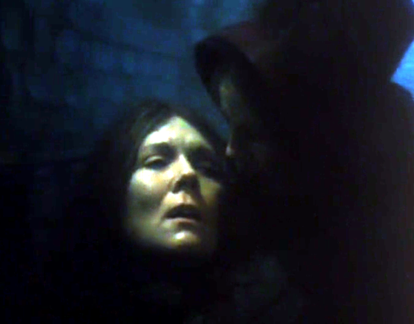 \\
\\

[fn:3] Just below we will explore why associating dark with bad, wrong
... fright, horror, evil is unnecessary and just plain wrong.

[fn:4] The word /moor/ appears forty-three times in /Jane Eyre/. After
the second or third use, I was just putty in Charlotte's hands...

[fn:5] Does loneliness, longing, yearning, /brooding/ come from, bring
us to a dark place?

[fn:6] ...or today by well-off tourists.

[fn:7] ...this identified /Jane Eyre/ with the gothic novel genre
where the protagonists are oppressed, distressed underdogs---setting
them parallel to all the equally oppressed, distressed underdog
species in the surrounding wilds. More about gothic prose later.

[fn:8] ...the first half in Southern Illinois.

[fn:9] ...more than double the next most popular, the Grand Canyon...

[fn:10] Perhaps give the Smokies a second chance by reading the
pre-park fictional work /[[https://en.wikipedia.org/wiki/Christy_(novel)][Christy]]/ by Catherine Marshall. She captures
something that might be called /Appalachian Gothic/. The narrative
features a claustrophobic, unforgiving wilderness, deep poverty, fatal
typhoid epidemics, and generational blood feuds. It also explores
mountain superstitions, fatalistic folklore, and ancient folk remedies
that clash with modern medicine. Again, the human is a set-upon
underdog in a wild place far from modernity, all the basics for gothic
fiction.

[fn:11] ...which barely pings on the Romanticism scholarship radar
... or is all but written off by them as a degeneration of "euphoric"
Romanticism. My take is very simple: If you don't /feel/ D&G (as
described at the start of this essay) you shouldn't attempt to play
the expert of it. More later.

[fn:12] Lots more about what nature is in the D&G context ahead.

[fn:13] Is this not a stone-and-glass model of the pagan "sacred
grove" brought into the city?  Mature Eastern White Pines where I live
can reach heights of 100 to 150 feet (30 to 45 meters), which is
remarkably similar to the vault height of the Cologne Cathedral, which
stands at roughly 142 feet (43.35 meters). I'm saying walking through
a mature forest of Eastern White Pines (unfortunately rare) feels very
much like standing inside the Cologne Cathedral.

[fn:14] Indeed, the mechanistic aspects of Enlightenment science
(based mainly on Newton's discoveries of the "clockwork universe")
caused great uproar and backlash throughout European intellectual
communities. The Enlightenment juggernaut of seemingly soulless
scientific rationalism begged for a response. Which supposedly came in
the form of /[[https://en.wikipedia.org/wiki/Sturm_und_Drang][Sturm und Drang]]/ (do peruse, please), then
Romanticism. We'll explore what could possibly be a counter to
rationalism other than /irrationalism/ later.

[fn:15] Forests naturally have attenuated light due on this huge
stage of life and death---where the shadows grow fast and pool to
darkness as the sun tends to the horizon. This alone...

[fn:16] We won't consider a third type, /dramatic/, i.e., verse-like
pieces of dramatic plays, e.g., a Shakespeare monologue.

[fn:17] Yes, mainly /poets/, and only certain poets whom I refer to as
my /principals/. Romanticism, as we'll explore later, was a confused
mess of actual versus would-be contributors, and then all the very
many hangers-on, coattailers, and professional explainers ... which
has only been made worse by latter-day scholars flying off in many
confusing directions. Although she might not be an actual university
scholar, see [[https://youtu.be/8IJHnHb0fhQ?si=evx85nsWrfy7CjeJ][this]] for a sample.

[fn:18] ...Edgar Allan Poe---/All that we see or seem is but a dream
within a dream/. [[https://www.spiegel.de/wissenschaft/mensch/neuregulin-1-genie-und-schizophrenie-moeglicherweise-folge-eines-gens-a-870089.html][Recent research]] has suggested that "poetic flights"
may be due to reduced prefrontal inhibition, perhaps
gene-influenced. Normally, the prefrontal cortex filters out
irrelevant sensory data and bizarre associations. Lowering that filter
may allow unconventional, layered, or dreamlike connections ("thoughts
behind thoughts") to reach conscious awareness without crossing into
full-blown psychosis.

[fn:19] His /Hymns to the Night/ which we'll go over below uses this
fragment approach masterfully.

[fn:20] ...the modern goth subculture described [[https://en.wikipedia.org/wiki/Goth_subculture][here]] by Wikipedia is
good enough. \\
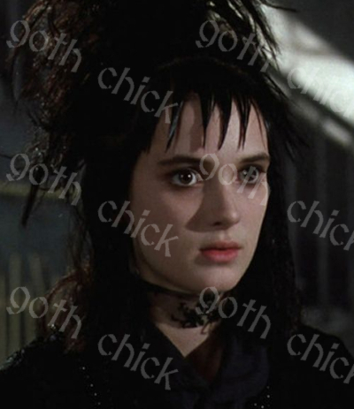 \\
\\

[fn:21] ...as explored above in describing the gothic. We'll keep
going deeper into D&G's connection to nature as we go.

[fn:22] We will learn about [[https://en.wikipedia.org/wiki/Jean_Baudrillard][Jean Baudrillard]] and his theories of
simulacra and hyperreality later.

[fn:23] ... for example, due to the Victorian Era shadow thrown over
my childhood, especially by my paternal grandmother?

[fn:24] Look [[https://en.wikipedia.org/wiki/Emily_Bront%C3%AB][here]] for a quick biography.  \\
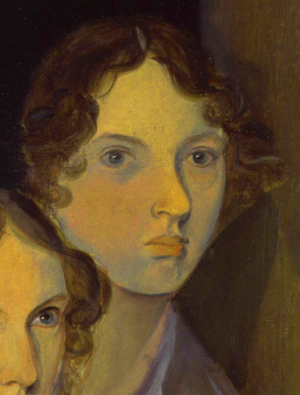 \\
\\

[fn:25] ...for reasons I'm exploring here and will explore the rest of
my life...

[fn:26] For example, the supposed world authority on Emily Brontë's
poetry, Janet Gezari, in her /Last Things: Emily Brontë's Poems/
completely avoids, misses Haworth Emily's dark muse. Seemingly
offhandedly, she inserts Freud's /Mourning and Melancholia/ here and
there, apparently to dismiss EB's D&G as mental illness?

[fn:27] See [[https://en.wikipedia.org/wiki/Christina_Rossetti][here]] for a bio. She is considered by many Britain's
most prolific poet. \\
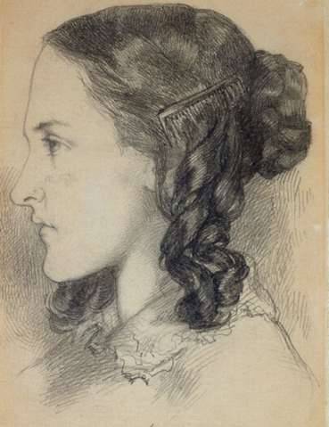 \\

[fn:28] Go [[https://en.wikipedia.org/wiki/Henry_Wadsworth_Longfellow][here]] for a quick biography. HWL was not typically D&G,
rather, a popular, "uplifting" poet with a big audience. That's what
makes this selection so unique for me.

[fn:29] Below, we will go over Romanticism poetising's originator,
Novalis. Much to say about poetising, Novalis, and Romanticism...

[fn:30] ...more about storytelling below...

[fn:31] Be aware I mean /melancholy/ in the modern sense, not the
earlier sense (e.g., Freudian) when it was synonymous with depression.

[fn:32] A side question may be, Why in such bounteous, prosperous,
easy times as ours today are so many people not thriving, rather, only
barely surviving---mainly due to obscure psychological infirmaries?
More on the false gospel of thrive! thrive! thrive! later...

[fn:33] /modus vivendi/: An arrangement or agreement allowing
conflicting parties to coexist peacefully, either indefinitely or
until a final settlement is reached; /or/ (literally) a way of living.

[fn:34] /Fazit/: n; in conclusion, in summary, all in all; Germanized
Latin for /it follows/.

[fn:35]  See [[https://en.wikipedia.org/wiki/Emily_Dickinson][here]] for a quick biography. \\
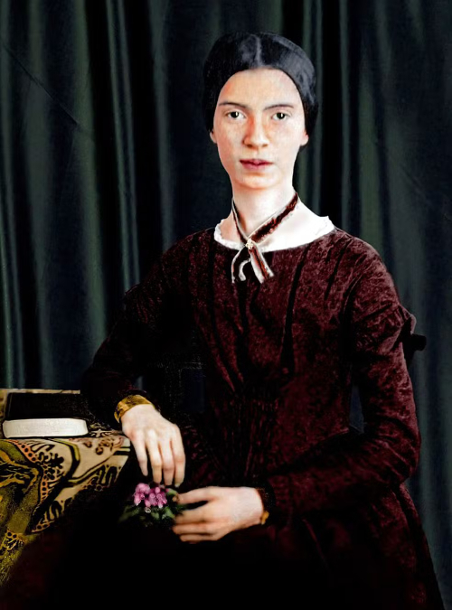
\\
\\

[fn:36] Compare with Jehan Alain, the French composer: /When the
Christian soul no longer finds new words in its distress to implore
God's mercy, it repeats incessantly the same invocation with a
vehement faith. Reason has reached its limits. Alone, faith pursues
its ascension./ Main point /ascension/.

[fn:37] Where has our human network gone? Something tells me getting
pity responses to a YouTube comment isn't the same...

[fn:38] Doom as unforeseen consequences of previous actions, which in
turn, entropically snowball into indebtedness, tragedy, and ruin;
typically multi-generational, a punishment that never seems to fit the
original crime---if it was a crime at all. One German word for doom is
/Untergang/, which also means /downfall/.

[fn:39] Queen Victoria in mourning black ca. 1862. \\
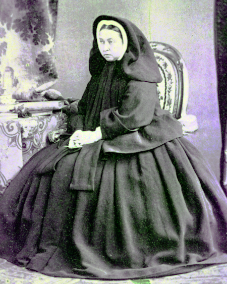 \\
\\

[fn:40] In addition, wearing black was a social cue, i.e., /No, I'm
not yet ready to consider any society with a tendency to merriment or
joviality./ For example, a woman in widow's weeds signaled to men she
wasn't receptive to any sort of courtship overtures.

[fn:41] Is there anything worse than the so-called /[[https://en.wikipedia.org/wiki/Five_stages_of_grief][five stages of
grief]]/ or the Kübler-Ross model? Grief as an emotional malfunction
to be systematically reduced, fixed, corrected? Alas.

[fn:42] The [[https://en.wikisource.org/wiki/In_Memoriam_(Tennyson)/Epilogue][Epilogue]] summarizes /In Memorium/ through heavy use of
poetizing life and nature. We'll discuss Romanticism's poetizing
below.

[fn:43] Dickinson freely employed the capitalising of nouns for poetic
emphasis. Did she get this from the Germans who always capitalize
nouns?

[fn:44] Aren't the vast majority of fairy tales embedded in nature,
set in primitive times? Remarkable too how, e.g., the Brothers Grimm's
tales were consumed by children and adults alike.

[fn:45] My shorthand for Emily Brontë and Emily Dickinson is based on
their earthly locations---Haworth, West Yorkshire, for the former and
Amherst, Massachusetts, for the latter.

[fn:46] Thomas Carlyle's [[https://en.wikipedia.org/wiki/Natural_Supernaturalism][Natural Supernaturalism]], as well as other
works by him employed capital-n Nature ... which is completely
different from any poetic Nature I mean to describe. Carlyle was a
translator of and spokesman for Novalis (see below), who
intellectualized on nature. But intellectualizing nature is
fraught---my efforts here notwithstanding. I say we may only poetize
nature into Nature. More later on Novalis. I'm also dismissive
of Emerson and his essay [[https://en.wikipedia.org/wiki/Nature_(essay)][Nature]]. More later on Emerson and Thoreau.

[fn:47] Pointedly absent from modern poetry is this underlying
understanding of nature as I'm defining it, and, therefore, any
nature-based metaphysics. Of course many celebrated poets of the
late-19th, 20th, and 21st century have waxed evocative, cleverly
painting lovely impressionistic canvases. An example is Robert Frost's
/Stopping by Woods on a Snowy Evening/. But then his protagonist goes
back indoors. We'll compare with Gottfried Keller's /Winternacht/
later---who goes back "indoors" with a whole different take.

[fn:48] Jesus of Nazareth left the wilds and rejected his cousin John
the Baptist's back-to-nature hermit rewilding to concentrate on towns
and cities. Buddha likewise. Telling...

[fn:49] Thoreau's writings were often prose-poetic without
specifically trying to go from small-n nature to capital-N
Nature. However, he was adamant that we not continually destroy wild
places. Every community should have adjacent large tracts of set-aside
wilds, he insisted.

[fn:50] Is it not ironic how nearly all lifeforms that attempt to
share our modern human environments uninvited are considered invasive,
noxious vermin, pests to which we have developed almost hysterical
revulsion? Back in the day there was an indoor and an outdoor
ecosystem.

[fn:51] Though /cotton/ was rapidly becoming a global commodity, both
cotton and wool fabrics eventually being produced in steam-powered
factories as the Industrial Age reached its inflexion point of growth.

[fn:52] In any modern (non-organic Amazon Whole Foods-style) chain
supermarket I'm sure less that 1% of the food items come from a truly
local source. Nearly everything is shipped in from often far afar.

[fn:53] ...e.g., what is a flower garden but a derivative, a mock-up
of an original place out in the wilds, albeit with the pretty bits
super-amplified idealised, the not-so-pleasant bits left, weeded out?
Again, this is Baudrillard's [[https://en.wikipedia.org/wiki/Hyperreality][hyperreality]], which we'll discuss below.

[fn:54] How often is a Shakespeare character out communing with
nature? Never?...

[fn:55] Churches were typically built in the centre of a town or city
on the highest ground. I once heard that to this day no building in
Vienna may be built taller than the tower of St. Stephen's Cathedral.

[fn:56] We'll explore the G part of D&G in some detail below.

[fn:57] Skyline of Orbit City from /The Jetsons/ cartoon sitcom
ca. 1962 \\
 \\
\\

[fn:58] Human population grew 60% between 1800 and 1900, and a
whopping 275% between 1900 and 2000!

[fn:59] Have we just discovered why so much "literary fiction" is
essentially flogging existential meaninglessness out to downright
absurdism? If the common man wants to be titillated by fear (horror
movies) and the literati by nihilism, **quo vadis**?!

[fn:60] Is our relatively gradual separation from nature not a perfect
example of the [[https://en.wikipedia.org/wiki/Boiling_frog][boiling frog]] metaphor?

[fn:61] Compare Klages' take on Chicago to that of Carl Sandburg in
his /Chicago/, possibly his best-known: /Hog Butcher for the World,
Tool Maker, Stacker of Wheat, Player with Railroads and the Nation's
Freight Handler; Stormy, husky, brawling, City of the Big
Shoulders.../ Sandburg is by contrast simply listing impressions. He's
all but an amoral apologist...

[fn:62] What became of Wordsworth's /[[https://www.poetryfoundation.org/poems/45560/to-a-highland-girl][To a Highland Girl]]/ shepherdess
when she and her family were forced into an industrial urban slum? We
can only hope she and her kin are in a better place now...

[fn:63] ...which we will explore again below...

[fn:64] In those days wild, untouched places were often referred to as
wastelands.

[fn:65] Where I live (the Arrowhead region of Northeast Minnesota) we
have two major bike races of over one hundred miles through our
wilderness. Is this some sacrificial, ceremonial ritual to nature?
Indeed, much of our "outdoor activities" here involve hardship and
discomfort in a sort of "rite of passage" way.

[fn:66] This could be an example of the general adage, /The bravest
birds sing from the highest, safest branches./

[fn:67] What is generally acknowledged as a clear breakthrough was
John Snow's tracing of the London cholera outbreak of 1854 back to
certain London neighborhood public wells. This was strong proof of
the [[https://en.wikipedia.org/wiki/Germ_theory_of_disease][contagion theory]]. However, it wasn't until the late nineteenth
century that Robert Koch and Louis Pasteur established the field of
bacteriology and our modern scientific understanding of microscopic
pathogens finally developed.

[fn:68] The standard, "official" definition of /liminality/ is the
quality or state of being in-between or on a threshold of change,
where a person, group, or object moves from one stage, status, or
condition to another. I find this general concept versus the idea of
the /liminal space/ as I mean it contradictory, hence, I'll expand on
my own interpretation. Maybe watch [[https://youtu.be/4S0PKegDQlg?si=lUbekVupHwjMmBM8][this YouTube video]] of a haunted
nighttime Victorian mansion.

[fn:69] At your leisure, perhaps compare with /[[https://en.wikipedia.org/wiki/Hypnagogia][hypnagogia]]/, a
disoriented, surreal state that may come upon the mind right before
falling fully asleep. Here's a quote: /Hypnagogic phenomena may be
interpreted as visions, prophecies, premonitions, apparitions and
inspiration (artistic or divine), depending on the experiencers'
beliefs and those of their culture./

[fn:70] How does the term /spatial haunting/ grab you?

[fn:71] ...and how does all this sync with dopamine, the hormone of
expectations? More on dopamine later...

[fn:72] 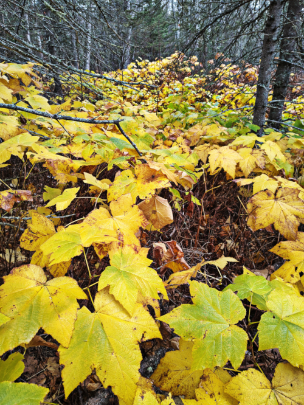 \\
\\

[fn:73] /Saudade/ (Portuguese): A deep emotional state of nostalgic
or profound longing for an absent something or someone that is loved,
often carrying a bittersweet pleasure.

[fn:74] /Sehnsucht/ (German): A psychological state of deep longing,
yearning, or craving for an ideal, alternative, or far-off reality
that is felt as a sweet ache.

[fn:75] /Mono no aware/ 物の哀れ (Japanese): The beautiful, gentle
sadness of witnessing the impermanence of things.

[fn:76] See Dostoyevski's POEH just below.

[fn:77] The last, /fascinans/, is dead-centre what Emily Brontë is
saying to us in her keystone poem /The night is darkening round
me/. Lots more about my favorite B-Sister below.

[fn:78] Here we see a standard misuse of romanticism to mean
idealisation. We'll clear this up later.

[fn:79] The Japanese permaculture expert [[https://en.wikipedia.org/wiki/Masanobu_Fukuoka][Masanobu Fukuoka]] once said,
/True culture arises from within nature, and is pure, modest, and
simple./ Another very B&B quote from Fukuoka is /The ultimate goal of
farming is not the growing of crops, but the cultivation and
perfection of human beings./ Fukuoka strongly critiqued the modern
definition of "culture," which he viewed as an artificial product
created by separating humans from the natural world through
industrialization and intellect. To him, when a society loses its
connection to the land and the changing seasons, its culture becomes
shallow, overly complex, and materialistic.

[fn:80] As Bauman suggests, modern amorphous, unrooted, uprooted
humans are captive in prisons of their own existential creations. As I
say, modern life has descended into various mix-and-match, self-styled
/lifestyles/. We'll visit the French philosopher Baudrillard's take on
this below.

[fn:81] For example, instead of entering a local diner with all its
unique-to-place obligatory social-psychological interaction demands,
we may now, the world over, walk into a generic fast-food chain
restaurant and have an entirely detached, impersonal experience and
eat a standardized "mono-meal."

[fn:82] Lots more about what nature really is below.

[fn:83] For reasons that will become apparent as we go, I will not
consider /urban gothic/, primarily because it is all but exclusively
built around fright, horror, terror, therefore, meant to
shock. Everything in urban gothic is ersatz, fake D&G, thoroughly
destroying aesthetics. This essay is about rehabilitating D&G.

[fn:84] Couple this modern mechanistic "death as malfunction" with
atheist nihilism to arrive at today's soulless mechanical universe
realism dumpster fire. Alas...

[fn:85] For critters, predators are other bigger critters. For humans,
predators are---outside of war and homicidal aggression---all
but exclusively bacteria and viruses.

[fn:86] Gillian Welch nod.

[fn:87] Consider [[https://youtu.be/PnjFu9CPwlQ?si=FRnqDZZXh5TAcvfG][this quite tolerable goth version]] of the classic rock
song. Had this been written in Brontëan times, it would have been no
cheap, sentimental gimmickry.

[fn:88] Consider the now commonplace heart pacemaker, a device that
literally overrides the human heart with artificial electronic
pulses. Also, hip and knee replacements are now routine. And this, we
are promised, is only the beginning. Some have called this
/[[https://en.wikipedia.org/wiki/Transhumanism][transhumanism]]/.

[fn:89] Ironically, both of his previous wives had likewise died from
smoking-related illnesses.

[fn:90] Anne Brontë's grave in Scarborough \\
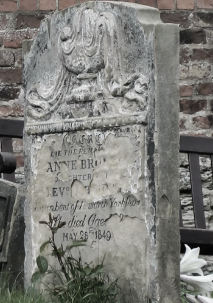
\\

[fn:91] Perhaps watch [[https://youtu.be/_yzBEP3Qyvc?si=QBkrGikYxWP7C9eN][this]] on Anne's last days in Scarborough.

[fn:92] Abiah Root (Strong), Amherst Emily's childhood friend \\
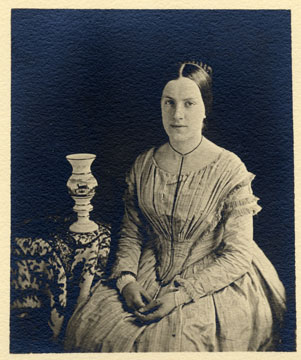 \\
\\

[fn:93] ...the third volume, /Fragmente/, of /Novalis: Werke, Briefe,
Dokumente/; Verlag Lambert Schneider; 1957. \\
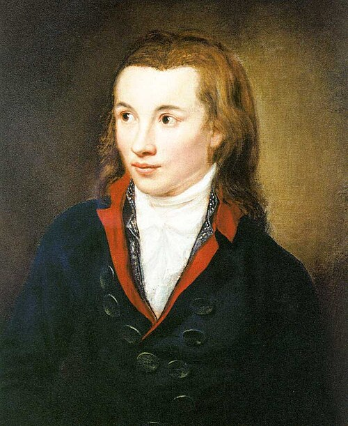 \\
This is the only known picture of Novalis, found at the family estate,
then later identified by Ludwig Tieck---meaning it might actually be a
brother of Novalis...

[fn:94] Coleridge and Wordsworth's /[[https://en.wikipedia.org/wiki/Lyrical_Ballads][Lyrical Ballads]]/, first edition
appearing in 1798.

[fn:95] Started ca. 1797, finally published in 1800. The German
/Hymnen/ (plural of /Hymne/) means "praising songs"
(/Lobgesang)/. Allow me the abbreviation /HttN/ from here on. Try
[[https://www.george-macdonald.com/etexts/hymns_to_night.html][this
George MacDonald translation]] as found in a publication from 1897.

[fn:96] ...referred to as the /Jena Set/ by Andrea Wulf in her
/Magnificent Rebels, The First Romantics and the Invention of the
Self/ by Andrea Wulf; 2022; Vintage Books. More about this flawed
account in a section below.

[fn:97] See the Wikipedia explanation of [[https://en.wikipedia.org/wiki/Romanticism][Romanticism]] or [[https://en.wikipedia.org/wiki/German_Romanticism][German
Romanticism]] ... but with a grain of salt. As I repeat throughout, one
of the main objectives of WutheringUK is to wrest Romanticism and
especially Dark away from the ivory tower humanities "scholars."

[fn:98] The German /Poesie/ is typically translated as simply
/poetry/; however, poetry as a concept beyond just the literary art,
more towards the older /poesy/ perhaps.

[fn:99] If you must, read [[https://plato.stanford.edu/entries/novalis/][this about Novalis]], which is as good as
any. But as academe is wont to do, it hangs on every word uttered and
written by a young man in his twenties feeling his way along. This
approach may work with Bohr and Einstein, but not with a
twenty-something poet...

[fn:100] Coleridge's /The Rime of the Ancient Mariner/ is closer to Ann
Radcliffe’s style of Gothic horror. Radcliffe was his contemporary,
her biggest novels predating him by only a few years. Lots more on
eighteenth-century English Gothic below.

[fn:101] And yet /HttN/ wasn't entirely new after all. Soon will be
discussed similar offerings from the eighteenth century.

[fn:102] Sophie von Kühn \\
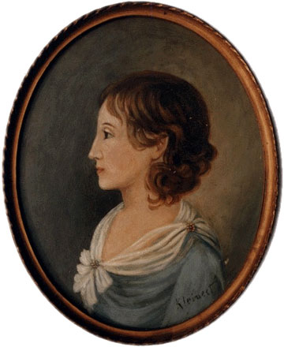 \\
\\

[fn:103] We'll dive into Edgar Allan Poe's very similar idealisations
in what is possibly his most popular poem /Annabel Lee/ below.

[fn:104] Coleridge: 1795 portrait by Peter Vandyke \\
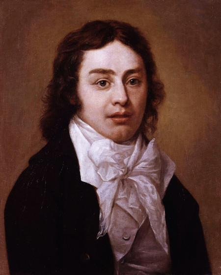 \\

[fn:105] *penetralium*: (plural /penetralia/) the innermost (or most
secret) part of a building; an inner sanctum; a sanctum sanctorum.

[fn:106] *verisimilar*: having the appearance of truth.

[fn:107] Edward John Poynter's sleeping /Endymion/ visited by
moon-goddess Diana \\
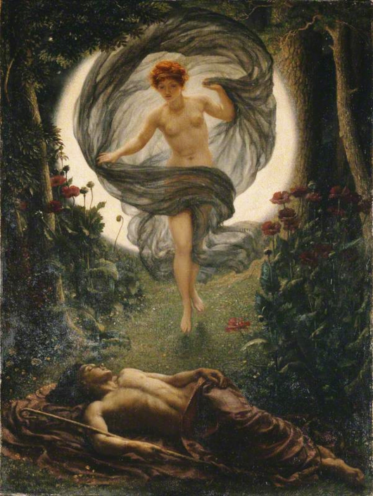 \\
\\

[fn:108] [[https://youtu.be/bASfrZYnkvI?si=JKGP2LiHgOj-h9oL][Here]] is the scene from /Bright Star/.

[fn:109] [[https://youtu.be/6Xmz-p9FYW8?si=Mh6MxaTuc8N3q8sW][Here]] is Dracula's take on just listening and enjoying...

[fn:110] /The Genius of Instinct; Reclaim Mother Nature's Tools for
Enhancing Your Health, Happiness, Family, and Work/ by Hendrie
Weisinger; 2009; Pearson Education, Inc.

[fn:111] Here in woodsy Minnesota we haven't noticed a shortage of
mosquitoes, one of bats' primary food sources.

[fn:112] Extremely reclusive and prone to severe homesickness, she only
left Haworth, Yorkshire, for four distinct, brief periods of education
and work---as a 6-year-old schoolgirl at Cowan Bridge School
(approx. 6 months), as a 17-year-old pupil at Roe Head School
(approx. 3 months), as an instructor at Law Hill School (approx. 6
months), and a pupil at Pensionnat Héger, Brussels (approx. 9
months). After returning from Brussels at age 24, Emily famously
refused to ever leave Haworth or the surrounding Yorkshire moors again
until her death in 1848.

[fn:113] Lots more on real life versus lifestyle later.

[fn:114] Sadly enough, Jane Austen was seemingly devoid, non-pursuant
of the deeper end of the Romanticism pool. Although she once did say,
"Pictures of perfection, as you know, make me sick and wicked."
(Letter to her niece Fanny Knight, 23 March 1817.) Again, we know
nothing of any D&G she might have contemplated ... other than to note
her /Northanger Abbey/ was meant as a good-natured parody of gothic
horror writer Ann Radcliffe.

[fn:115] One other analogy would be the stark emptiness of a distant
wilderness is a match to the stark emptiness of a modern city.

[fn:116] From my 1853 copy \\
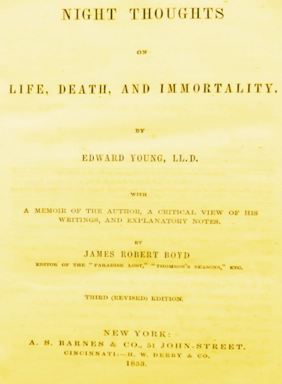 \\
\\

[fn:117]  YMMV. Personally, I like a good doom-and-gloom session, and
Young really delivers with /Night Thoughts/. Again, YMMV.

[fn:118] ...that is, in a past age not exposed to the science of modern
public relations. See [[https://en.wikipedia.org/wiki/Edward_Bernays][this]] about Edward Bernays and the birth of
modern advertising and public relations. TL;DR: Since Bernays, no
"movement" in our modern times can be considered natural and organic,
rather, the result of somebody's financed public relations campaign.

[fn:119] ...but the Germans were not idle during this time, either. I
should also mention Gottfried August Bürger's very popular and often
translated into English epic poem /[[https://en.wikipedia.org/wiki/Lenore_(ballad)][Lenore]]/ from 1774.

[fn:120] /Das Land der Dichter und Denker/. Intentionally absent was
novelists. Although now novelists count as part of /die Belletristik/,
i.e., /schöngeistige Literatur/ or aesthetic literature.

[fn:121] Two terms, /novel/ (English) and /roman/ (French, German,
etc. from the adjectival /Roman/, /Roman-like/) came to describe any
long-form prose story-telling.

[fn:122] Ironically, the /Novella/, a long short-story format with no
chapter breaks, was better tolerated in Germany.

[fn:123] One giveaway is /gothic/ in the title. Perhaps read [[https://en.wikipedia.org/wiki/Gothic_fiction][this
overview]] of Gothic fiction. More about "Gothic" ahead...

[fn:124] Walpole initially claimed /Otranto/ to be a medieval
manuscript he had discovered and translated, when all along it had
been his own creation.

[fn:125] A model woebegone gothic novel heroine (from /El Mundo
ilustrado/; 1879). \\
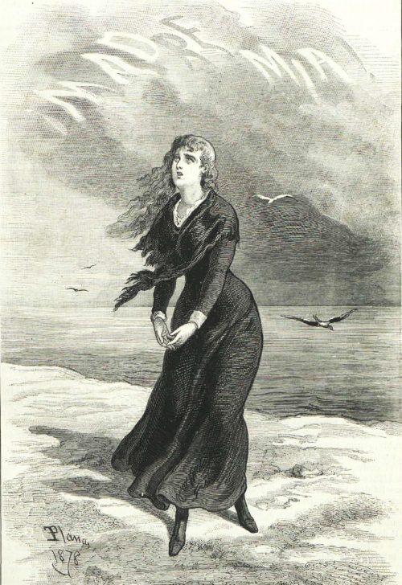 \\
\\

[fn:126] Hitchcock was once asked why he thought his horror films were
so popular. He replied, "We all enjoy putting our toe in the cold
water of fear."

[fn:127] See [[https://en.wikipedia.org/wiki/Romance_(prose_fiction)][this]] sorting out.

[fn:128] My former wife, a Jane Austen fan, read /Wuthering Heights/
and advised me to skip it. I always trusted her literary advice and,
thus, have never read it.

[fn:129] ...although Wordsworth would later mention Barbauld and
/ASEM/ as inspirational.

[fn:130] ...and as the whole theme of this essay brings, D&G is first
and foremost a life-shaping aesthetic.

[fn:131]  The Jena Set's Friedrich Schlegel first used /romantic/ in
contrast to /classic/ to describe what they in Jena were supposedly
starting. But it wasn't until the 1820s when the term Romanticism
became widely known and used---evermore randomly since...

[fn:132] A quote from M.H. Abrams' laborious /The Mirror and the Lamp/
would insist ... /even an aesthetic philosophy so abstract and
seemingly academic as that of Kant can be shown to have modified the
work of poets./ Really? I doubt the Brontë sisters read much Kant. But
then Abrams never even mentions the Brontës...

[fn:133] Peruse on YouTube under /The Romantics: [[https://youtu.be/oLwRXlSgiSQ?si=y4a1MQek8Ac0pkyJ][Liberty]], [[https://youtu.be/liVQ21KZfOI?si=GpsPOUfS_l6w6r8_][Nature]],
[[https://youtu.be/R6mefXs5h9o?si=c-cJk0fKTneunPZH][Eternity]]/ at your peril.

[fn:134] Notably absent is *Romanticism = Dark*...

[fn:135] From the outset, the Schlegels in Jena made Shakespeare a
principal proto-Romanticist, Ludwig Tieck and others of the Jena Set
feverishly translating his plays into German. For me this was a clear
sign they were on the wrong road. I will at some future date have my
fictional character from my novel /Emily of Wolkeld/ tell you why.

[fn:136] So convenient for modern experts that Jena Romanticism was
located in, for its time, free-wheeling university town, many of the
Jena Set also lecturers and professors at the University of
Jena. Perhaps a modern version would have been [[https://en.wikipedia.org/wiki/Black_Mountain_College][Black Mountain College]].

[fn:137]  Sample perhaps [[https://www.youtube.com/watch?v=aIffazJIrLo&list=PLhP9EhPApKE_9uxkmfSIt2JJK6oKbXmd-&pp=iAQB][Isaiah Berlin's 1965 lectures on Romanticism]],
published later in book form as /The Roots of Romanticism/.

[fn:138] ...my italics...

[fn:139] The year 1816, when the poem was written, was known as the
Year Without a Summer - this is because Mount Tambora had erupted in
the Dutch East Indies the previous year, casting enough ash in to the
atmosphere to block out the sun and cause abnormal weather across much
of northeast America and northern Europe. This pall of darkness
inspired Byron to write his poem.

[fn:140] Contrast /Frankenstein/ with E.T.A. Hoffmann's very gothic
and sinister /[[https://en.wikipedia.org/wiki/The_Sandman_(short_story)][The Sandman]]/ appeared in 1817 dealing with an
all-too-human mechanical automaton.

[fn:141] ...due to ignorance of Jena and Novalis? Alas...

[fn:142] ...and again there is certainly no inkling of what I spoke of
above about the modern indoor-outdoor dichotomy.

[fn:143] One observer called this modern tendency to appropriate
Eastern religion along with animist aboriginal shamanism "spiritual
grandiosity."

[fn:144] /[[https://en.wikipedia.org/wiki/Enclosure][Enclosure]]/ or especially the /[[https://en.wikipedia.org/wiki/Inclosure_act][Inclosure act]]/, as it pertains
to Clare's own life, dealt with the transition of common land
(/commons/) available to everyone in a community into exclusively
private, commercial agriculture land aimed at maximizing profit for
landholders. This typically led to destruction of wildlife habitat and
further impoverishing of marginal peasants who relied on commons areas
for grazing and foraging. In my opinion this was the final death knell
of the manorial monarchist system, as the mostly aristocratic
landholders placed profit clearly ahead of their human charges.

[fn:145] /[[https://en.wikipedia.org/wiki/Solastalgia][Solastalgia]]/ or "environmental grief" is what modern
psychology calls the dysphoria brought on by environmental change to
one's home environment while one is still living in it. Is solastalgia
and today's definition of nostalgia related? /[[https://en.wikipedia.org/wiki/Anomie][Anomie]]/ is a personal
feeling of alienation, rootlessness, or a lack of direction in modern
life.

[fn:146]  Drawn from the ancient Egyptian-Hellenistic myth of /Isis/
(and Plutarch's account of her temple inscription, /I am all that has
been, that is, and that will be./) Isis represents the mysterious,
living book of nature that Novalis' apprentices and sages seek to read
and understand.

[fn:147] We'll look into Henry David Thoreau's prose-poetic
descriptive style of nature later. Nature for Thoreau may be
transcendent, not because it immediately points to some distant
realms, but because stepping into the wild allows the human to have a
more stereoscopic view of life, to gain a sort of depth perception.

[fn:148] /Immanence/ is the condition of being entirely within,
inherent to, or permanently present inside something, rather than
existing outside or above it. The word comes from the Latin
/immanere/, meaning "to dwell in" or "remain".

[fn:149] Novalis aphorisms are apropos: /A poet understands nature
better than a scientific mind./ Or /Poetry heals the wounds inflicted
by reason./ Or the Kantian /We dream of travels throughout the
universe: is not the universe within us?/

[fn:150] ...they always trot out Byron for their **Romanticism =
sensual** axiom. For me, Byron was a Romantic Era poet only by date,
never displaying the depth vis-à-vis nature and D&G that, e.g., the
Brontë Sisters had.

[fn:151] In 1810 he published /[[https://en.wikipedia.org/wiki/Guide_to_the_Lakes][Guide to the Lakes]]/, which kicked off
Lake District tourism fever in earnest. Rail access began in 1846
and 1847 facilitating mass tourism to the region.

[fn:152] The Wordsworths' Dove Cottage near Grasmere, Cumbria. \\
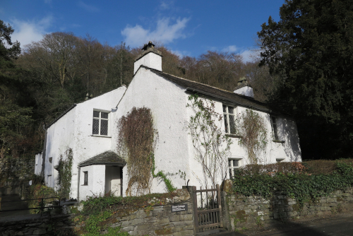 \\
\\

[fn:153] ...named in 1843.

[fn:154] /[[https://en.wikipedia.org/wiki/Homo_homini_lupus][Man is a wolf to man]]/.

[fn:155] Some might call Marx's [[https://en.wikipedia.org/wiki/The_Condition_of_the_Working_Class_in_England][The Condition of the Working Class in
England]] published in 1845 the beginning of Marxism.

[fn:156] [[https://en.wikipedia.org/wiki/German_mediatisation][German mediatisation]] brought on by Napoleonic conquest of the
so-called Germanic /Holy Roman Empire/ reduced, secularlised, and
consolidated the German states from 300 down to 39.

[fn:157] Friedrich's enigmatic /Der Chasseur im Walde/, 1814 \\
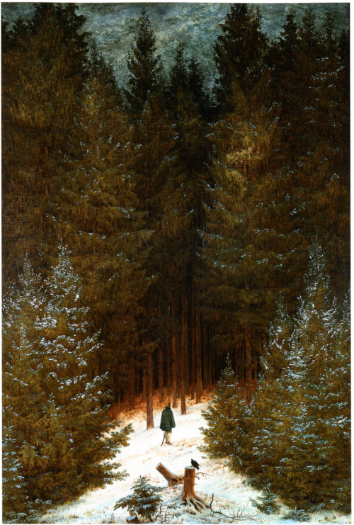 \\
\\

[fn:158] More just below...

[fn:159] Again, the Romantic Era is typically fenced between the years
1800 and 1850.

[fn:160] ...e.g., the Brontës were pastor's daughters in rural West
Yorkshire with little exposure to (taint from?) the cultural and
literary buzz of the cities.

[fn:161] Again, today we have the concept of left-brain, right-brain,
as often enough nothing else can describe this split-personality
confusion. The best ideas about left-right brain are those of Iain
McGilchrist. Try [[https://www.youtube.com/watch?v=hK7XG3t2nFg&list=PLqBHk3itxyPDKFnwj8-SmlwHra64cCrky&pp=iAQB][these]].

[fn:162] [[https://engines.egr.uh.edu/english-romanticism/what-romanticism][This]] will save you some googling. Again, note especially the
tortured, left-brained origin of the term /romantic/.

[fn:163] For what it's worth, German Romanticism can be broken down
into Jena, Heidelberg, then Berlin Romanticism based largely on the
principal artists.

[fn:164] Again, Goethe would criticise Romanticism harshly, but
attempted to bridge proto-Romanticm /Sturm und Drang/ with his new
classicism.

[fn:165] Daguerreotype of Poe 1849 \\
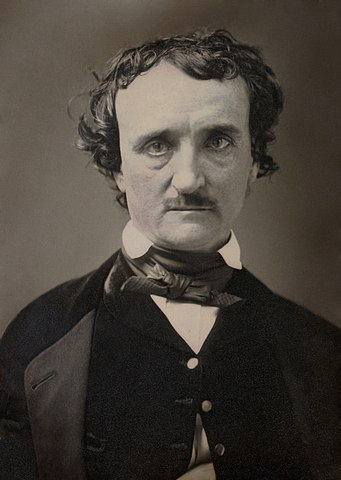

[fn:166] Child Wolfgang and sister Maria Anna \\
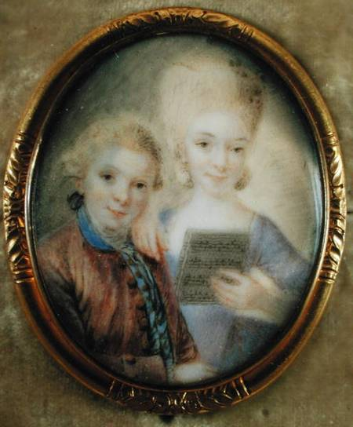 \\
\\

[fn:167] Academe is also wont to play around with Freud's [[https://en.wikipedia.org/wiki/Death_drive][death drive]]
(/Todestrieb/), another red herring completely antithetical to
everything I'm about here with WutheringUK. If anyone didn't get
feelings and poetisation as my principals saw it, that would be
Sigmund Freud.

[fn:168] ...a blessing perhaps?

[fn:169] Let me finally mention here that the word /wuthering/ is
"Northern" dialect for the wind blowing; from late Middle English
/whither/, /wuther/ "rush, make a rushing sound", probably of
Scandinavian origin; or /whithering/ comes from the Old Norse and
means roaring like the wind on a stormy day. This is the sort of
/wuthering/ I'm using in my title /WutheringUK/, i.e., I'm not
referencing the book.

[fn:170] /Gestalt/ in the sense of form, pattern,
configuration. Perhaps as well legends are comprised of /atoms/ of
legend stuff, etc. More on "legend receptor sites" later.

[fn:171] Case in point is Goethe's /The Sorrows of Young Werther/
(first print 1774) which supposedly unleashed a wave of suicides of
young men who identified all too closely with the story's male
protagonist who commits suicide after losing at love.

[fn:172] ...forcefully, poking me in the chest with his finger!

[fn:173] Compare perhaps with the [[https://en.wikipedia.org/wiki/Mircea_Eliade#Philosophy][Mircea Eliade]] "terror of history"
concept where, literally, the linear progression of time and history
is meaningless when compared to the mythical sacred times of
origin. In effect, mundane life is meaningless, thus, its accumulation
of "events" are also meaningless, even oppressive destructive for
those still trapped in linear time and a strictly mundane
interpretation of life and reality.

[fn:174] An Emily Brontë Gondol poem \\
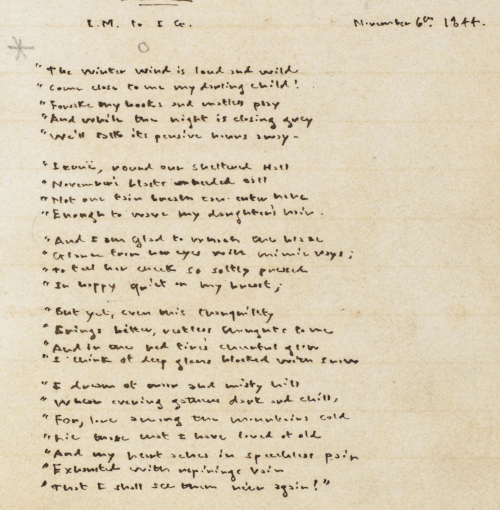 \\
\\

[fn:175] Imagine reading Tolkien's /Lord of the Rings/ poems without
any knowledge of his Middle Earth or the /Lord of the Rings/ story...

[fn:176] Enjoy [[https://youtu.be/wjxZ-VbUihI?si=ei3UwASvoRQgbVW0][this Unthanks Sisters version]].

[fn:177] ...as per her poem /Plead for me/

[fn:178] Baroness Annette von Droste-Hülshoff \\
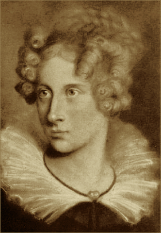 \\
\\

[fn:179] Gerhard Wedepohl's illustration for /Der Knabe im Moor/ \\
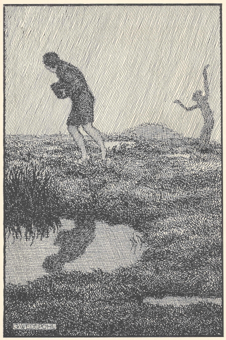 \\
\\

[fn:180] Sometimes I can't help but feel America is just a land of
lost peasants who have failed at rising above peasant ignorance and
can't figure out where to go other than into evermore materialism,
i.e., the exercise of peasant hoarding...

[fn:181] ...reading into Biblical scripture what one subjectively
wants to believe, as opposed to /exegesis/, which purportedly is
exactly what the original author meant.

[fn:182] The well-known German liqueur /[[https://en.wikipedia.org/wiki/J%C3%A4germeister#Label][Jägermeister]]/ features a stag
with a glowing crucifix between its antlers, which originated from an
apparition seen by [[https://en.wikipedia.org/wiki/Hubertus][Saint Hubertus]]. \\
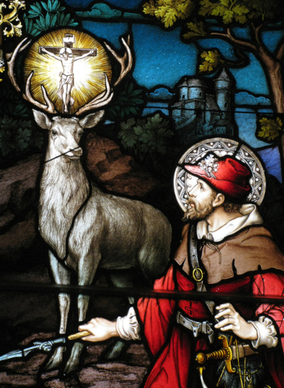 \\
\\

[fn:183] ...based on her unflattering portrayal of St John Rivers'
drive to be a missionary in India in /Jane Eyre/.

[fn:184] I can see the Reverend Patrick coming away from a theological
discussion with his braincase daughters theatrically shaking his head,
muttering, "Oh, my daughters!" to hearty laughter.

[fn:185] And yet [[https://youtu.be/2qCmtUhiKcA?si=12R2dDiYdqwRZ-GG][this version]] might very well have cringed out all
three of the Christian minimalist B-Sisters...

[fn:186] Oddly enough, the Brontës are completely left out of many key
academic analyses of Romanticism. For example, Abrams' /The Mirror and
the Lamp/, Beach's /The Concept of Nature in Nineteenth-Century
English Poetry/, and Berlin's /The Roots of Romanticism/ make no
mention of them!

[fn:187] Millais' /The Blind Girl (1854-56)/ \\
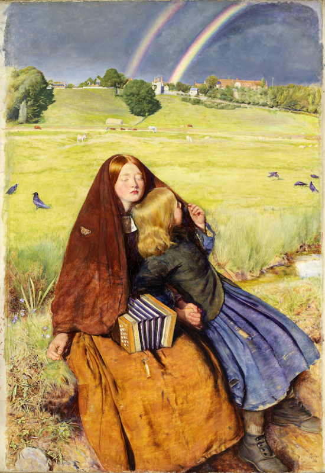 \\
\\

[fn:188] Alethea, by Julia Margaret Cameron (1872) \\
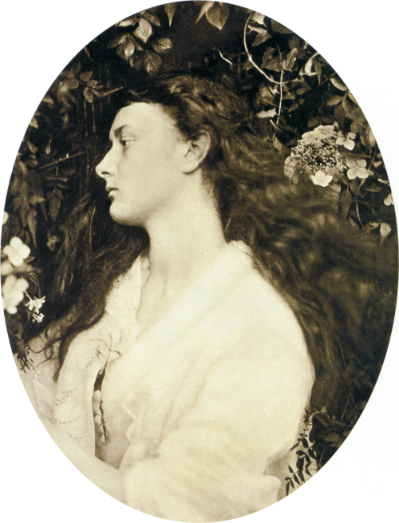 \\
\\

[fn:189] *Nostalgia*, from Latin, literally means /[[https://en.wikipedia.org/wiki/Homesickness][homesickness]]/ and
was an acknowledged medical condition in the 1800s.

[fn:190] Elizabeth Eleanor Siddall, ca. 1860; the original "super model"
for the  Pre-Raphaelite painters. \\
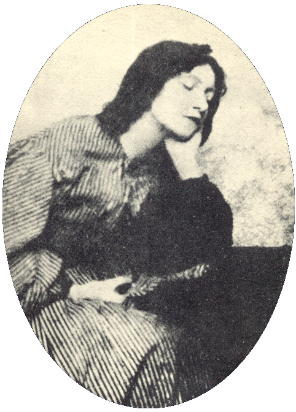 \\
\\

[fn:191] Luke 12:48: /For unto whomsoever much is given, of him shall
be much required: and to whom men have committed much, of him they
will ask the more./

[fn:192] Depiction of Rimbach some six hundred years prior. Note the
red star just below the castle, my digs. \\
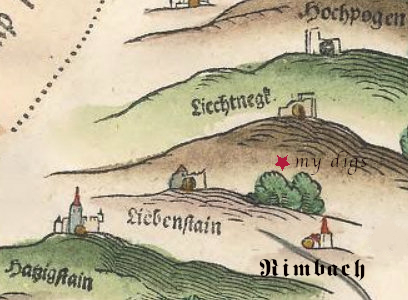 \\
\\

[fn:193] ...but aren't all fairy tales in suspended animation "until
further notice," e.g., Merlin supposedly biding his time in some pit
or inside a hawthorn tree?

[fn:194] Really though, calling her /Lake/ Superior is like calling
Einstein a high school graduate.

[fn:195] Wetsuits de rigueur. Even in summer a dunk in her longer than
ten minutes can lead to hypothermia ... at least on the North
Coast.

[fn:196] ...or if they're here they're hiding very well.

[fn:197] Our little cemetery looks nothing like the Cimetière du
Père-Lachaise, Paris, France \\
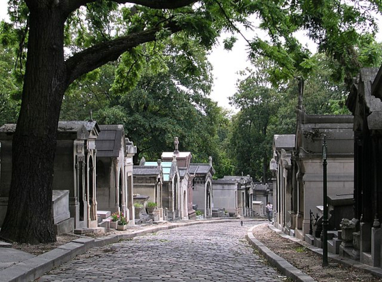 \\
\\

[fn:198] American Wordworthian derivative?
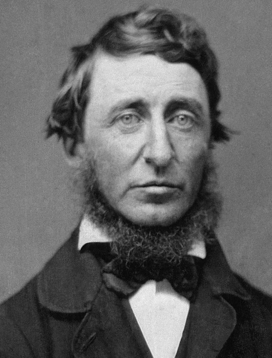 \\
\\
You might as well see [[https://youtu.be/nd6CD1X1rvw?si=9S4N1kvs9LnszFM_][this twisted depiction]] of Thoreau before we
proceed...

[fn:199] My Cook County, Minnesota, alone accounts for 1.2 million
visitors per year, most of whom wander around gazing into their
devices as much as at the sights." \\
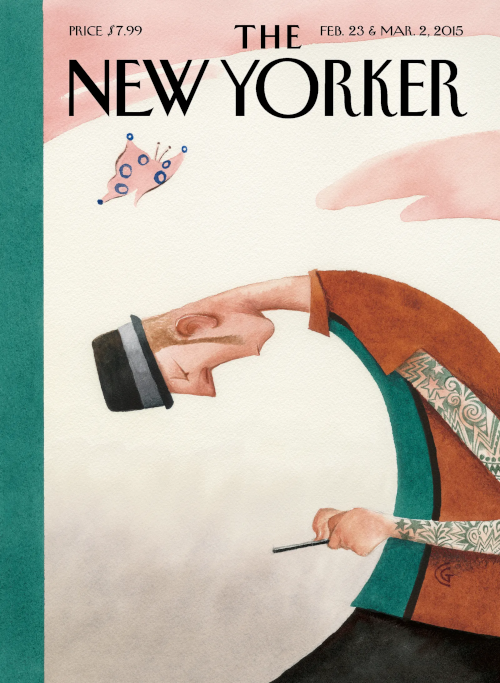 \\
\\

[fn:200] Allow this simple definition of /porn/: Illusion coupled with
big dopamine spikes. Just below we'll tackle the hormone dopamine.

[fn:201] Perhaps read the synopsis given by the Wikipedia article.

[fn:202] Buddhism speaks volumes about freeing oneself from desires as
the way to alleviating suffering.

[fn:203] The Great Lakes tourist scene has always been a grittier,
more working-class world than other tourist Meccas.

[fn:204] A flip of the James Bond martini quip?

[fn:205] ...mad, bad, and dangerous to know Lord Byron from his
/Childe Harold's Pilgrimage/.

[fn:206] /...But could the day seem dark to me because the night was
fair?/ asked Haworth Emily.

[fn:207] Quick preliminary, much more later: The term Romanticism
followed a twisted path beginning with the Latin /romant/, or, "in the
Roman manner", thus, not at all our current use of the word as a
synonym of lovey-dovey stuff. In general, bundling what I'm trying to
get at as /Romanticism/ is fraught to say the least. Academe wants to
grip butterflies, but when they open their hands there is only
goo. Lots more on this problem as we go...
